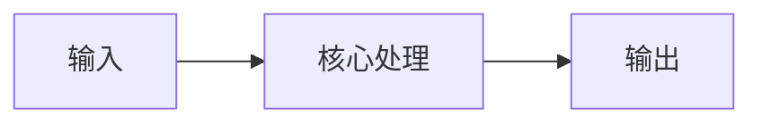
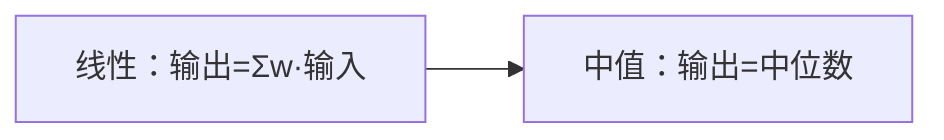

# 第 3 页 · 核心概念

🧪 公式看不懂？去 <a href="/math-lab/">原理实验室</a> 拖动滑块直观体验卷积/梯度/高斯/霍夫/角点/RANSAC/光流等核心概念；看完原理再去本页底部 <a href="./source">源码/真机实验室</a> 亲手调参数。

## 先用生活直觉理解

你站在广场上听大家报价，大多数人都喊 50 块，有两个人恶作剧喊 0 和 1000。平均是 275，严重失真；但取中位数还是 50，完美干掉捣蛋鬼。中值滤波就是这么回事。

**典型应用**：椒盐噪声去除、扫描文档去噪、老照片修复、二值图去小白点

## 概念逐个拆解

### 概念 1：为什么中位数不怕离群点

均值会被极端值拉偏，中位数只看排序位置。1000 个 50 里混进一个 0 和一个 1000，排序后中间仍是 50。

### 概念 2：非线性滤波

中值滤波不满足「叠加原理」，输出不能写成输入像素的线性加权和，因此称为非线性滤波。

### 概念 3：椒盐噪声模型

椒盐噪声即像素被随机替换成 0 或 255，像撒了黑胡椒与白盐，中值滤波专门针对它设计。

### 概念 4：窗口形状

除了方形窗口，还可用十字形、圆形窗口，能减少对斜线的破坏。

## 和其他算法的关系

| 关系 | 算法 | 说明 |
|------|------|------|
| 前置依赖 | 灰度化 | 通常先做这些再做本算法 |
| 同类对比 | 高斯滤波、双边滤波 | 解决同类问题，各有取舍 |
| 下游常用 | 二值化、连通域分析、边缘检测 | 本算法结果常交给它们处理 |

::: tip 记忆锚点
记住「中值滤波专治黑白点，核取 3 就够狠，取 5 会伤细线」。
:::

---

## 🧪 原理可视化

看不懂上面的公式？下面这个互动组件把「卷积」画出来了——拖动滑块，看每一步怎么算。

<ClientOnly>
  <MathVisualizer initial-tab="conv" compact />
</ClientOnly>

> 想看它在真实照片上的实际效果？回到 [本算法首页](./index) 或去 [🎮 真机实验室](/playgrounds/)。
