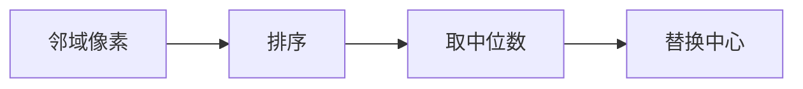

# 第 2 页 · 论文溯源

## 论文名片

| 项目 | 内容 |
|------|------|
| 标题 | **Nonlinear (nonsuperposable) methods for smoothing data** |
| 作者 | John Tukey |
| 年份 | 1978 |
| 发表 | Proc. Conf. Record, EASCON 1974（Tukey）；图像中值滤波 1978 年普及 |
| 原文 | [https://ieeexplore.ieee.org/document/1163410](https://ieeexplore.ieee.org/document/1163410) |
| 一句话贡献 | 提出用邻域中位数代替均值做平滑，可彻底抑制脉冲噪声。 |

## 1. 当时的问题

20 世纪 70 年代，信号与图像处理几乎被线性滤波垄断。但线性滤波对脉冲噪声（个别点被完全污染）无能为力：平均值会被离群点带偏。

## 2. 核心思想

既然均值怕离群点，那就别用均值——用排序后的中位数。中位数只关心「排在中间的那个」，个别极端值再大也影响不了它。

## 3. 关键贡献

- 提出**非线性平滑**这一整类新方法
- 证明中值滤波能完全消除宽度小于窗口半径的脉冲
- 提出「根信号」概念，为中值滤波族（加权中值、方向中值）奠基

## 4. 核心公式（看懂思路即可）

out(x, y) = median{ I(x+i, y+j) | (i, j) ∈ W }，W 为 k×k 邻域窗口。

## 5. 实验结果

对叠加 10% 椒盐噪声的图像，3×3 中值滤波几乎完全恢复原图，而同等核的均值滤波仍留下大片灰斑。

## 6. 局限与争议

对高斯型噪声提升有限；核越大，边缘与细结构损失越明显；排序运算限制了实时性。

## 7. 历史影响

成为图像去噪的标准工具，并催生了加权中值、中值金字塔、形态学滤波等一大批非线性方法；也是 JPEG 抗脉冲噪声、扫描仪固件的常驻算法。

## 8. 一句话总结

> 一个「取中位数」的朴素想法，成了所有椒盐去噪的默认答案。
