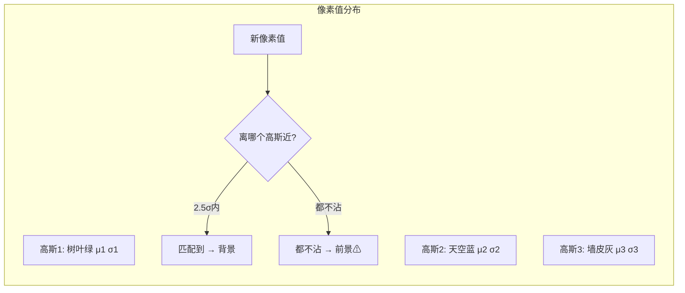

# 💡 核心概念

🧪 公式看不懂？去 <a href="/math-lab/">原理实验室</a> 拖动滑块直观体验卷积/梯度/高斯/霍夫/角点/RANSAC/光流等核心概念；看完原理再去本页底部 <a href="./source">源码/真机实验室</a> 亲手调参数。

## 帧差法为什么不够？

最朴素的「当前帧 - 上一帧 = 前景」只能看到**刚在动的东西**。停下来的人立刻消失；而且树叶一直抖，永远是前景。

## 混合高斯的思路：一个像素不是「一个背景」，而是「多种背景」

想象一个被风吹的树叶像素：**1/3 时间是树叶绿，1/3 时间是天空蓝，1/3 时间是墙皮灰**——三种颜色都"正常"，所以它的背景模型应该是**3 个高斯叠加**。

## 三个核心参数

| 参数 | 含义 | 小 | 大 |
| --- | --- | --- | --- |
| `history` | 用多少帧学背景 | 学得快、忘得快（车开过几秒就融入背景） | 学得慢但稳 |
| `varThreshold` | 多大偏差算匹配 | 严格（轻微变动都判前景） | 宽松（抖动被容忍） |
| `detectShadows` | 是否标记阴影 | — | 开后阴影用灰色 (value=127) 标记，不混进前景 |

## 学习率 α 的直觉

$$
\mu \leftarrow (1-\alpha)\mu + \alpha x
$$

α 越大 → "忘得快"，新背景立刻记住，鬼影消失快；但缓慢停在场景里的入侵者也会被逐渐当成背景。
