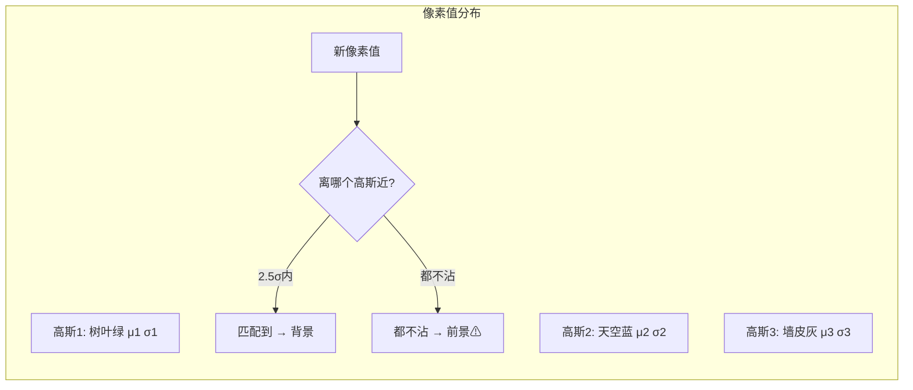

## 🧪 原理互动演示

<AlgoVisualizer type="mog2" />

# 💡 核心概念

🧪 公式看不懂？去 <a href="/math-lab/">原理实验室</a> 拖动滑块直观体验卷积/梯度/高斯/霍夫/角点/RANSAC/光流等核心概念；看完原理再去本页底部 <a href="./source">源码/真机实验室</a> 亲手调参数。

## 帧差法为什么不够？

最朴素的「当前帧 - 上一帧 = 前景」只能看到**刚在动的东西**。停下来的人立刻消失；而且树叶一直抖，永远是前景。

## 混合高斯的思路：一个像素不是「一个背景」，而是「多种背景」

想象一个被风吹的树叶像素：**1/3 时间是树叶绿，1/3 时间是天空蓝，1/3 时间是墙皮灰**——三种颜色都"正常"，所以它的背景模型应该是**3 个高斯叠加**。

## 三个核心参数

| 参数 | 含义 | 小 | 大 |
| --- | --- | --- | --- |
| `history` | 用多少帧学背景 | 学得快、忘得快（车开过几秒就融入背景） | 学得慢但稳 |
| `varThreshold` | 多大偏差算匹配 | 严格（轻微变动都判前景） | 宽松（抖动被容忍） |
| `detectShadows` | 是否标记阴影 | — | 开后阴影用灰色 (value=127) 标记，不混进前景 |

## 学习率 α 的直觉

$$
\mu \leftarrow (1-\alpha)\mu + \alpha x
$$

α 越大 → "忘得快"，新背景立刻记住，鬼影消失快；但缓慢停在场景里的入侵者也会被逐渐当成背景。

<!-- AUTO-EXTENSION -->

## 🔍 直观对比：三种背景减法谁最强？

**帧差法**只看"相邻两帧差"，物体一旦停住就消失；**KNN** 用 K 个最近邻建模，对动态树叶更宽容但慢半拍；**MOG2** 用自适应 K 个高斯，每像素高斯数量自动增减，是速度和鲁棒的最优平衡。

<svg xmlns="http://www.w3.org/2000/svg" width="720" height="160" style="background:#fafbfc;border-radius:12px;border:1px solid #eaecef">
  <g transform="translate(10,5)">
    <text x="110" y="18" text-anchor="middle" font-size="13" font-weight="bold" fill="#333">原图（走路的人+树叶抖动）</text>
    <rect x="0" y="28" width="220" height="120" fill="#b4c7e7"/>
    <rect x="0" y="108" width="220" height="40" fill="#7a8e5a"/>
    <circle cx="60" cy="60" r="6" fill="#2ecc71" opacity="0.7"/>
    <circle cx="90" cy="60" r="6" fill="#2ecc71" opacity="0.7"/>
    <circle cx="120" cy="60" r="6" fill="#2ecc71" opacity="0.7"/>
    <rect x="150" y="60" width="25" height="50" fill="#2c3e50"/>
    <circle cx="162" cy="50" r="10" fill="#f4c28b"/>
  </g>
  <g transform="translate(250,5)">
    <text x="110" y="18" text-anchor="middle" font-size="13" font-weight="bold" fill="#333">帧差法（只看见边缘）</text>
    <rect x="0" y="28" width="220" height="120" fill="#000"/>
    <rect x="145" y="55" width="6" height="55" fill="#fff"/>
    <rect x="174" y="55" width="6" height="55" fill="#fff"/>
    <text x="110" y="135" text-anchor="middle" font-size="10" fill="#888">人停了就消失</text>
  </g>
  <g transform="translate(490,5)">
    <text x="110" y="18" text-anchor="middle" font-size="13" font-weight="bold" fill="#333">MOG2（整个人+阴影灰）</text>
    <rect x="0" y="28" width="220" height="120" fill="#000"/>
    <ellipse cx="162" cy="120" rx="25" ry="6" fill="#888"/>
    <rect x="150" y="60" width="25" height="50" fill="#fff"/>
    <circle cx="162" cy="50" r="10" fill="#fff"/>
    <text x="110" y="135" text-anchor="middle" font-size="10" fill="#888">阴影标灰，可分离</text>
  </g>
</svg>

## 🧓 老奶奶能听懂的版本

想象你坐在窗前看小区。**帧差法**像个每隔 1 秒看一眼、只记"谁动了"的老花眼——那人站着打电话，它就以为人没了。**MOG2** 像你自己：你知道那棵树一直在晃（"绿/蓝/灰"三种状态都是"正常"），同时你也能一下子认出"那个穿黑衣的人是新来的"，还能看出来他脚下的黑影不是他本人。

## 🧩 为什么 "K" 个高斯而不是 1 个？

- **1 个高斯**假设像素"一直在某个平均值附近轻微抖动"——树叶、波浪、喷泉这种多状态像素直接崩；
- **固定 K（比如 5）个高斯**浪费算力，纯色墙面用 1 个就够；
- **MOG2 自动选 K**：哪个像素分布简单就少用几个，复杂就多加，省下的算力给更需要的地方。
