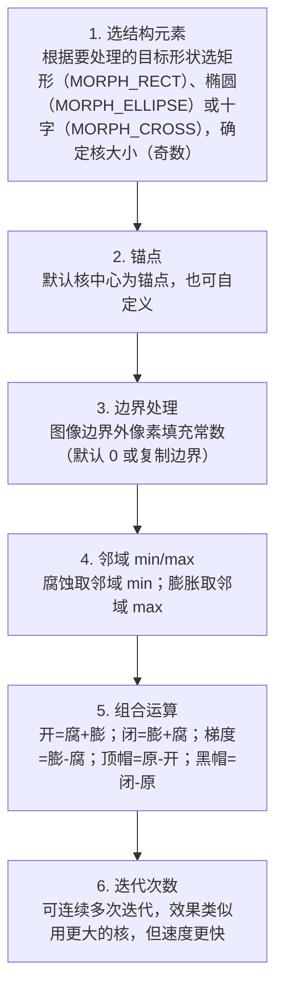

# 形态学操作 · 算法流程

<AlgorithmCard
  name="形态学操作"
  enName="Mathematical Morphology"
  chapter="ch-4-image-enhancement"
  branch="image-processing"
  year="1964"
  author="G. Matheron / J. Serra"
  paper="—"
  level="basic"
  tagline="膨胀、腐蚀、开、闭、顶帽黑帽——五把瑞士军刀帮你清理图像里的小毛刺和黑洞"
  analogy="形态学就像一套木匠的打磨工具：腐蚀像用砂纸把凸起毛刺磨掉，膨胀像给凹坑补腻子，开运算像「先磨毛刺再补漆」（去小白点），闭运算像「先补漆再磨平」（填小黑洞）"
  scene="二值图去噪、孔洞填充、边缘提取、骨架提取、字符识别预处理、OCR、工业缺陷检测"
  :pros='["速度极快", "效果直观可控", "组合能力强", "支持任意核形状", "CPU 实时"]'
  :cons='["核大小/形状需调", "大核慢", "过度腐蚀/膨胀丢信息", "对边界细节破坏"]'
/>

## 完整算法流程

形态学操作算法可以分解为以下关键步骤：

## 步骤详解

### 步骤 1：选结构元素

根据要处理的目标形状选矩形（MORPH_RECT）、椭圆（MORPH_ELLIPSE）或十字（MORPH_CROSS），确定核大小（奇数）

### 步骤 2：锚点

默认核中心为锚点，也可自定义

### 步骤 3：边界处理

图像边界外像素填充常数（默认 0 或复制边界）

### 步骤 4：邻域 min/max

腐蚀取邻域 min；膨胀取邻域 max

### 步骤 5：组合运算

开=腐+膨；闭=膨+腐；梯度=膨-腐；顶帽=原-开；黑帽=闭-原

### 步骤 6：迭代次数

可连续多次迭代，效果类似用更大的核，但速度更快

## 在整体视觉 pipeline 中的位置

### 关键复杂度

| 维度 | 复杂度 |
|---|---|
| 时间 | 详见各实现 |
| 内存 | 与图像尺寸线性相关 |

