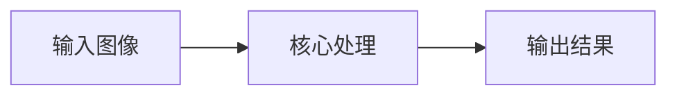
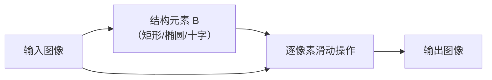
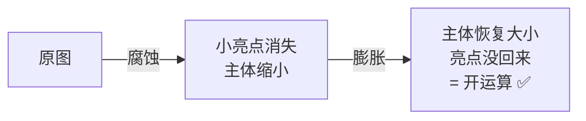

# 形态学操作 · 核心概念

<AlgorithmCard
  name="形态学操作"
  enName="Mathematical Morphology"
  chapter="ch-4-image-enhancement"
  branch="image-processing"
  year="1964"
  author="G. Matheron / J. Serra"
  paper="—"
  level="basic"
  tagline="膨胀、腐蚀、开、闭、顶帽黑帽——五把瑞士军刀帮你清理图像里的小毛刺和黑洞"
  analogy="形态学就像一套木匠的打磨工具：腐蚀像用砂纸把凸起毛刺磨掉，膨胀像给凹坑补腻子，开运算像「先磨毛刺再补漆」（去小白点），闭运算像「先补漆再磨平」（填小黑洞）"
  scene="二值图去噪、孔洞填充、边缘提取、骨架提取、字符识别预处理、OCR、工业缺陷检测"
  :pros='["速度极快", "效果直观可控", "组合能力强", "支持任意核形状", "CPU 实时"]'
  :cons='["核大小/形状需调", "大核慢", "过度腐蚀/膨胀丢信息", "对边界细节破坏"]'
/>

🧪 公式看不懂？去 <a href="/math-lab/">原理实验室</a> 拖动滑块直观体验卷积/梯度/高斯/霍夫/角点/RANSAC/光流等核心概念；看完原理再去本页底部 <a href="./source">源码/真机实验室</a> 亲手调参数。

## 形态学操作的核心思想

膨胀、腐蚀、开、闭、顶帽黑帽——五把瑞士军刀帮你清理图像里的小毛刺和黑洞。形态学就像一套木匠的打磨工具：腐蚀像用砂纸把凸起毛刺磨掉，膨胀像给凹坑补腻子，开运算像「先磨毛刺再补漆」（去小白点），闭运算像「先补漆再磨平」（填小黑洞）

**生活类比**：形态学就像一套木匠的打磨工具：腐蚀像用砂纸把凸起毛刺磨掉，膨胀像给凹坑补腻子，开运算像「先磨毛刺再补漆」（去小白点），闭运算像「先补漆再磨平」（填小黑洞）

**典型应用**：二值图去噪、孔洞填充、边缘提取、骨架提取、字符识别预处理、OCR、工业缺陷检测

## 核心概念详解

### 概念1：结构元素（核）

形态学操作需要一个「形状模板」叫结构元素（structuring element），像一个印章盖到图像上滑动，根据核覆盖下像素的关系决定输出。核可以是矩形、椭圆、十字，甚至任意形状。**核形状和大小决定了操作效果**。

### 概念2：腐蚀 Erosion

对每个像素，取核覆盖范围内**最小值**作为输出。对二值图：核必须完全落在前景里，该像素才保留为前景——**缩小白块、消除小白点**。

### 概念3：膨胀 Dilation

对每个像素，取核覆盖范围内**最大值**作为输出。对二值图：只要核有一部分碰着前景，该像素就扩成前景——**放大白块、填补小黑洞**。

### 概念4：开运算 Opening

**先腐蚀后膨胀**。作用：**消除小亮斑、断开细连接、平滑大区域边界**，但总体形状和面积基本不变。

### 概念5：闭运算 Closing

**先膨胀后腐蚀**。作用：**填充小黑洞、连接相邻物体、弥合小缺口**，同样基本不改变主体面积。

### 概念6：其他衍生操作

- **形态学梯度** = 膨胀 - 腐蚀 → 提取边缘
- **顶帽 Top-Hat** = 原图 - 开运算 → 提取**比周围亮的小元素**
- **黑帽 Black-Hat** = 闭运算 - 原图 → 提取**比周围暗的小元素**
- **击中击不中 Hit-Miss** → 匹配指定像素模式（角点、端点）

---

## 🧪 原理可视化

看不懂上面的公式？下面这个互动组件把「形态学运算」画出来了——拖动滑块，看每一步怎么算。

<ClientOnly>
  <MathVisualizer initial-tab="morph" compact />
</ClientOnly>

> 想看它在真实照片上的实际效果？回到 [本算法首页](./index) 或去 [🎮 真机实验室](/playgrounds/)。
