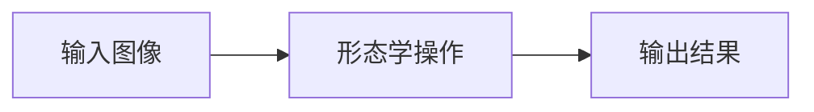

# 形态学操作

<AlgorithmCard
  name="形态学操作"
  enName="Mathematical Morphology"
  chapter="第3章 · 图像预处理"  chapterLink="/chapters/ch03-preprocessing"
  branch="image-processing"
  year="1964"
  author="Georges Matheron / Jean Serra (巴黎矿校)"
  paper="https://books.google.com/books?id=6R8_AQAAIAAJ"
  level="basic"
  tagline="膨胀、腐蚀、开、闭、顶帽黑帽——五把瑞士军刀帮你清理图像里的小毛刺和黑洞"
  analogy="形态学就像一套木匠的打磨工具：腐蚀像用砂纸把凸起毛刺磨掉，膨胀像给凹坑补腻子，开运算像「先磨毛刺再补漆」（去小白点），闭运算像「先补漆再磨平」（填小黑洞）"
  scene="二值图去噪、孔洞填充、边缘提取、骨架提取、字符识别预处理、OCR、工业缺陷检测预处理"
  :pros='["速度极快（邻域比较）", "效果直观可控", "组合能力强（开闭梯度顶帽黑帽）", "支持任意核形状", "CPU 实时"]'
  :cons='["核大小/形状需要调", "大核运算慢", "过度腐蚀/膨胀会丢信息", "对边界细节破坏", "灰度形态学语义不如二值清晰"]'
/>

## 一句话理解

膨胀、腐蚀、开、闭、顶帽黑帽——五把瑞士军刀帮你清理图像里的小毛刺和黑洞。形态学就像一套木匠的打磨工具：腐蚀像用砂纸把凸起毛刺磨掉，膨胀像给凹坑补腻子，开运算像「先磨毛刺再补漆」（去小白点），闭运算像「先补漆再磨平」（填小黑洞）。

## 生活类比

形态学就像一套木匠的打磨工具：腐蚀像用砂纸把凸起毛刺磨掉，膨胀像给凹坑补腻子，开运算像「先磨毛刺再补漆」（去小白点），闭运算像「先补漆再磨平」（填小黑洞）

## 它解决什么问题

二值图去噪、孔洞填充、边缘提取、骨架提取、字符识别预处理、OCR、工业缺陷检测预处理。

在传统 CV 的六分支体系中，形态学操作 属于 **image-processing** 分支，主要解决的是该分支中膨胀、腐蚀、开、闭、顶帽黑帽——五把瑞士军刀帮你清理图像里的小毛刺和黑洞的问题。

## 核心优点

- ✅ **速度极快（邻域比较）**
- ✅ **效果直观可控**
- ✅ **组合能力强（开闭梯度顶帽黑帽）**
- ✅ **支持任意核形状**
- ✅ **CPU 实时**

## 它的短板

- ⚠️ 核大小/形状需要调
- ⚠️ 大核运算慢
- ⚠️ 过度腐蚀/膨胀会丢信息
- ⚠️ 对边界细节破坏
- ⚠️ 灰度形态学语义不如二值清晰

## 本算法档案包含 7 个页面

| 页面 | 内容 |
|---|---|
| [论文故事](/algorithms/morphology/paper) | 作者、发表时间、核心贡献、为什么它会被提出 |
| [核心概念](/algorithms/morphology/concepts) | 用生活比方讲清它依赖的关键概念 |
| [算法流程](/algorithms/morphology/architecture) | 一步步走通算法全流程，配 mermaid 图 |
| [源码实现](/algorithms/morphology/source) | OpenCV 调用 + NumPy 手写最小实现 |
| [踩坑清单](/algorithms/morphology/painpoints) | 新手最常犯的 N 个错误 |
| [调参口诀](/algorithms/morphology/tricks) | 参数怎么选、实战技巧、性能优化 |

## 相关链接

- 返回 [六大分支总览](/branches/)
- [形态学操作所在分支](/branches/image-processing/)
- [算法档案总览](/algorithms/)
