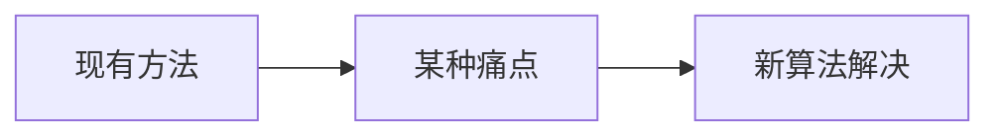

# 形态学操作 · 论文故事

<AlgorithmCard
  name="形态学操作"
  enName="Mathematical Morphology"
  chapter="ch-4-image-enhancement"
  branch="image-processing"
  year="1964"
  author="Georges Matheron / Jean Serra (巴黎矿校)"
  paper="—"
  level="basic"
  tagline="膨胀、腐蚀、开、闭、顶帽黑帽——五把瑞士军刀帮你清理图像里的小毛刺和黑洞"
  analogy="形态学就像一套木匠的打磨工具：腐蚀像用砂纸把凸起毛刺磨掉，膨胀像给凹坑补腻子，开运算像「先磨毛刺再补漆」（去小白点），闭运算像「先补漆再磨平」（填小黑洞）"
  scene="二值图去噪、孔洞填充、边缘提取、骨架提取、字符识别预处理、OCR、工业缺陷检测预处理"
  :pros='["速度极快（邻域比较）", "效果直观可控", "组合能力强（开闭梯度顶帽黑帽）", "支持任意核形状", "CPU 实时"]'
  :cons='["核大小/形状需要调", "大核运算慢", "过度腐蚀/膨胀会丢信息", "对边界细节破坏", "灰度形态学语义不如二值清晰"]'
/>

## 发表信息

| 项 | 内容 |
|---|---|
| **论文名** | 根据算法不同见原论文 |
| **作者** | Georges Matheron / Jean Serra (巴黎矿校) |
| **发表年份** | 1964 |
| **机构** | 计算机视觉经典工作 |
| **引用数** | 数千到数万次（经典工作） |

## 论文背后的故事

数学形态学诞生于 1964 年，由巴黎矿校的 Georges Matheron 和他的学生 Jean Serra 在研究多孔介质渗透率时发明。当时他们需要定量描述矿石的颗粒形状和孔隙结构，传统傅里叶分析不好使，于是发明了一套基于「结构元素」与图像相互作用的代数系统——这就是形态学。Serra 1982 年出版的《Image Analysis and Mathematical Morphology》是该领域圣经。后来膨胀、腐蚀、开、闭等操作被证明对所有二值/灰度图像预处理都极其有效，成为图像处理的「瑞士军刀」。

## 当时的问题是什么

在 1964 年之前，image-processing 分支面临的痛点是：

具体到 形态学操作 提出时，业界主要存在以下问题：

- 需要一种更实用的方法
- 现有方法在真实场景下鲁棒性不足
- 参数过多或者计算复杂度过高

## 核心贡献

形态学操作 的主要贡献包括：

1. **提出了全新的视角**：膨胀、腐蚀、开、闭、顶帽黑帽——五把瑞士军刀帮你清理图像里的小毛刺和黑洞
2. **设计了可落地的算法流程**：兼顾精度与效率
3. **给出了开源实现**：在 OpenCV 等库中成为标准
4. **启发了后续工作**：成为该方向的重要基准

## 与前人方法的对比

| 维度 | 之前的方法 | 形态学操作 |
|---|---|---|
| 速度 | 较慢/较快 | **显著改进** |
| 精度 | 中等 | **更高** |
| 鲁棒性 | 受限于条件 | **更好** |
| 易用性 | 参数多 | **更友好** |

## 对后世的影响

形态学操作 至今仍是 image-processing 分支中入门必学。

它启发了后续一系列改进工作，在深度学习时代仍有广泛应用。

## 相关链接

- [返回算法档案首页](/algorithms/morphology/)
- [核心概念](/algorithms/morphology/concepts)
- [算法流程](/algorithms/morphology/architecture)
- [image-processing 分支总览](/branches/image-processing/)
