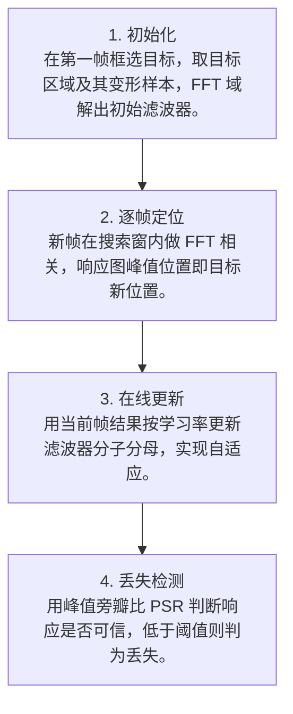

# 第 4 页 · 算法架构

## 完整流程图

## 每一步在做什么

### 步骤 1：初始化

在第一帧框选目标，取目标区域及其变形样本，FFT 域解出初始滤波器。

### 步骤 2：逐帧定位

新帧在搜索窗内做 FFT 相关，响应图峰值位置即目标新位置。

### 步骤 3：在线更新

用当前帧结果按学习率更新滤波器分子分母，实现自适应。

### 步骤 4：丢失检测

用峰值旁瓣比 PSR 判断响应是否可信，低于阈值则判为丢失。

## 在整体视觉管线中的位置

## 复杂度分析

时间复杂度 O(W·H·log(WH))，主要来自两次 FFT；空间复杂度 O(W·H)。实际可跑数百 FPS。

## 参数总览（论文建议 vs OpenCV 默认 vs 实战推荐）

| 参数 | 含义 | 论文建议 | OpenCV 默认 | 实战推荐 |
|------|------|----------|-------------|----------|
| lr | 学习率 | 0.125 | 0.125 | ****0.02~0.2**** |
| sigma | 高斯响应 σ | 2.0 | 2.0 | **2.0** |
| psr_thresh | 峰值旁瓣比阈值 | — | 7.0 | **7.0（判丢失）** |
| search_window | 搜索窗相对目标倍数 | 1.5 | — | **1.5~2.0** |

## 边界情况与失败模式

- **目标出画/遮挡后不找回**：MOSSE 无重检测，一旦丢失就永久丢失。
- **快速运动跟丢**：搜索窗太小，目标一下跳出窗口。
- **尺度变化失败**：MOSSE 假设目标大小不变，变大变小就丢。
- **初始化框不准**：初始框含大量背景，滤波器学到背景纹理。
