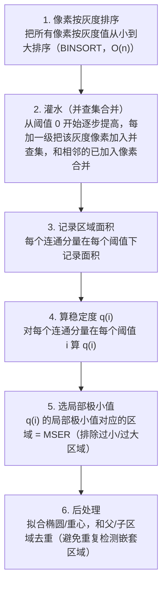

# MSER 最大稳定极值区域 · 算法流程

<AlgorithmCard
  name="MSER 最大稳定极值区域"
  enName="Maximally Stable Extremal Regions"
  chapter="ch-8-local-feature"
  branch="feature-detection"
  year="2002"
  author="Jiri Matas et al."
  paper="—"
  level="mid"
  tagline="像往黑白照片上浇水，颜色深浅慢慢渗开，那些形状最稳定的水坑就是好区域"
  analogy="把灰度图想象成一块地形，从黑到白慢慢淹水：一开始只有最深的坑有水，水涨后水面扩大。那些「水位变一点、水面大小几乎不变」的湖泊，就是最稳定的区域——MSER"
  scene="宽基线立体匹配、文本检测（自然场景文字）、目标识别、对仿射变换要求高的场景"
  :pros='["仿射不变性", "多尺度区域检测", "无需预设阈值", "对光照鲁棒", "形状任意"]'
  :cons='["对模糊敏感", "速度较慢", "参数 delta/minArea/maxArea 要调", "不适合低对比度"]'
/>

## 完整算法流程

MSER 最大稳定极值区域算法可以分解为以下关键步骤：

## 步骤详解

### 步骤 1：像素按灰度排序

把所有像素按灰度值从小到大排序（BINSORT，O(n)）

### 步骤 2：灌水（并查集合并）

从阈值 0 开始逐步提高，每加一级把该灰度像素加入并查集，和相邻的已加入像素合并

### 步骤 3：记录区域面积

每个连通分量在每个阈值下记录面积

### 步骤 4：算稳定度 q(i)

对每个连通分量在每个阈值 i 算 q(i)

### 步骤 5：选局部极小值

q(i) 的局部极小值对应的区域 = MSER（排除过小/过大区域）

### 步骤 6：后处理

拟合椭圆/重心，和父/子区域去重（避免重复检测嵌套区域）

## 在整体视觉 pipeline 中的位置

### 关键复杂度

| 维度 | 复杂度 |
|---|---|
| 时间 | 详见各实现 |
| 内存 | 与图像尺寸线性相关 |

