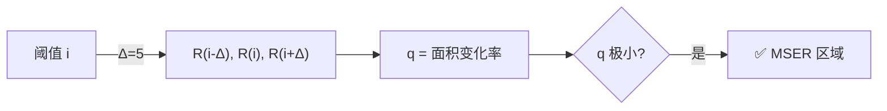

# MSER 最大稳定极值区域 · 核心概念

<AlgorithmCard
  name="MSER 最大稳定极值区域"
  enName="Maximally Stable Extremal Regions"
  chapter="ch-8-local-feature"
  branch="feature-detection"
  year="2002"
  author="Jiri Matas et al."
  paper="—"
  level="mid"
  tagline="像往黑白照片上浇水，颜色深浅慢慢渗开，那些形状最稳定的水坑就是好区域"
  analogy="把灰度图想象成一块地形，从黑到白慢慢淹水：一开始只有最深的坑有水，水涨后水面扩大。那些「水位变一点、水面大小几乎不变」的湖泊，就是最稳定的区域——MSER"
  scene="宽基线立体匹配、文本检测（自然场景文字）、目标识别、对仿射变换要求高的场景"
  :pros='["仿射不变性", "多尺度区域检测", "无需预设阈值", "对光照鲁棒", "形状任意"]'
  :cons='["对模糊敏感", "速度较慢", "参数 delta/minArea/maxArea 要调", "不适合低对比度"]'
/>

🧪 公式看不懂？去 <a href="/math-lab/">原理实验室</a> 拖动滑块直观体验卷积/梯度/高斯/霍夫/角点/RANSAC/光流等核心概念；看完原理再去本页底部 <a href="./source">源码/真机实验室</a> 亲手调参数。

## MSER 最大稳定极值区域的核心思想

像往黑白照片上浇水，颜色深浅慢慢渗开，那些形状最稳定的水坑就是好区域。把灰度图想象成一块地形，从黑到白慢慢淹水：一开始只有最深的坑有水，水涨后水面扩大。那些「水位变一点、水面大小几乎不变」的湖泊，就是最稳定的区域——MSER

**生活类比**：把灰度图想象成一块地形，从黑到白慢慢淹水：一开始只有最深的坑有水，水涨后水面扩大。那些「水位变一点、水面大小几乎不变」的湖泊，就是最稳定的区域——MSER

**典型应用**：宽基线立体匹配、文本检测（自然场景文字）、目标识别、对仿射变换要求高的场景

## 核心概念详解

### 概念1：极值区域 Extremal Region

极值区域 = 图像中**所有像素都比边界外暗**（或亮）的连通区域。随着二值化阈值从 0 升到 255，极值区域会逐渐长大、合并。

### 概念2：稳定度 q(i)

MSER 的核心量：**区域面积在阈值变化时的相对变化率**。q(i) = |R(i+Δ) - R(i-Δ)| / |R(i)|，其中 R(i) 是阈值为 i 时的区域像素集合。q 越小说明这个区域越「稳定」——水位变了水面几乎不变。

### 概念3：为什么仿射不变

因为 MSER 基于**区域拓扑关系**（连通性）和**相对亮度顺序**，而不是绝对像素位置或灰度值。仿射变换（拉伸/旋转/倾斜）不会改变连通关系，也不会改变局部亮度排序——所以同一个区域无论怎么透视变形，都会被检测到。

### 概念4：MSER 区域→特征点

MSER 输出的是区域（像素集合），不是点。使用时通常取每个 MSER 区域的**重心+等效椭圆（二阶矩）**作为仿射协变区域，再归一化成 41×41 patch 提 SIFT 描述子。

