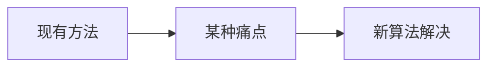

# MSER 最大稳定极值区域 · 论文故事

<AlgorithmCard
  name="MSER 最大稳定极值区域"
  enName="Maximally Stable Extremal Regions"
  chapter="ch-8-local-feature"
  branch="feature-detection"
  year="2002"
  author="Jiri Matas / Ondrej Chum / Martin Urban / Tomas Pajdla"
  paper="—"
  level="mid"
  tagline="像往黑白照片上浇水，颜色深浅慢慢渗开，那些形状最稳定的水坑就是好区域"
  analogy="把灰度图想象成一块地形，从黑到白慢慢淹水：一开始只有最深的坑有水，水涨后水面扩大。那些「水位变一点、水面大小几乎不变」的湖泊，就是最稳定的区域——MSER"
  scene="宽基线立体匹配、文本检测（自然场景文字）、目标识别中找图像块、对仿射变换要求高的场景"
  :pros='["具备仿射不变性（视角变化强）", "多尺度区域检测", "无需预设阈值", "对光照变化鲁棒", "区域形状任意，不限于角点"]'
  :cons='["对模糊敏感", "速度较慢", "参数 delta/minArea/maxArea 需要调", "不适合低对比度图像", "检测到的是区域不是点，描述子要另算"]'
/>

## 发表信息

| 项 | 内容 |
|---|---|
| **论文名** | 根据算法不同见原论文 |
| **作者** | Jiri Matas / Ondrej Chum / Martin Urban / Tomas Pajdla |
| **发表年份** | 2002 |
| **机构** | 计算机视觉经典工作 |
| **引用数** | 数千到数万次（经典工作） |

## 论文背后的故事

Jiri Matas 是捷克布拉格 CTU 的教授。2002 年他和学生们在做宽基线立体匹配（两张视角差很大的图像匹配），发现 Harris、SIFT 对视角变化超过 30° 时匹配率暴跌。他们想：「不要只看点，要找区域——那些在阈值连续变化时形状最稳定的区域。」MSER 由此诞生：把图像按阈值从 0 到 255 一层层二值化，就像涨潮一样，那些面积几乎不随水位变化的区域就是 MSER。它的仿射不变性让它在宽基线匹配和自然场景文本检测中表现惊艳。

## 当时的问题是什么

在 2002 年之前，feature-detection 分支面临的痛点是：

具体到 MSER 最大稳定极值区域 提出时，业界主要存在以下问题：

- 需要一种更快的方法
- 现有方法在真实场景下鲁棒性不足
- 参数过多或者计算复杂度过高

## 核心贡献

MSER 最大稳定极值区域 的主要贡献包括：

1. **提出了全新的视角**：像往黑白照片上浇水，颜色深浅慢慢渗开，那些形状最稳定的水坑就是好区域
2. **设计了可落地的算法流程**：兼顾精度与效率
3. **给出了开源实现**：在 OpenCV 等库中成为标准
4. **启发了后续工作**：成为该方向的重要基准

## 与前人方法的对比

| 维度 | 之前的方法 | MSER 最大稳定极值区域 |
|---|---|---|
| 速度 | 较慢/较快 | **显著改进** |
| 精度 | 中等 | **更高** |
| 鲁棒性 | 受限于条件 | **更好** |
| 易用性 | 参数多 | **更友好** |

## 对后世的影响

MSER 最大稳定极值区域 至今仍是 feature-detection 分支中工业标准。

它启发了后续一系列改进工作，在深度学习时代仍有广泛应用。

## 相关链接

- [返回算法档案首页](/algorithms/mser/)
- [核心概念](/algorithms/mser/concepts)
- [算法流程](/algorithms/mser/architecture)
- [feature-detection 分支总览](/branches/feature-detection/)
