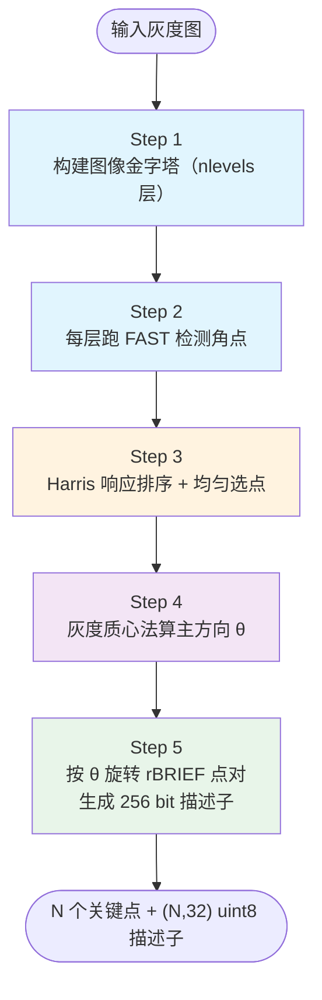
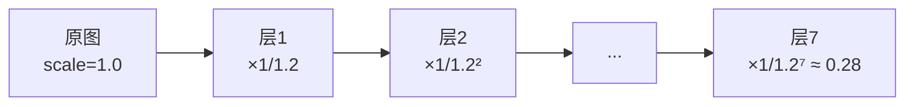
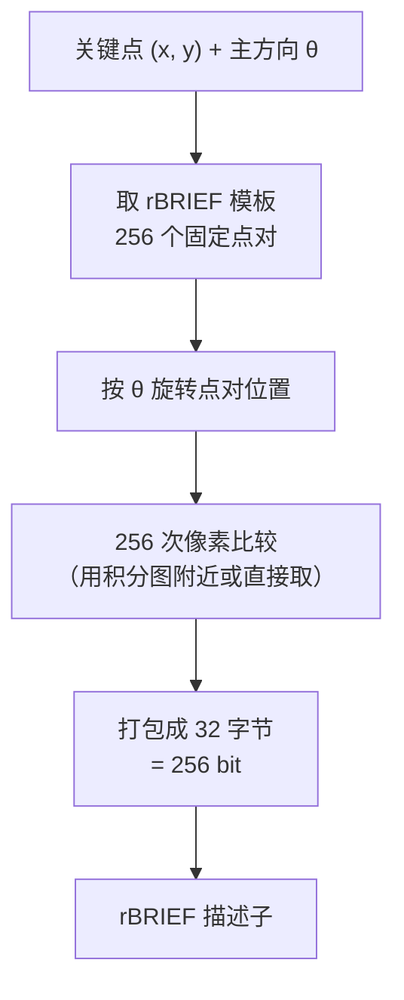

# ORB 算法流程



---

## Step 1：构建图像金字塔

```python
def build_pyramid(img, nlevels=8, scaleFactor=1.2):
    pyramid = [img]
    for i in range(1, nlevels):
        h, w = pyramid[-1].shape
        new_w = int(round(w / scaleFactor))
        new_h = int(round(h / scaleFactor))
        pyramid.append(cv2.resize(pyramid[-1], (new_w, new_h)))
    return pyramid
```

- **nlevels 默认 8**
- **scaleFactor 默认 1.2**
- 每层独立处理，关键点坐标最后**反算回原图坐标**



---

## Step 2：每层跑 FAST 检测角点

### FAST-9 核心判断（半径=3 的 Bresenham 圆）

对每个候选点 p：
1. 取 16 个圆周像素：编号 1~16（见 concepts 页）
2. **先看 4 个锚点**（上/右/下/左：1, 5, 9, 13）——若既无连续 3 个亮于 Ip+t，也无连续 3 个暗于 Ip−t，**直接跳过**（这个初筛刷掉 80%+ 非角点）
3. 否则扫完整 16 个点，看是否存在**连续 9 个（FAST-9）或 12 个（FAST-12）**像素都亮/暗于中心
4. 如果是，p 是角点候选

```python
# FAST-9 伪代码（原理版）
def is_fast_corner(img, x, y, threshold=20):
    Ip = img[y, x]
    t = threshold
    # 取圆周 16 点（3 像素半径 Bresenham 圆）
    circle = [(-3,0),(-3,1),(-2,2),(-1,3),(0,3),(1,3),(2,2),(3,1),
              (3,0),(3,-1),(2,-2),(1,-3),(0,-3),(-1,-3),(-2,-2),(-3,-1)]
    pixels = [img[y+dy, x+dx] for dx, dy in circle]
    bright = [1 if p > Ip + t else 0 for p in pixels]
    dark   = [1 if p < Ip - t else 0 for p in pixels]
    # 判断是否存在连续 9 个亮或连续 9 个暗
    for arr in (bright, dark):
        doubled = arr + arr  # 拼两次，方便检查跨边界连续
        run = 0
        for v in doubled:
            run = run + 1 if v else 0
            if run >= 9:
                return True
    return False
```

---

## Step 3：Harris 响应排序 + 每尺度均匀选点

FAST 会在一个角点附近出一堆扎堆点，需要**去重 + 择优**：

### 3.1 非极大值抑制（NMS）
- 对每个角点计算 Harris 响应 M = det(M) − k·tr(M)²
- 同一邻域内（比如 3×3）只保留响应最大的那个

### 3.2 按金字塔层级均匀分配 nfeatures
- 每层应分到 `nfeatures / nlevels` 个点（默认 500/8 ≈ 62）
- 每层按 Harris 响应从大到小取前 K 个

### 3.3 minDistance 保证点不扎堆
- OpenCV ORB 内部保证关键点之间至少隔 patchSize 像素（默认 31），避免扎堆

---

## Step 4：灰度质心法算主方向 θ

对每个关键点 (x, y)，在它**所在金字塔层**，取半径为 `patchSize/2`（默认 15）的圆形邻域：

```python
def ic_angle(img, x, y, half_k=15):
    """灰度质心法，返回主方向角度（弧度）"""
    m01 = 0
    m10 = 0
    for dy in range(-half_k, half_k+1):
        # 每行水平范围（圆形，不是方）
        dx_range = int((half_k**2 - dy**2) ** 0.5)
        for dx in range(-dx_range, dx_range+1):
            v = int(img[y+dy, x+dx])
            m10 += dx * v
            m01 += dy * v
    return math.atan2(m01, m10)  # θ
```

::: tip 真实 OpenCV 实现更优化
OpenCV 用**预计算的偏移表**和"u 形"扫描模式（按行加，每行两端点固定），把判断圆内的乘法和 sqrt 都省掉，**速度是手写版的 10 倍以上**。
:::

---

## Step 5：生成 rBRIEF 二进制描述子

### 5.1 rBRIEF 的 256 个点对是**预训练好的固定模板**

OpenCV 内置了 256 对点的相对坐标 (x1,y1)→(x2,y2)，存为 `pattern` 表（都在 patchSize=31 的坐标系下，原点在中心）。

### 5.2 按主方向 θ 旋转点对

把每个模板点对 (p, q) 乘以旋转矩阵 R_θ：

$$
R_\theta = \begin{bmatrix} \cos\theta & -\sin\theta \\ \sin\theta & \cos\theta \end{bmatrix}
$$

得到旋转后的实际采样位置：
$$
p' = R_\theta \cdot p,\quad q' = R_\theta \cdot q
$$

### 5.3 进行 256 次 τ 测试

对 i = 0...255：
- 在关键点周围取图像值 I(p'_i) 和 I(q'_i)
- 若 I(p'_i) < I(q'_i) 则第 i bit = 1，否则 = 0
- 256 bit 打包成 32 字节（uint8）就是最终描述子

```python
def compute_rbrief(img, kp_x, kp_y, angle_rad, pattern, n_pairs=256):
    """
    pattern: (256, 4) array，每行 (x1,y1,x2,y2) 相对坐标
    返回 32 字节 uint8 描述子
    """
    cos_a = math.cos(angle_rad)
    sin_a = math.sin(angle_rad)
    des = bytearray(32)
    for i in range(n_pairs):
        x1, y1, x2, y2 = pattern[i]
        # 旋转
        rx1 = x1*cos_a - y1*sin_a
        ry1 = x1*sin_a + y1*cos_a
        rx2 = x2*cos_a - y2*sin_a
        ry2 = x2*sin_a + y2*cos_a
        # 取像素（实际 OpenCV 会做双线性插值）
        v1 = img[int(kp_y+ry1), int(kp_x+rx1)]
        v2 = img[int(kp_y+ry2), int(kp_x+rx2)]
        # 写 bit
        if v1 < v2:
            des[i >> 3] |= (1 << (i & 7))
    return np.frombuffer(des, dtype=np.uint8)
```

### 5.4 多尺度处理

对金字塔每一层的关键点：
- 描述子都用该层图像计算（小尺度用小图、大尺度用大图）
- 角点坐标最后映射回原图



---

## 参数总览

| 参数 | 默认值 | 含义 |
|---|---|---|
| nfeatures | 500 | 最多返回的关键点数量 |
| scaleFactor | 1.2 | 金字塔每层缩放比 |
| nlevels | 8 | 金字塔层数 |
| edgeThreshold | 31 | 图像边缘不出点的距离（等于 patchSize） |
| firstLevel | 0 | 把原图放在第几层（一般不改） |
| WTA_K | 2 | τ 测试每次比几个点（2 或 3 或 4） |
| scoreType | HARRIS_SCORE | 排序方式（HARRIS_SCORE 或 FAST_SCORE） |
| patchSize | 31 | 描述子 patch 尺寸 |
| fastThreshold | 20 | FAST 角点阈值 |
