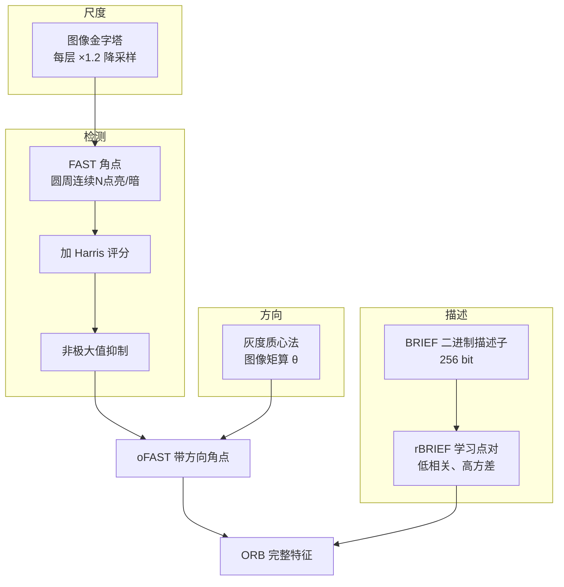

# ORB 核心概念

理解 ORB，要搞懂五样东西：**FAST 角点**、**灰度质心法**、**图像金字塔**、**BRIEF 二进制描述子**、**rBRIEF 学习点对**。

## ① FAST 角点（Features from Accelerated Segment Test）

### 一句话

**圆周上连续 N 个点都比中心亮（或都暗），就是角点**。

### 判定法则（FAST-9 为例）

1. 在像素 p 周围取 Bresenham 半径为 3 的圆（**圆上共 16 个像素**）
2. 先只看上下左右 4 个点（#1, #5, #9, #13）
   - 若这 4 个点里既没有 3 个比 p 亮 Ip+t 以上，也没有 3 个比 p 暗 Ip-t 以下，**直接跳过**（初筛）
3. 如果通过初筛，再看完整 16 个点，若有**连续 9~12 个点**（FAST-9/12）都满足亮/暗，则 p 是角点

```
     15  1  2
   14        3
  13          4
  12    p     5      ← Bresenham 半径为 3 的 16 像素圆
  11          6
   10        7
      9  8
```

### 为什么快

- **初筛只要 4 次比较**，能刷掉 80% 以上的非角点
- 不需要计算梯度、Hessian、Harris 矩阵，**纯整数比较**
- 速度比 Harris 快一个数量级以上

### FAST 的问题

- ❌ 没有方向
- ❌ 没有尺度
- ❌ 对阈值敏感
- ❌ 在边缘上也容易响应（需要 NMS + Harris 排序）

## ② 灰度质心法（Intensity Centroid，算方向）

### 一句话

**把图像块当成一个"不均匀的板子"，亮点多的那头就是"重心偏移方向"——即特征点的主方向**。

### 公式

在关键点周围一个圆形邻域（半径 r，ORB 默认 r = patch_size/2 = 15.5 附近），计算图像矩：

$$
m_{pq} = \sum_{x,y} x^p y^q \cdot I(x,y)
$$

- m₀₀ = 块内总灰度（质量）
- m₁₀ = x 方向一阶矩（x*I 之和）
- m₀₁ = y 方向一阶矩（y*I 之和）

质心 C = (m₁₀/m₀₀, m₀₁/m₀₀)，主方向：

$$
\theta = \operatorname{atan2}(m_{01}, m_{10})
$$

### 为什么比 SIFT/SURF 的方向法快

| | SIFT/SURF 方向 | ORB 灰度质心 |
|---|---|---|
| 计算 | 36 bin 梯度直方图 | 3 次矩累加 |
| 邻域大小 | 半径 ~6s | 圆形 patch |
| 复杂度 | O(N) 乘加 + 直方图 | O(N) 加 |
| 精度 | ~±10° | ~±15°（够用） |

## ③ 图像金字塔（提供尺度）

ORB 不做 SIFT/SURF 那种连续的尺度空间卷积，而是**简单粗暴地降采样**：

| 层 | 图像尺寸 | 相对尺度 |
|---|---|---|
| 0 | W × H | 1.0 |
| 1 | W/1.2 × H/1.2 | 1.2 |
| 2 | W/1.2² × H/1.2² | 1.2² = 1.44 |
| ... | ... | ... |
| 7 | W/1.2⁷ × H/1.2⁷ | ~3.58 |
| ... | ... | ... |

- **scaleFactor 默认 1.2**（每层缩小 1.2 倍）
- **nlevels 默认 8**（共 8 层，覆盖 1 ~ 3.58 倍尺度）
- 每层独立跑 FAST，各自提 nfeatures/nlevels 个角点

**优点**：实现简单、快。**缺点**：尺度是离散的，跨尺度匹配不如 SIFT 精确。

## ④ BRIEF 二进制描述子

### 一句话

**在关键点周围随机选 256 对点，每对比较亮暗得到 1 bit，拼成 256 bit 字符串——这就是 BRIEF**。

### 单个 binary test（τ 测试）

$$
\tau(I; x, y) = \begin{cases} 1 & I(x) < I(y) \\ 0 & I(x) \geq I(y) \end{cases}
$$

选 256 个 (x_i, y_i) 点对，256 次比较拼成一个 **256 bit** 描述子。

### Hamming 距离（汉明距离）

两个二进制串 **不同 bit 的个数**：

$$
d_h(a, b) = \sum_{i=0}^{255} a_i \oplus b_i
$$

**CPU 指令 XOR + POPCNT**，一个 64 位整数的 popcount 只要 1 个时钟周期，**32 个 uint8（=256 bit）的汉明距离算起来极快**。

### BRIEF 的问题

1. **无旋转不变性**：图像一转，选点位置歪了，bit 全错
2. **对噪声敏感**：单个像素比较容易被噪声翻转
3. **在模糊图像上性能下降**

## ⑤ rBRIEF（rotated BRIEF，旋转+去相关）

ORB 不是简单地"把 BRIEF 的点对按主方向旋转"，而是**重新学习了一组优质点对**。

### 学习过程（关键思想）

1. 从大量自然图像中抽取 ~300k 个 patch
2. 在每个 patch 中以**各向同性高斯分布**随机采 205k+ 候选点对（x_i, y_i）
3. 对每个点对，在 patch 旋转到 0°~360° 的各角度下统计 τ=0/1 的频率
4. 按以下标准**贪心挑选** 256 对点：
   - 每对的期望均值接近 0.5（即"一半亮一半暗"，信息量大）
   - 各点对之间**相关性低**（避免所有 bit 都在说同一件事）
5. 用这组固定的 256 对点作为"模板"。**实际提描述子时，把模板点对按主方向 θ 旋转到对应角度**，再做比较

### 为什么要"去相关"

如果 256 个点对高度相关（比如都在比中心 vs 周围），很多 bit 其实在重复信息，**有效维度远小于 256**。ORB 用贪心选点对让它们**尽可能互相独立**，榨干每一 bit 的信息量。

## 概念关系图



## 相关算子/概念

| 算子 | 作用 |
|---|---|
| Harris 角点响应 | 给 FAST 点排序，选最好的 N 个 |
| 非极大值抑制 | 去掉 FAST 扎堆点 |
| 图像金字塔 | 提供多尺度 |
| Hamming 距离 | 二进制描述子匹配度量 |
