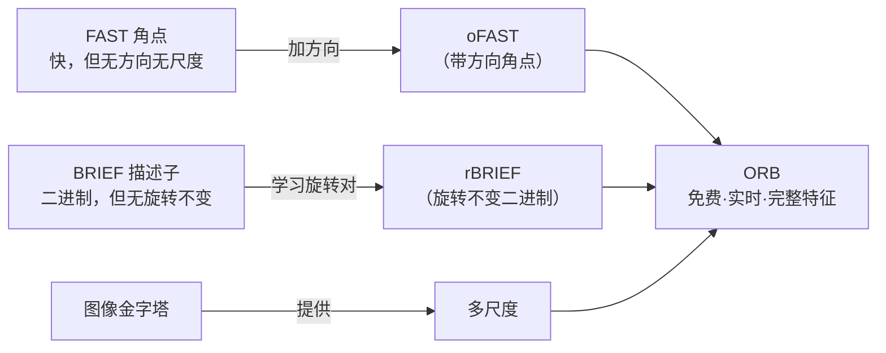
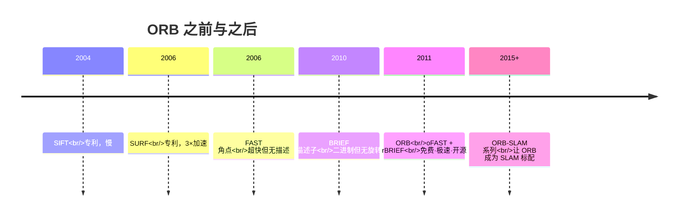

# ORB 实时特征点

<AlgorithmCard
  name="ORB"
  enName="Oriented FAST and Rotated BRIEF"
  chapter="第4章 · 基元检测"  chapterLink="/chapters/ch04-primitives"
  branch="feature-detection"
  year="2011"
  author="Ethan Rublee / Vincent Rabaud / Kurt Konolige / Gary Bradski"
  paper="https://ieeexplore.ieee.org/document/6126544"
  level="mid"
  tagline="免费、二进制、实时——工业界特征点的事实标准"
  analogy="SIFT/SURF 像专业单反，画质好但笨重；ORB 像手机摄像头，画质够用、随手一拍、关键是免费又快"
  scene="SLAM、AR、手机端实时拼接、无人机视觉、任何需要实时匹配又不能付专利费的场合"
  :pros="['完全免费（BSD 协议）','二进制 256 位描述子，Hamming 距离极速匹配','比 SIFT 快两个数量级','OpenCV 内置，一行调用','旋转不变+尺度近似不变']"
  :cons="['尺度不变性靠图像金字塔（不如 SIFT 的尺度空间严谨）','对大视角变化鲁棒性不如 SIFT','二进制描述子区分度略低','rBRIEF 采样对是固定学习的，泛化性一般']"
/>

## 一句话理解

ORB = **oFAST**（给 FAST 角点加方向）+ **rBRIEF**（给 BRIEF 描述子加旋转）+ **图像金字塔**（给尺度）。

它把之前**两个"没有方向/尺度"的快速组件**（FAST、BRIEF）包装成了一个**有方向、有尺度、二进制描述子**的完整特征点算法，而且——**完全免费、开源、速度极快**。



## 生活类比：把两个简单工具粘成一个"快照相机"

- **FAST** 像一个按下快门超快的镜头：0.001 秒一张，但**不知道镜头朝哪个方向**（无方向），也**不能变焦**（无尺度）。
- **BRIEF** 像一个只能出**黑白对比照**的胶卷：比较几对点的亮暗，写成 0/1 二进制串，特别省空间，但**照片歪了就认不出来**（无旋转不变）。

ORB 的工程师做了三件事：
1. 给镜头加了个**指南针**（灰度质心法算方向，让 FAST 知道自己朝哪）
2. 提前学习"歪了也能认"的**对比点对**（rBRIEF，挑出对旋转不敏感的 binary test）
3. 加了**变焦环**（图像金字塔，让远近都能拍）

结果：快、小、免专利费，**直接统治了 SLAM/AR/移动端**。

## 算法时间线



## 你会在这里看到什么

| 页面 | 内容 |
|---|---|
| [论文精读](/algorithms/orb/paper) | Rublee 等人 ICCV 2011 原文，为什么 OpenCV 团队要做免费替代 |
| [核心概念](/algorithms/orb/concepts) | FAST 角点、灰度质心法、BRIEF、rBRIEF、图像金字塔 |
| [算法流程](/algorithms/orb/architecture) | 五步走：金字塔 → oFAST → 方向 → rBRIEF 描述子 |
| [源码走读](/algorithms/orb/source) | OpenCV ORB_create 调用，手写 FAST 角点核心判断 |
| [实战踩坑](/algorithms/orb/painpoints) | nfeatures 设多少、scaleFactor 怎么选、金字塔层数、Hamming 距离匹配 |
| [调参技巧](/algorithms/orb/tricks) | SLAM/拼接/AR 各场景参数模板、与 SIFT/SURF 选型 |

## 快速上手

```python
import cv2
orb = cv2.ORB_create(nfeatures=1000)
kp, des = orb.detectAndCompute(img, None)
print(f"关键点: {len(kp)}, 描述子形状: {des.shape}")  # des: (N, 32) uint8
# 注意：描述子是 uint8 二进制，匹配用 NORM_HAMMING
bf = cv2.BFMatcher(cv2.NORM_HAMMING, crossCheck=True)
```

::: tip 为什么 des 是 (N, 32)？
rBRIEF 默认输出 **256 bit** 二进制串。OpenCV 用 `uint8` 数组存，每个 uint8 存 8 bit，所以 256/8 = **32 字节**。Hamming 距离可以用 CPU 的 POPCNT 指令**异或+数 1** 极快计算。
:::

## 适用/不适用场景

| ✅ 适用 | ❌ 不适用 |
|---|---|
| SLAM / 视觉里程计（ORB-SLAM 系列标配） | 需要专利保护期内的 SIFT 级精度（用 SIFT） |
| 手机/嵌入式/无人机实时处理 | 大视角变化 > 45° 的宽基线匹配 |
| AR 实时跟踪 | 高精度三维重建（稠密匹配） |
| 商业闭源产品（不想要专利风险） | 极强光照变化（用 AKAZE 或学习特征） |
| OpenCV 内置、一行调用的快速原型 | 对描述子可解释性有要求（二进制不直观） |


---

## 🚀 动手体验（浏览器里直接玩，不用装环境）

> 下面这些组件都在**你的浏览器本地运行**，不上传任何图片、也不用安装 OpenCV 或写代码。

### 🎮 再跑真机：在浏览器里真跑 ORB

换成你自己的照片也行；下面还会**实时生成**对应的 Python / C++ / JavaScript 代码，拖参数时代码同步更新。

<ClientOnly>
  <OpencvPlayground initial-algo="orb" compact />
</ClientOnly>

> 想换示例图、上传自己的照片、或切换别的算法？去 [🎮 真机实验室](/playgrounds/)；想看完整的 14 个数学原理互动？去 [🧪 原理实验室](/math-lab/)。
