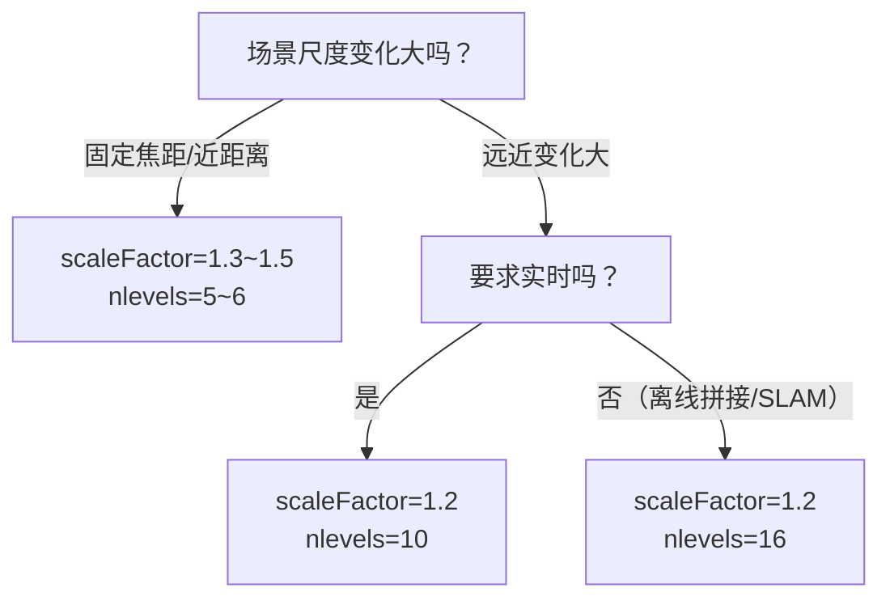

# ORB 调参技巧

## ① nfeatures：核心数量参数

**默认 500**。按场景选：

| 场景 | nfeatures |
|---|---|
| 快速模板匹配、简单识别 | 300~500 |
| **通用场景（默认）** | **500~1000** |
| 图像拼接 | 1000~2000 |
| ORB-SLAM2（单目） | 1000~2000（按帧） |
| ORB-SLAM3（关键帧） | 2000~3000 |
| 大图/全景/三维重建 | 2000~5000 |

**心法**：匹配时间大致 O(N·M)，点数翻倍 → 匹配耗时翻 4 倍。从 500 开始试，不够再往上加。

## ② scaleFactor + nlevels：金字塔配置

### 两种典型组合

**组合 A：平衡型（默认）**
```python
scaleFactor=1.2, nlevels=8
# 覆盖尺度: 1.0 ~ 3.58 倍，速度好
```

**组合 B：大尺度范围**
```python
scaleFactor=1.2, nlevels=16
# 覆盖尺度: 1.0 ~ 15.4 倍，慢约 2 倍
```

**组合 C：速度优先**
```python
scaleFactor=1.414, nlevels=5
# 每层 √2 倍（倍频），共 5 层覆盖到 4 倍尺度，极快
```

### 选择决策树



## ③ fastThreshold：角点灵敏度

| 场景 | fastThreshold |
|---|---|
| 低光/夜景/低对比 | 8~15 |
| **默认** | **20** |
| 光照好/高对比/要更稳的点 | 25~30 |
| 只想要最强点 | 40~50 |

阈值越小，角点越多但越容易出噪声点；阈值越大，角点越少但越稳定。

## ④ scoreType：HARRIS_SCORE vs FAST_SCORE

| 模式 | 效果 | 速度 |
|---|---|---|
| **ORB_HARRIS_SCORE**（默认） | 用 Harris 响应排序，点分布更均匀、更可靠 | 略慢 |
| ORB_FAST_SCORE | 直接用 FAST 响应排序，快一点 | 点质量略差，扎堆 |

**建议**：默认 HARRIS_SCORE；**嵌入式/极致速度**才切到 FAST_SCORE。

## ⑤ patchSize 与 edgeThreshold

这两个参数基本要成对设置：

| patchSize | edgeThreshold | 适用 |
|---|---|---|
| 31（默认） | 31 | 通用 |
| 21 | 21 | 小图、近距离 |
| 15 | 15 | 小模板（<100px） |
| 41 | 41 | 大尺度、要更鲁棒的描述 |

**注意**：patchSize 必须是奇数（保证中心对称）。

## ⑥ WTA_K：每次比较几个点

| WTA_K | 描述子长度 | 距离类型 | 效果 |
|---|---|---|---|
| 2（默认） | 256 bit = 32 B | NORM_HAMMING | 通用、信息量最大 |
| 3 | 256 bit = 32 B（每 2 bit 存一个结果） | NORM_HAMMING2 | 区分度略高，但匹配慢一点 |
| 4 | 256 bit = 32 B | NORM_HAMMING2 | 区分度再高一点 |

**实战建议**：**保持默认 2**。3/4 的收益很小但实现麻烦，OpenCV 3.x/4.x 对它们的 support 也不如 2 稳定。

## ⑦ 匹配阶段参数

### 7.1 BFMatcher 参数

```python
# 标准选择
bf = cv2.BFMatcher(cv2.NORM_HAMMING, crossCheck=False)

# crossCheck=True：精度高、速度翻倍（适合点数<500）
bf = cv2.BFMatcher(cv2.NORM_HAMMING, crossCheck=True)
```

### 7.2 ratio test 阈值

```python
good = [m for m, n in knn_matches if m.distance < ratio * n.distance]
```

| ratio | 场景 |
|---|---|
| 0.6~0.65 | 严格（重复纹理、低质量图） |
| **0.75** | **经典值** |
| 0.8 | 宽松（纹理弱、图清晰） |

### 7.3 Hamming 距离绝对阈值（可选）

除了 ratio test，可以再加一个"绝对距离阈值"把太远的点对直接去掉：
```python
MAX_HAMMING = 64  # 256 bit 里，最多允许 64 位不同
good = [m for m, n in knn_matches
        if m.distance < 0.75 * n.distance and m.distance < MAX_HAMMING]
```

## ⑧ 典型场景参数模板

### 模板 A：实时 AR / SLAM（ORB-SLAM 风格）
```python
orb = cv2.ORB_create(
    nfeatures=1200,
    scaleFactor=1.2,
    nlevels=8,
    edgeThreshold=31,
    firstLevel=0,
    WTA_K=2,
    scoreType=cv2.ORB_HARRIS_SCORE,
    patchSize=31,
    fastThreshold=20
)
# 匹配：BF + ratio test(0.75) + RANSAC(fundamentalMat)
```

### 模板 B：图像拼接（稳）
```python
orb = cv2.ORB_create(
    nfeatures=2000,
    scaleFactor=1.2,
    nlevels=12,
    patchSize=31,
    fastThreshold=15
)
# 匹配：BF + ratio test(0.7) + RANSAC(findHomography, 5.0)
```

### 模板 C：移动端/嵌入式（快）
```python
orb = cv2.ORB_create(
    nfeatures=500,
    scaleFactor=1.414,
    nlevels=5,
    edgeThreshold=21,
    patchSize=21,
    fastThreshold=25,
    scoreType=cv2.ORB_FAST_SCORE
)
# 匹配：BF(crossCheck=True)，不做 ratio test，直接用
```

### 模板 D：低光照/夜景
```python
orb = cv2.ORB_create(
    nfeatures=2000,
    fastThreshold=8,      # 低阈值找更多弱角点
    scaleFactor=1.2,
    nlevels=10
)
# 先做 CLAHE 再提 ORB 效果更好：
# clahe = cv2.createCLAHE(2.0, (8,8))
# img = clahe.apply(img)
```

## ⑨ 与 SIFT/SURF/AKAZE 选型表

| 需求 | 选谁 |
|---|---|
| **商业闭源、实时、移动端** | ✅ ORB |
| **SLAM（ORB-SLAM 生态）** | ✅ ORB |
| 高精度、离线、不缺算力 | SIFT（专利过期） |
| 非线性形变（强旋转/模糊） | AKAZE |
| 嵌入式 30fps 以上 | ✅ ORB（调小 nfeatures/patchSize） |
| 大视角/强光照 | 深度学习方法（SuperPoint/LoFTR） |
| 教学演示（简单好懂） | ✅ ORB |
| 工业流水线固定场景 | ✅ ORB（upright 思想 + 自定义 FAST 阈值） |

## ⑩ 常见组合套路

### 套路 1：标准物体识别流程
```python
orb = cv2.ORB_create(1000)
kp1, des1 = orb.detectAndCompute(img1, None)
kp2, des2 = orb.detectAndCompute(img2, None)
bf = cv2.BFMatcher(cv2.NORM_HAMMING)
knn = bf.knnMatch(des1, des2, k=2)
good = [m for m,n in knn if m.distance < 0.75*n.distance]
H, mask = cv2.findHomography(
    np.float32([kp1[m.queryIdx].pt for m in good]),
    np.float32([kp2[m.trainIdx].pt for m in good]),
    cv2.RANSAC, 5.0)
```

### 套路 2：CLAHE + ORB（低光场景）
```python
gray = cv2.cvtColor(img, cv2.COLOR_BGR2GRAY)
clahe = cv2.createCLAHE(clipLimit=2.0, tileGridSize=(8,8))
gray = clahe.apply(gray)
orb = cv2.ORB_create(1000, fastThreshold=10)
kp, des = orb.detectAndCompute(gray, None)
```

### 套路 3：格点均匀采样（类似 ORB-SLAM 的 quadtree 分配）
OpenCV ORB 已经内部做了按层分配；如果要更均匀，自己对图像做 grid，每个 cell 内强制保留若干点：
```python
# 把图分成 4×4 格，每格最多 20 个点（手工实现四叉树效果的简化版）
CELL = 4
per_cell = 20
cell_w, cell_h = W//CELL, H//CELL
selected = []
for cy in range(CELL):
    for cx in range(CELL):
        cell_kps = [p for p in kp
                    if cx*cell_w <= p.pt[0] < (cx+1)*cell_w
                    and cy*cell_h <= p.pt[1] < (cy+1)*cell_h]
        cell_kps.sort(key=lambda p: p.response, reverse=True)
        selected.extend(cell_kps[:per_cell])
```

## 速查表

| 参数 | 默认 | 推荐范围 |
|---|---|---|
| nfeatures | 500 | 500~3000 |
| scaleFactor | 1.2 | 1.15~1.5 |
| nlevels | 8 | 5~16 |
| edgeThreshold | 31 | 15~41（=patchSize） |
| WTA_K | 2 | 保持 2 |
| scoreType | HARRIS_SCORE | 保持默认 |
| patchSize | 31 | 15~41（奇数） |
| fastThreshold | 20 | 8~30 |
