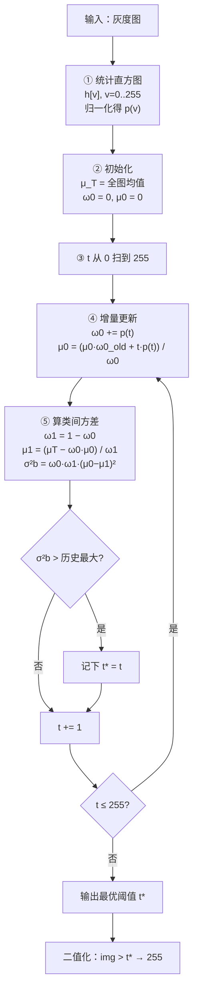
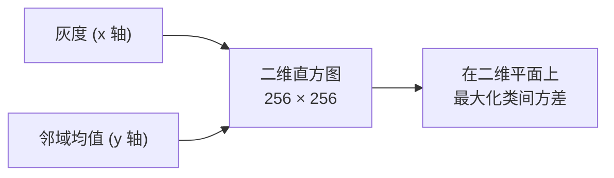

# Otsu 算法流程

> Otsu 的完整流程不到 30 行代码，但每一步的「为什么」都值得讲。这一页从管线图到可运行实现，给你三档代码。

## 完整管线



## 步骤拆解

| 步骤 | 做什么 | 关键点 |
|---|---|---|
| ① 直方图 | 统计每个灰度级像素数并归一化 | 一次遍历，$O(N)$ |
| ② 初始化 | 算全图均值 $\mu_T$（一次） | $\mu_T$ 只算一遍，是常数 |
| ③ 遍历阈值 | $t$ 从 0 到 255 | 只有 256 次 |
| ④ 增量更新 | 更新背景组的 $\omega_0, \mu_0$ | $O(1)$ 每步，靠前缀递推 |
| ⑤ 算类间方差 | 用 $\mu_1 = (\mu_T-\omega_0\mu_0)/\omega_1$ 快速求 | 避免重新遍历像素 |
| ⑥ 取最大 | 记录 $\arg\max\sigma_b^2$ | 平局时通常取最小 $t$ |

::: tip 为什么 $\mu_1$ 不用重新算
因为全图均值是固定的：$\mu_T = \omega_0\mu_0 + \omega_1\mu_1$。所以

$$\mu_1 = \frac{\mu_T - \omega_0 \mu_0}{1-\omega_0}$$

一个减法一次除法就够，不必再遍历前景像素。这是 Otsu 快的核心原因之一。
:::

## Numpy 手写（20 行，完整可运行）

```python
import numpy as np
import cv2

def otsu_manual(gray):
    """纯 Numpy 手写 Otsu，返回最优阈值与二值图"""
    hist = cv2.calcHist([gray], [0], None, [256], [0, 256]).ravel()
    total = gray.size
    p = hist / total                            # 归一化直方图

    mu_T = np.sum(np.arange(256) * p)           # 全图均值（常数）

    omega0 = 0.0
    mu0 = 0.0
    best_t, best_var = 0, -1.0

    for t in range(256):
        omega0 += p[t]                          # 背景占比增量更新
        if omega0 == 0:
            continue
        omega1 = 1.0 - omega0
        if omega1 == 0:
            break

        mu0 = (mu0 * (omega0 - p[t]) + t * p[t]) / omega0   # 背景均值增量
        mu1 = (mu_T - omega0 * mu0) / omega1                # 前景均值

        var_between = omega0 * omega1 * (mu0 - mu1) ** 2    # 类间方差
        if var_between > best_var:
            best_var, best_t = var_between, t

    binary = np.where(gray > best_t, 255, 0).astype(np.uint8)
    return best_t, binary
```

## OpenCV 一行版（生产用）

```python
import cv2

# 注意：阈值参数传 0（占位），真正的阈值由 THRESH_OTSU 标志自动算
th, binary = cv2.threshold(gray, 0, 255, cv2.THRESH_BINARY + cv2.THRESH_OTSU)
print("Otsu 自动阈值 =", th)
```

## 五种阈值类型与 Otsu 的组合

`THRESH_OTSU` 可以和五种基础类型组合：

| 类型 | 行为 |
|---|---|
| `THRESH_BINARY` + OTSU | 像素 > $t^*$ → 255，否则 0（最常用） |
| `THRESH_BINARY_INV` + OTSU | 反转：>$t^*$ → 0，否则 255 |
| `THRESH_TRUNC` + OTSU | 大于 $t^*$ 的截断为 $t^*$ |
| `THRESH_TOZERO` + OTSU | 小于 $t^*$ 的置 0 |
| `THRESH_TOZERO_INV` + OTSU | 大于 $t^*$ 的置 0 |

## 扩展一：多阈值 Otsu（三分类以上）

把「切一刀」扩展成「切多刀」，遍历 $O(256^k)$（$k$ 个阈值）。工程上一般用**递归二分**：

```python
def otsu_multi(gray, levels=3):
    """递归二分：先切一刀，再对每类各切一刀"""
    if levels <= 1:
        return []
    t, _ = cv2.threshold(gray, 0, 255, cv2.THRESH_BINARY + cv2.THRESH_OTSU)
    lo = gray[gray <= t]
    hi = gray[gray > t]
    ts = [t]
    if lo.size > 100:
        t2, _ = cv2.threshold(lo, 0, 255, cv2.THRESH_BINARY + cv2.THRESH_OTSU)
        ts.append(t2)
    if hi.size > 100:
        t3, _ = cv2.threshold(hi, 0, 255, cv2.THRESH_BINARY + cv2.THRESH_OTSU)
        ts.append(t3)
    return sorted(ts)
```

## 扩展二：二维 Otsu（加入空间信息）

普通 Otsu 只看灰度，**二维 Otsu 同时看「灰度」和「邻域均值」**，构造二维直方图（$256\times256$），在二维平面上找最优划分。好处是抗噪，坏处是慢（工程上常用降采样版本）。



## 与其他阈值法的对比

| 方法 | 自动 | 空间信息 | 光照不均 | 速度 |
|---|---|---|---|---|
| 固定阈值 | ❌ | ❌ | ❌ | 最快 |
| **Otsu** | ✅ | ❌ | ❌ | 很快 |
| 三角法 | ✅ | ❌ | ❌ | 很快 |
| 自适应阈值 | ✅ | ✅（局部窗口） | ✅ | 中 |
| 2D Otsu | ✅ | ✅ | 一般 | 慢 |

**选择口诀**：

> 光照均匀 → **Otsu**；光照不均 → **自适应阈值**；只有单峰 → **三角法/固定阈值**。

[← 上一篇：核心概念](./concepts) · [下一篇：源码走读 →](./source)
