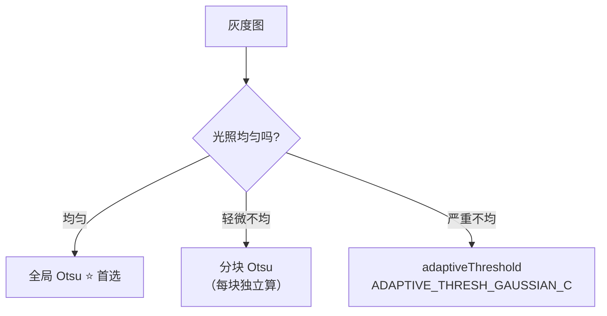
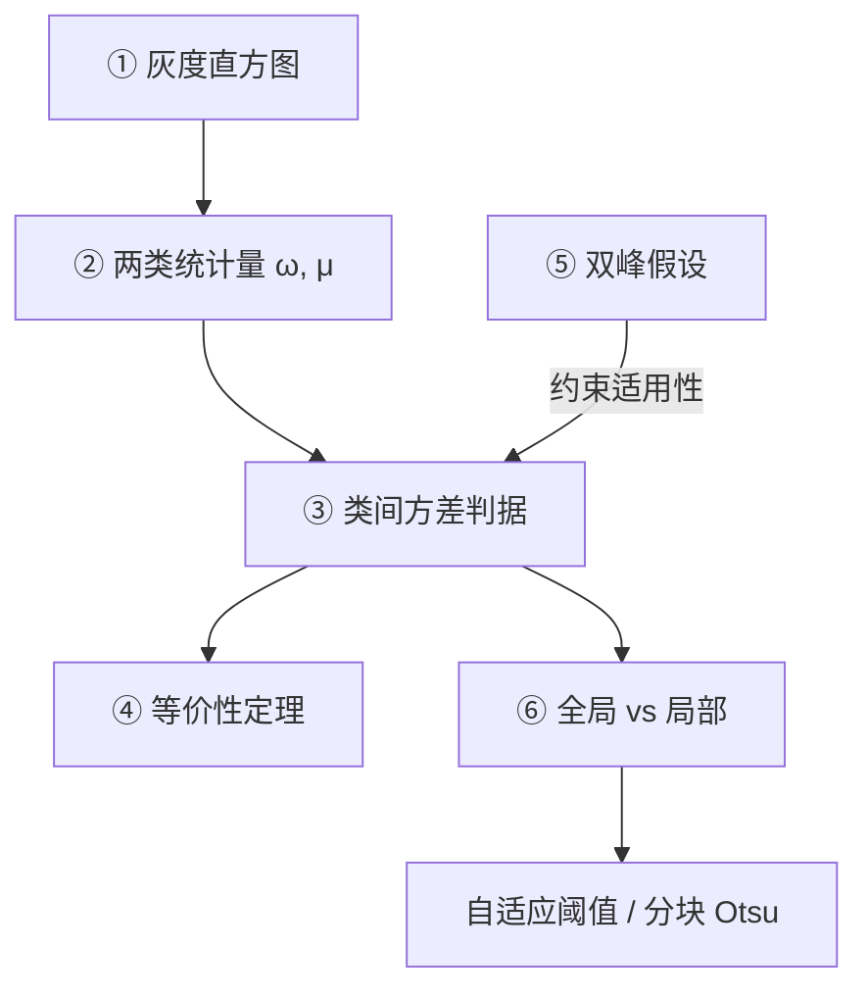

# Otsu 核心概念

> Otsu 的全部数学可以压缩成一句话和一个公式。这一页把这句话和这个公式拆到透明。

## Concept 1：灰度直方图是出发点

**一句话**：把每个亮度值有多少个像素数出来，得到一张柱状图——Otsu 只依赖这张图，不依赖像素的空间位置。

**通俗版**：不看你人站在哪，只统计「全场有多少高个、多少矮个」。

**公式**：

$$
h(v) = \#\{(x,y) \mid I(x,y) = v\}, \quad v = 0,1,\dots,255
$$

**三个要点**：

- Otsu **只看直方图**，所以它天然**丢失空间信息**（这也解释了为什么会受光照不均影响）
- 直方图形状决定 Otsu 成败：**双峰清晰 → 很好；单峰/平坦 → 很差**
- 直方图统计是 $O(N)$ 一次遍历，便宜

**对应本体实体**：`op-histogram`

## Concept 2：两类统计量（占比与均值）

**一句话**：阈值 $t$ 把像素分两组，每组算两个数——「占多大比例」和「平均灰度多少」。

**符号定义**：

$$
\omega_0(t) = \sum_{v=0}^{t} p(v),
\qquad
\omega_1(t) = \sum_{v=t+1}^{255} p(v) = 1 - \omega_0(t)
$$

$$
\mu_0(t) = \frac{\sum_{v=0}^{t} v\, p(v)}{\omega_0(t)},
\qquad
\mu_1(t) = \frac{\sum_{v=t+1}^{255} v\, p(v)}{\omega_1(t)}
$$

其中 $p(v) = h(v)/N$ 是归一化直方图。

**通俗版**：

- $\omega_0, \omega_1$ = 两组「人数占比」
- $\mu_0, \mu_1$ = 两组「平均身高」

**对应本体实体**：`concept-otsu-threshold`

## Concept 3：类间方差判据（核心）

**一句话**：用两组的「占比之积」乘「均值之差的平方」，越大说明这个阈值分得越好。

$$
\sigma_b^2(t) = \omega_0(t)\,\omega_1(t)\,\bigl[\mu_0(t) - \mu_1(t)\bigr]^2
$$

**两项的物理意义**：

| 因子 | 什么时候大 | 含义 |
|---|---|---|
| $\lvert\mu_0-\mu_1\rvert$ | 两组中心离得远 | **分得开** |
| $\omega_0\omega_1$ | 两组都有足够像素 | **分得均衡** |

**为什么两者都重要**：

- 只看均值差 → 可能把阈值推到极端（比如只要 1 个像素当前景，均值差也可能很大），这就是「面积悬殊时会偏移」
- 乘上占比之积 → 惩罚「一组几乎没有像素」的划分，$\omega_0\omega_1$ 在两组各占一半时最大（$\le 0.25$）

**对应本体实体**：`concept-otsu-threshold`

## Concept 4：等价性定理（为什么可以用它）

**一句话**：类间方差最大 = 类内方差最小 = 两组各自最「齐整」，三者是同一件事。

**公式**：

$$
\sigma_T^2 = \sigma_b^2(t) + \sigma_w^2(t)
$$

其中 $\sigma_T^2$ 是**全图方差**（与 $t$ 无关的常数），$\sigma_w^2$ 是类内方差。

**推论**：

$$
\arg\max_t \sigma_b^2(t) = \arg\min_t \sigma_w^2(t)
$$

**为什么选类间方差**：

- $\sigma_w^2$ 要分别算两组的内部散度，计算量大
- $\sigma_b^2$ 只需两组的**均值**，计算量小
- 两者等价 → 当然选好算的

::: tip 与聚类的联系
$\arg\max \sigma_b^2$ 恰好是「把一维数据分成 2 类、组内平方和最小」的解——这正是 **2-means 聚类**在二维以下的最优解。所以 Otsu = **全局最优的一维 2-means**，只是它用直方图直接枚举，保证找到全局最优而非局部最优。
:::

## Concept 5：双峰假设（Otsu 的命门）

**一句话**：Otsu 隐含假设「前景和背景各对应一个灰度峰」，直方图双峰时最灵，其他形状就不可靠。

**三种直方图下的表现**：

| 直方图形状 | Otsu 表现 | 原因 |
|---|---|---|
| **双峰明显** | ⭐⭐⭐⭐⭐ 接近完美 | 阈值落在谷底，正好分开两峰 |
| **单峰** | ⭐ 很差 | 没有真正的两类可分，会硬切一刀 |
| **多峰** | ⭐⭐ 一般 | 只能切一刀，多个目标分不干净 |
| **峰不明显（平坦）** | ⭐ 很差 | 类间方差曲线平坦，$t^*$ 随机性大 |

**判断方法（工程第一步）**：

```python
import cv2, numpy as np
hist = cv2.calcHist([gray], [0], None, [256], [0, 256]).ravel()
# 看形状：双峰 → 放心用 Otsu；单峰 → 换方法
```

**对应本体实体**：`concept-otsu-threshold`

## Concept 6：全局 vs 局部（Otsu 的边界）

**一句话**：Otsu 给**一个**阈值给整张图；一旦光照不均，就该分成小块各自 Otsu，或改用自适应阈值。

| 方法 | 阈值数量 | 适用 |
|---|---|---|
| Otsu（全局） | 1 个 | 光照均匀、前景背景分明 |
| 分块 Otsu | 每块 1 个 | 轻度光照渐变 |
| 自适应阈值（局部均值/高斯） | 每像素 1 个 | 强光照不均、文档阴影 |



## 概念之间的关系



**逻辑链**：

1. 从直方图出发（丢掉空间信息）→
2. 两个阈值对应的占比与均值 →
3. 类间方差判据 →
4. 等价性定理保证「最大化类间 = 最小化类内」→
5. 双峰假设划出适用范围 →
6. 超出范围就局部化（自适应阈值）。

## 本体实例映射

```yaml
- id: algo-otsu
  type: Algorithm
  concepts:
    - "concept-otsu-threshold"
    - "concept-histogram"
  dependsOn:
    - "op-histogram"
  replacedBy:
    - "algo-adaptive-threshold"
```

[← 返回 Otsu 总览](./) · [下一篇：算法流程 →](./architecture)
