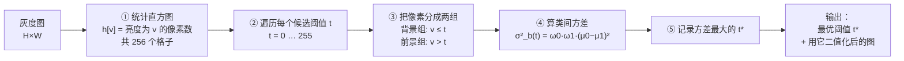
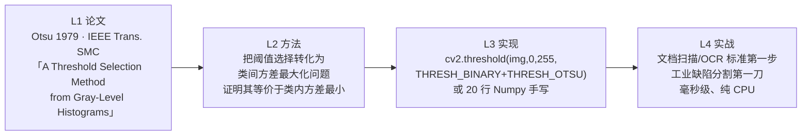
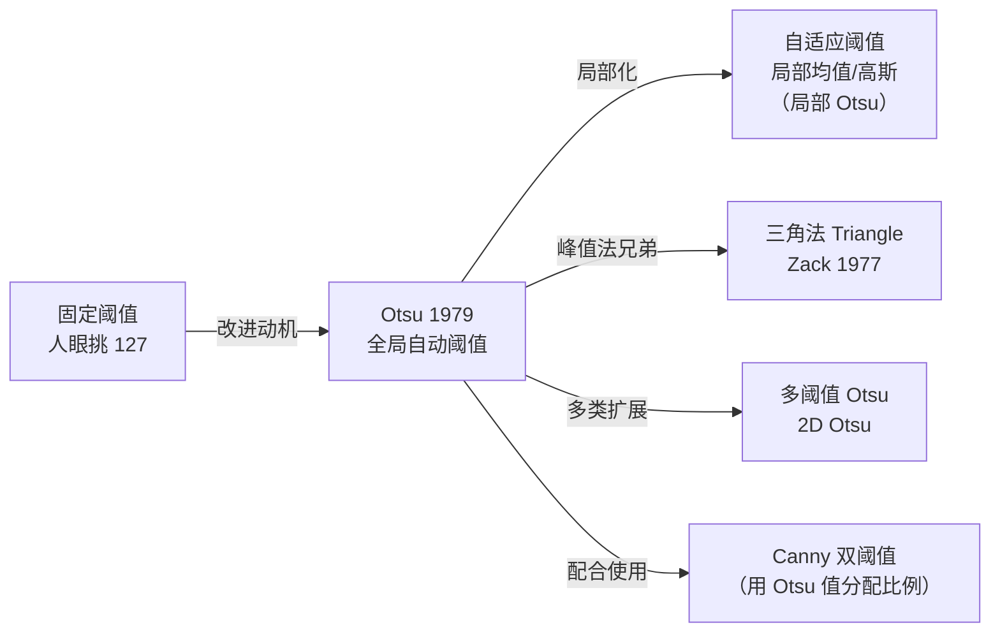

# Otsu 大津阈值法

<AlgorithmCard
  name="Otsu 大津阈值法"
  en-name="Otsu's Method"
  chapter="第3章 · 图像预处理"  chapterLink="/chapters/ch03-preprocessing"
  branch="图像处理 · 阈值分割族"
  year="1979"
  author="Nobuyuki Otsu（大津展之）"
  paper="https://doi.org/10.1109/TSMC.1979.4310076"
  level="低层"
  tagline="不用人眼看、不用手调阈值的「自动黑白分界线」"
  analogy="像给一群高矮不一的人自动划一条「高个线」：试遍所有可能的高度，找那条让「高个组」和「矮个组」各自最齐整、两组之间差得最开的线——那就是最不冤枉人的分界。"
  scene="文档扫描二值化（黑白化）、工业零件/缺陷分割的第一刀、车牌与字符分割、细胞与菌落计数、硬币/零件计数、OCR 前的预处理、几乎任何「前景背景分明」的二值化任务。"
  :pros="[
    '全自动：不用手调阈值，换张图照样能自己算出来',
    '极快：只需一次直方图统计 + 遍历 256 个候选阈值，O(L) 复杂度',
    '有明确数学目标（类间方差最大），结果可解释、可复现',
    '几十行代码就能手写，任何硬件都能跑，不依赖任何库',
    '是文档扫描、工业分割、OCR 链条上事实上的标准第一步'
  ]"
  :cons="[
    '假设直方图是双峰——单峰、多峰、峰不明显时表现会明显变差',
    '只给一个全局阈值，光照不均、有阴影的图上会「一边过曝一边欠曝」',
    '前景/背景面积悬殊时（如小缺陷）阈值会向大面积一侧偏移',
    '忽略空间信息，纯靠灰度统计，对噪声敏感',
    '不做任何形态学处理的话，二值结果会带毛刺和孔洞'
  ]"
/>

## TL;DR

**一句话**：把图像灰度做成直方图，**遍历每一个可能的阈值 $t$**，计算「用 $t$ 把像素分成前景/背景两组后，两组的类间方差」，**选那个让类间方差最大的 $t$** 就是最优阈值。

**解决**：二值化时「阈值只能靠人眼反复试」的问题——把阈值选择变成一个**有明确数学目标的优化问题**。

**代价**：假设直方图双峰（单峰/多峰会失效）、只给全局阈值（对光照不均敏感）、面积悬殊时会偏移。

**前置阅读**：[💡 核心概念](./concepts) → [🌿 图像处理分支 · 阈值分割](/branches/image-processing/thresholding) → [🧱 算子词典 · 直方图](/operators/histogram)

## 3 分钟电梯演讲

**一句话流程**：**统计直方图 → 试遍所有阈值 → 选类间方差最大的那个**。没有迭代、没有训练、没有参数。

## 四层闭环视图

## 核心贡献一览

| 贡献 | 一句话 | 代码落点 |
|---|---|---|
| 把阈值问题变成优化问题 | 阈值不再是「试试看」，而是有目标可解 | 遍历 `t` 求 `argmax` |
| 类间方差判据 | $\sigma_b^2(t)=\omega_0\omega_1(\mu_0-\mu_1)^2$ | 见[算法流程](./architecture) |
| 等价性证明 | 类间方差最大 ⟺ 类内方差最小 ⟺ 总方差−类间方差最小 | 论文核心定理 |
| O(L) 算法 | 一次直方图统计即可，无需遍历图像每个像素 | `cv2.calcHist` + 前缀和 |
| 多阈值自然扩展 | 同一目标可推广到多个阈值（多类分割） | 工程上用 2D Otsu |

## 📖 档案目录

| 页面 | 内容 |
|---|---|
| [论文精读](./paper) | Otsu 1979 论文精读：为什么要用方差、等价性定理怎么证 |
| [核心概念](./concepts) | 直方图、类间/类内方差、判据推导、双峰假设、与其他阈值法对比 |
| [算法流程](./architecture) | 完整管线 + Numpy 手写 20 行 + OpenCV API + 多阈值扩展 |
| [源码走读](./source) | OpenCV 调用 / 手写增量版 / 缺陷检测与文档扫描工业案例 |
| [实战与踩坑](./painpoints) | 单峰失效、光照不均、面积悬殊、噪点等 10 个坑 |
| [调参技巧](./tricks) | 预处理配方、分块 Otsu、与自适应阈值/分位数法的选择 |

## 它在阈值家族里的位置

**一句话定位**：Otsu 是**「全局自动阈值」这条线的代表**。只要你的图「前景背景灰度分明、光照基本均匀」，Otsu 几乎是免费的最优解。一旦光照不均，就该往右走，用**局部/自适应阈值**。

[算子词典](/operators/) · [场景反查](/scenarios/) · [版本总览](/versions/) · [图像处理分支](/branches/image-processing/)

---

## 🚀 动手体验（浏览器里直接玩，不用装环境）

> 下面这些组件都在**你的浏览器本地运行**，不上传任何图片、也不用安装 OpenCV 或写代码。

### 🧪 先懂原理：阈值分割到底在算什么

拖动滑块，看数学是怎么一步步变成图像的——纯 Canvas 绘制，秒开。

<ClientOnly>
  <MathVisualizer initial-tab="thresh" compact />
</ClientOnly>

### 🎮 再跑真机：在浏览器里真跑 Otsu 大津阈值法

换成你自己的照片也行；下面还会**实时生成**对应的 Python / C++ / JavaScript 代码，拖参数时代码同步更新。

<ClientOnly>
  <OpencvPlayground initial-algo="threshold" compact />
</ClientOnly>

> 想换示例图、上传自己的照片、或切换别的算法？去 [🎮 真机实验室](/playgrounds/)；想看完整的 14 个数学原理互动？去 [🧪 原理实验室](/math-lab/)。
