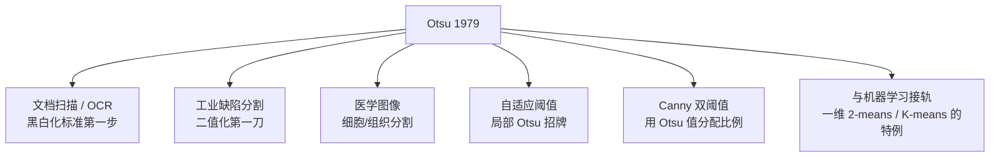

# Otsu 大津阈值法 · 论文精读

> 1979 年，日本学者 **大津展之（Nobuyuki Otsu）** 在 IEEE Trans. on Systems, Man, and Cybernetics 上发表了一篇仅 8 页的论文，给出了「自动选阈值」的一个优雅解。这篇论文被引用超过 25000 次，至今仍是图像二值化的默认答案。

## 论文名片

| 项 | 内容 |
|---|---|
| 标题 | *A Threshold Selection Method from Gray-Level Histograms* |
| 作者 | Nobuyuki Otsu |
| 年份 | 1979 |
| 出处 | IEEE Trans. Systems, Man, and Cybernetics, Vol. 9, No. 1 |
| DOI | 10.1109/TSMC.1979.4310076 |
| 本体 ID | `paper-otsu-1979` |
| 引用量级 | 25,000+ |
| 阅读状态 | deep-read |

## 一、当时的问题：阈值到底怎么定？

二值化（把灰度图变成黑白图）是最古老也最常用的图像处理操作：**灰度 > 阈值 → 白（前景），反之 → 黑（背景）**。

问题是——**阈值该取多少？**

1979 年之前的做法：

| 做法 | 问题 |
|---|---|
| 人工设一个常见值（如 127） | 换张图就不对了，全凭经验 |
| 迭代法（Iterative Selection） | 依赖初值，收敛慢，可能收敛到局部 |
| 基于直方图谷底 | 只能处理「谷底清晰」的双峰图，噪声下谷底找不到 |
| 基于最小误差 | 需要假设概率分布形式（正态），不一定成立 |

大津的核心洞察是：**别去猜分布形状，也别去找谷底——直接找一个「让前景和背景分得最开」的阈值。**

## 二、核心贡献（三条）

### 贡献 1：把「分得好不好」量化成类间方差

设阈值为 $t$，把所有像素分成两组：

| 组 | 灰度范围 | 像素占比 | 平均灰度 |
|---|---|---|---|
| 背景（C₀） | $v \le t$ | $\omega_0$ | $\mu_0$ |
| 前景（C₁） | $v > t$ | $\omega_1 = 1-\omega_0$ | $\mu_1$ |

定义**类间方差（between-class variance）**：

$$
\sigma_b^2(t) = \omega_0(t)\,\omega_1(t)\,\bigl[\mu_0(t) - \mu_1(t)\bigr]^2
$$

**直观理解**：这个式子包含两个「越大越好」的因子——

1. $\lvert\mu_0 - \mu_1\rvert$ 大 → 两组的灰度中心离得远 → **分得开**
2. $\omega_0\omega_1$ 大 → 两组都有足够多的像素 → **分得均衡**

两者乘积最大，就是「既分得开、又不偏心」的阈值。

### 贡献 2：证明等价性（论文的核心定理）

大津进一步证明了三个目标是**等价的**：

$$
\sigma_b^2(t) \text{ 最大}
\iff
\sigma_w^2(t) \text{（类内方差）最小}
\iff
\text{总方差} - \sigma_b^2(t) \text{ 最小}
$$

因为**总方差 $\sigma_T^2$ 与阈值无关**（它是全图常数），所以：

$$
\sigma_b^2 + \sigma_w^2 = \sigma_T^2 = \text{常数}
$$

**这意味着**：最大化类间方差 = 最小化类内方差 = 让两组各自的「内部离散程度」最小。三种说法描述的是同一件事，而**类间方差最好算**（只需各组均值），所以用它。

::: tip 一句话记住
Otsu 的目标就是：**让「组间差」最大，同时「组内差」最小**——正好是聚类里「好的划分」的定义，所以 Otsu 本质上是**一维 2-means 聚类的全局最优解**。
:::

### 贡献 3：O(L) 高效算法

朴素做法要对每个 $t$ 重新遍历所有像素（$O(L \cdot N)$）。大津给出了**增量递推**：

用直方图 $h(v)$ 先算前缀和，然后从 $t=0$ 开始，每把阈值右移一格，只需 $O(1)$ 更新 $\omega_0, \mu_0$：

$$
\omega_0(t) = \omega_0(t-1) + \frac{h(t)}{N},
\qquad
\mu_0(t) = \frac{\mu_0(t-1)\,\omega_0(t-1) + t\cdot h(t)/N}{\omega_0(t)}
$$

最终**只需一次直方图统计 + 一遍 256 次循环**，复杂度 $O(L + 256)$，与图像大小基本无关。这是 Otsu 能进实时系统的关键。

## 三、局限性（论文也承认）

| 局限 | 说明 | 后来谁补上了 |
|---|---|---|
| 双峰假设 | 直方图单峰/多峰时失效 | 三角法、多阈值 Otsu |
| 全局唯一阈值 | 光照不均会失灵 | 自适应/局部阈值 |
| 面积敏感 | 前景远小于背景时阈值偏移 | 加权 Otsu、局部 Otsu |
| 无空间信息 | 纯统计，不看邻域 | 2D Otsu（加入邻域均值） |
| 无抗噪机制 | 椒盐噪声直接影响直方图 | 先中值滤波 |

## 四、对后世的影响

**它为什么这么长寿**：因为它找到了一个**「不用假设、不用训练、有闭式解、能实时跑」的阈值**。在一个被各种「调参玄学」折磨的领域里，一个「自动、且结果可复现」的方法就是奢侈品。

## 五、论文里值得抄的一句话

> 原文思想（意译）：**「阈值的优劣，应当由它把图像分成两类的『可分性』来衡量，而不是由任何先验的分布假设决定。」**

这句话是整篇论文的灵魂——**把阈值选择从「猜分布」解放为「做优化」**。今天你写 `cv2.threshold(..., THRESH_OTSU)` 时，背后就是这句 1979 年的洞察。

[← 返回 Otsu 总览](./) · [下一篇：核心概念 →](./concepts)
