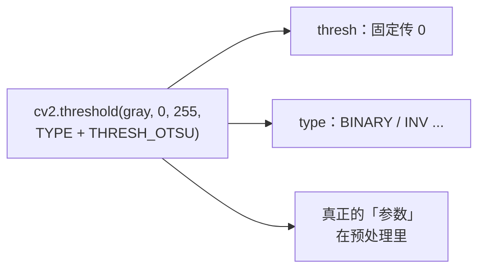
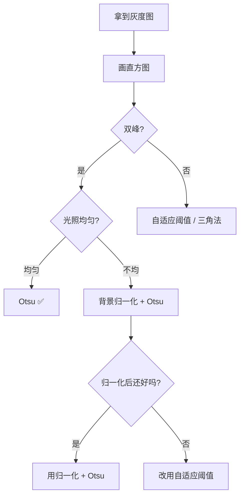

# Otsu 调参技巧

> Otsu 几乎没有「参数」——它自己算阈值。真正的技巧在于**怎么让它的假设成立**：光照、噪声、面积比。

## 参数总览



**关键认知**：Otsu 的调参 = **预处理调参**。灰度怎么来的、去噪没去噪、光照平不平，决定了 Otsu 的成败。

## 技巧 1：三步预处理配方（万能开头）

```python
def otsu_pipeline(gray):
    # ① 去噪
    gray = cv2.medianBlur(gray, 3)
    # ② 光照归一化
    bg = cv2.morphologyEx(gray, cv2.MORPH_CLOSE,
                          cv2.getStructuringElement(cv2.MORPH_ELLIPSE, (25, 25)))
    norm = cv2.divide(gray, bg, scale=255)
    # ③ Otsu
    th, bw = cv2.threshold(norm, 0, 255, cv2.THRESH_BINARY + cv2.THRESH_OTSU)
    return th, bw
```

**覆盖面**：工业表面、文档、零件——80% 的二值化任务用这个开头都不会太差。

## 技巧 2：先看直方图，再决定用不用 Otsu

```python
import matplotlib.pyplot as plt
plt.hist(gray.ravel(), bins=256, range=(0, 256))
```

| 你看到的形状 | 决定 |
|---|---|
| 两个清晰峰 | ✅ 直接用 Otsu |
| 一个大峰 + 小尾巴 | ⚠️ 用三角法或固定阈值 |
| 单峰，无分离 | ❌ 别用阈值法，换思路 |
| 多峰 | ⚠️ 递归二分 / 多阈值 |

## 技巧 3：光照不均的三种解法（按推荐度）

| 解法 | 代码 | 优点 | 代价 |
|---|---|---|---|
| **背景归一化** | `divide(gray, bg)` | 保留全局 Otsu、快 | 核大小要匹配目标尺度 |
| **分块 Otsu** | 每 128×128 独立算 | 简单直接 | 块边界可能不连续 |
| **自适应阈值** | `adaptiveThreshold` | 最强适应 | 参数多、稍慢 |

::: tip 背景归一化的核怎么定
核的大小要**大于目标、小于光照变化尺度**。一般取目标尺寸的 1.5-3 倍。选小了会把目标本身当背景抹掉，选大了起不到归一化作用。
:::

## 技巧 4：面积悬殊 → 局部 + 面积过滤

```python
def small_defect_pipeline(gray):
    denoised = cv2.medianBlur(gray, 3)
    th, bw = cv2.threshold(denoised, 0, 255,
                           cv2.THRESH_BINARY_INV + cv2.THRESH_OTSU)
    # 面积过滤：只留合理大小的缺陷
    n, labels, stats, _ = cv2.connectedComponentsWithStats(bw)
    mask = np.zeros_like(bw)
    for i in range(1, n):
        area = stats[i, cv2.CC_STAT_AREA]
        if 20 < area < 5000:
            mask[labels == i] = 255
    return mask
```

## 技巧 5：Otsu 值当 Canny 阈值（隐藏福利）

```python
blur = cv2.GaussianBlur(gray, (5, 5), 1.4)
t, _ = cv2.threshold(blur, 0, 255, cv2.THRESH_BINARY + cv2.THRESH_OTSU)
edges = cv2.Canny(blur, int(t * 0.4), int(t))   # Otsu 值作高阈值
```

**为什么好用**：Otsu 值反映了「边缘幅度的自然分界」，比拍脑袋的 50/150 更有依据。

## 技巧 6：5 个场景抄作业参数表

| 场景 | 预处理 | 阈值类型 | 后处理 | 说明 |
|---|---|---|---|---|
| **文档扫描** | 中值滤波 + 背景归一化 | BINARY + OTSU | 开运算去噪 | 光照不均必做归一化 |
| **工业零件分割** | 高斯 (3,3) | BINARY + OTSU | 闭运算填洞 | 光照稳定，可省归一化 |
| **小缺陷检测** | 中值滤波 | BINARY_INV + OTSU | 连通域面积过滤 | 面积极悬殊，务必过滤 |
| **车牌字符** | 高斯 + 形态学 | BINARY_INV + OTSU | 开运算去细噪 | 车牌光照不均，配归一化 |
| **细胞计数** | 高斯 (5,5) | BINARY_INV + OTSU | 分水岭 | Otsu 只做初分割 |

## 技巧 7：判断是否需要「放弃 Otsu」



## 技巧 8：参数速查（cv2 相关）

| 场景 | `adaptiveThreshold` 参数建议 |
|---|---|
| 文档（文字粗） | `blockSize=31, C=10` |
| 文档（文字细） | `blockSize=15, C=5` |
| 工业表面 | `blockSize=51, C=15` |
| 高噪图 | `blockSize` 调大 + 先去噪 |

## 调参顺序建议

1. **先画直方图** → 判断能不能用 Otsu
2. **去噪**（中值优先）
3. **光照归一化**（不均时）
4. **跑 Otsu，看阈值是否合理**
5. **接形态学**清理二值结果
6. **面积/形状过滤** → 拿到最终目标
7. 还不行 → 换**自适应阈值**或**局部 Otsu**

## 一句话口诀

> **Otsu 不用调阈值，调到的是预处理；先看直方图双峰，光照不均先归一。**

[← 上一篇：实战与踩坑](./painpoints) · [返回总览](./)
