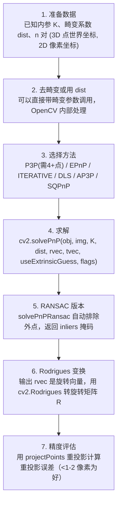

# PnP 位姿估计 · 算法流程

<AlgorithmCard
  name="PnP 位姿估计"
  enName="Perspective-n-Point"
  chapter="ch-14-3d-vision"
  branch="geometry"
  year="1841/2009(EPnP)"
  author="Grunert / Lepetit(EPnP)"
  paper="—"
  level="advanced"
  tagline="已知几个 3D 点和它们在图上的位置，反推出相机在哪里看——AR 和机器人抓取的基石"
  analogy="你站在房间里，认出了墙上的钟、桌上的杯子、书架上的花盆——这三个东西真实位置你知道，就能反推出自己站在房间的什么地方、朝什么方向看"
  scene="AR 标记跟踪、机械臂抓取、视觉伺服、无人机着陆、AR 虚拟物体叠加、SLAM 位姿求解"
  :pros='["最少 3 点可解(P3P)", "毫秒级", "RANSAC 鲁棒", "OpenCV 内置多种方法", "精度高"]'
  :cons='["需要已知内参", "3D 点精度要高", "点共面/共线退化", "对外点敏感", "单位易搞错"]'
/>

## 完整算法流程

PnP 位姿估计算法可以分解为以下关键步骤：

## 步骤详解

### 步骤 1：准备数据

已知内参 K、畸变系数 dist、n 对 (3D 点世界坐标, 2D 像素坐标)

### 步骤 2：去畸变或用 dist

可以直接带畸变参数调用，OpenCV 内部处理

### 步骤 3：选择方法

P3P(需4+点) / EPnP / ITERATIVE / DLS / AP3P / SQPnP

### 步骤 4：求解

cv2.solvePnP(obj, img, K, dist, rvec, tvec, useExtrinsicGuess, flags)

### 步骤 5：RANSAC 版本

solvePnPRansac 自动排除外点，返回 inliers 掩码

### 步骤 6：Rodrigues 变换

输出 rvec 是旋转向量，用 cv2.Rodrigues 转旋转矩阵 R

### 步骤 7：精度评估

用 projectPoints 重投影计算重投影误差（<1-2 像素为好）

## 在整体视觉 pipeline 中的位置

### 关键复杂度

| 维度 | 复杂度 |
|---|---|
| 时间 | 详见各实现 |
| 内存 | 与图像尺寸线性相关 |

