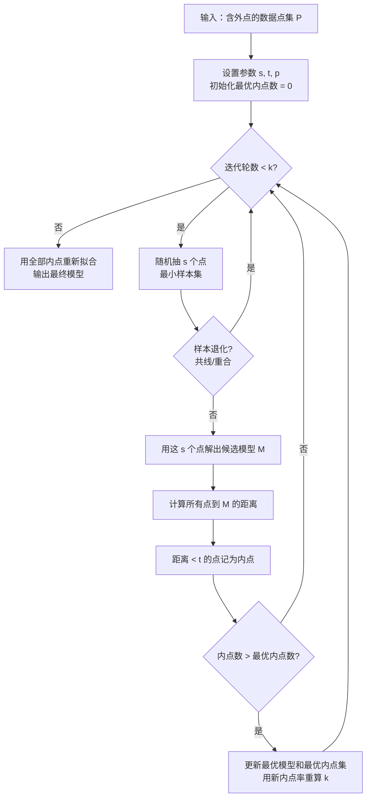

# 算法流程 · RANSAC

## 主流程图



## 六步拆解

### 第 1 步：设定参数并初始化

确定 $s$（最小样本数）、$t$（距离阈值）、$p$（目标成功概率，通常 0.99），并设初始迭代上限 $k = \infty$（自适应版本会动态收缩）。最优内点数置 0。

### 第 2 步：随机抽取最小样本集

从 $N$ 个点里**不放回**地随机抽 $s$ 个点。这一步的随机性由固定种子控制，保证可复现。

```python
idx = rng.choice(n, size=s, replace=False)
```

### 第 3 步：退化检查（关键但常被忽略）

抽到的 $s$ 个点可能无法确定唯一模型——两点重合、三点共线、四点共面等。**此时必须跳过本轮重抽**，否则会解出数值上爆炸的模型。

```python
if is_degenerate(sample_pts):   # 如三点共线
    continue
```

### 第 4 步：拟合候选模型

用这 $s$ 个点解出模型参数。不同模型的解法不同：直线用两点式、单应矩阵用 DLT（直接线性变换）、基础矩阵用 8 点法或 7 点法。

```python
M = fit_model(sample_pts)
```

### 第 5 步：全数据投票，统计内点

对**全部** $N$ 个点计算到模型的距离，小于 $t$ 的记为内点。内点数量即该模型的得分。

```python
dist = distance_to_model(pts, M)
inliers = np.abs(dist) < t
if inliers.sum() > best_count:
    best_model, best_mask = M, inliers
```

### 第 6 步：动态更新迭代次数并重拟合

用当前最优内点率 $w$ 重算所需迭代次数 $k$；若已达 $k$ 则退出。最后用全部内点做一次最小二乘精修。

```python
w = best_count / n
k = np.log(1 - p) / np.log(1 - w**s + 1e-10)
```

## 手写实现（Numpy，单应矩阵 RANSAC）

```python
import numpy as np

def normalize_pts(pts):
    """Hartley 归一化：把点搬到质心为原点、平均距离为 sqrt(2)"""
    c = pts.mean(axis=0)
    d = np.sqrt(((pts - c) ** 2).sum(axis=1)).mean()
    s = np.sqrt(2) / (d + 1e-12)
    T = np.array([[s, 0, -s * c[0]], [0, s, -s * c[1]], [0, 0, 1]])
    return (pts - c) * s, T

def dlt_homography(src, dst):
    """用 4 对点解单应矩阵（DLT + 归一化）"""
    if len(src) < 4:
        return None
    src_n, T1 = normalize_pts(src)
    dst_n, T2 = normalize_pts(dst)
    A = []
    for (x, y), (u, v) in zip(src_n, dst_n):
        A.append([-x, -y, -1, 0, 0, 0, u * x, u * y, u])
        A.append([0, 0, 0, -x, -y, -1, v * x, v * y, v])
    A = np.array(A)
    _, _, Vt = np.linalg.svd(A)
    H = Vt[-1].reshape(3, 3)
    H = np.linalg.inv(T2) @ H @ T1      # 反归一化
    return H / H[2, 2]

def ransac_homography(src, dst, t=5.0, p=0.99, max_iter=5000, seed=0):
    rng = np.random.default_rng(seed)
    n = len(src)
    best_H, best_mask, best_count = None, None, 0
    k = max_iter
    it = 0
    while it < k:
        it += 1
        idx = rng.choice(n, size=4, replace=False)          # 第2步
        H = dlt_homography(src[idx], dst[idx])              # 第4步
        if H is None:
            continue
        # 重投影距离（第5步）
        proj = (H @ np.c_[src, np.ones(n)].T).T
        proj = proj[:, :2] / (proj[:, 2:3] + 1e-12)
        dist = np.linalg.norm(proj - dst, axis=1)
        mask = dist < t
        if mask.sum() > best_count:
            best_count, best_H, best_mask = int(mask.sum()), H, mask
            w = best_count / n
            k = min(k, np.log(1 - p) / np.log(1 - w ** 4 + 1e-12))   # 第6步
    # 用全部内点重拟合
    if best_mask is not None and best_mask.sum() >= 4:
        best_H = dlt_homography(src[best_mask], dst[best_mask])
    return best_H, best_mask, it
```

## 变体家族对比

| 变体 | 评分方式 | 采样策略 | 优势 | 代价 |
|---|---|---|---|---|
| **RANSAC** | 内点计数 | 均匀随机 | 简单、通用 | 低内点率下慢 |
| **LMedS** | 残差中位数 | 均匀随机 | 抗外点率 >50% | 内点率高时反而不如 RANSAC |
| **MSAC** | 内点满分、外点按误差扣分 | 均匀随机 | 评分平滑，鲁棒性略好 | 需设计扣分函数 |
| **MLESAC** | 最大似然 | 均匀随机 | 有概率解释 | 计算量稍大 |
| **PROSAC** | 内点计数 | **按匹配质量降序** | 特征匹配场景收敛快 10 倍 | 需先知道匹配质量 |
| **LO-RANSAC** | 内点计数 + 局部优化 | 均匀随机 | 低内点率下精度高 | 每轮多做一次优化 |
| **USAC** | 融合 | 自适应 | 目前最优综合性能 | 实现复杂 |

## OpenCV 三大常用 API

| API | 任务 | 关键参数 | 返回 |
|---|---|---|---|
| `cv2.findHomography(src, dst, cv2.RANSAC, t)` | 单应矩阵 | `t`＝重投影阈值（px） | `H, mask` |
| `cv2.findFundamentalMat(pts1, pts2, cv2.FM_RANSAC, t, conf)` | 基础矩阵 | `t`＝Sampson 距离阈值 | `F, mask` |
| `cv2.solvePnPRansac(obj, img, K, dist, reprojectionError=t)` | 相机位姿 | `t`＝重投影误差 | `rvec, tvec, inliers` |
| `cv2.estimateAffine2D(src, dst, method=cv2.RANSAC, ransacReprojThreshold=t)` | 仿射变换 | `t` | `M, inliers` |
| `cv2.findEssentialMat(pts1, pts2, K, method=cv2.RANSAC, threshold=t)` | 本质矩阵 | `t` | `E, mask` |

## H 还是 F？选模型的判据

| 判据 | 用 H（单应矩阵） | 用 F（基础矩阵） |
|---|---|---|
| 场景 | 点是**共面**的（平面、墙面、地面、文档） | 场景有**深度变化** |
| 最小样本 | 4 点 | 7 或 8 点 |
| 退化风险 | 三点共线 | 点集接近共面时退化 |
| 典型应用 | 图像拼接、AR 平面跟踪、文档矫正 | 三维重建、SLAM 初始化 |

👉 **拿不准时**：先用 `findFundamentalMat` 求解并看内点数，若内点率异常高（>90%）且残差极小，多半场景是平面的，可改用 H 求解更稳。

## 复杂度

- **单轮成本**：$O(N \cdot d)$，其中 $N$ 是点数、$d$ 是距离计算成本。
- **总成本**：$O(k \cdot N \cdot d)$，$k$ 随内点率指数上升。
- **优化方向**：降低 $N$（预筛）、降低 $k$（提高 $w$）、降低单轮成本（向量化距离计算）。

## 下一步

- [💻 源码走读](/algorithms/ransac/source)：OpenCV 完整调用 + 图像拼接实战
- [⚠️ 踩坑指南](/algorithms/ransac/painpoints)：从退化检查到坐标归一化
- [🎛️ 调参技巧](/algorithms/ransac/tricks)：t 怎么定 + 场景抄作业
