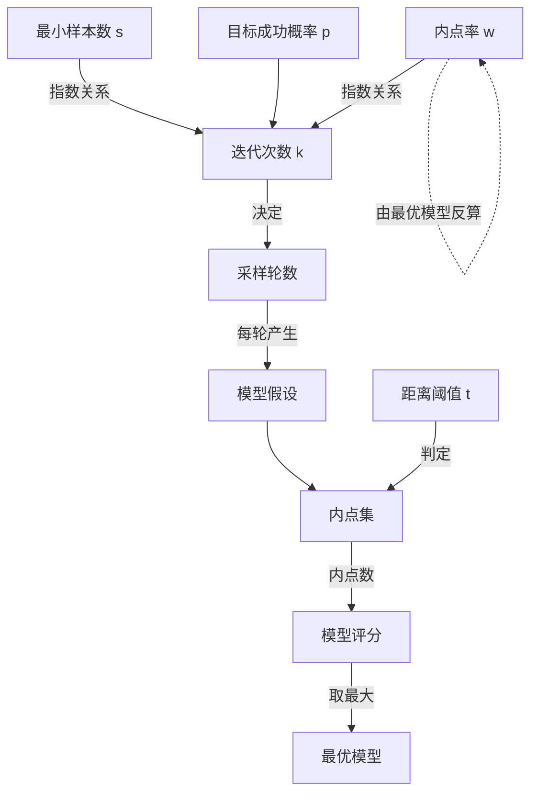

# 核心概念 · RANSAC

RANSAC 的概念不多，但每一个都直接决定它能不能跑对。这一页把四个参数 $s$、$t$、$w$、$k$ 和两种数据角色讲透。

## 概念 1：内点（Inlier）与外点（Outlier）

**定义**：给定一个候选模型 $M$，数据点 $x$ 到模型的距离 $d(x, M)$ 小于阈值 $t$ 时称为**内点**，否则称为**外点**。

**白话**：内点就是「同意这个模型」的点，外点就是「不同意」的点。注意——**外点的身份是相对于模型而言的，不是数据的固有属性**。同一条数据，对模型 A 是外点、对模型 B 可能是内点。

**关键认知**：RANSAC 全程不试图解释外点「为什么错」，也不假设外点的分布。论文原文说外点可以是「任意分布的、无结构的噪声」。这正是它与最小二乘、M 估计等方法的根本区别。

## 概念 2：最小样本数 $s$

**定义**：确定一个模型的唯一解所需的最少数据点数。

**为什么重要**：抽到全内点的概率是 $w^s$。$s$ 每增加 1，这个概率就乘一次 $w$——当 $w = 0.5$ 时，$s=2$ 的成功率是 25%，$s=4$ 降到 6.25%，$s=8$ 只剩 0.4%。**$s$ 越小，RANSAC 越快越稳。**

| 模型 | 参数量 | 最小样本数 $s$ | OpenCV 对应 API |
|---|---|---|---|
| 直线（2D） | 2 | **2** | 手写 / `cv2.fitLine` 需先分组 |
| 圆（2D） | 3 | **3** | 手写 |
| 平面（3D） | 3 | **3** | `open3d.segment_plane` |
| 仿射变换（2D） | 6 | **3** | `cv2.estimateAffine2D` |
| 单应矩阵 H（2D） | 8 | **4** | `cv2.findHomography` |
| 基础矩阵 F | 7（含约束） | **7 或 8** | `cv2.findFundamentalMat` |
| 本质矩阵 E | 5 | **5 或 8** | `cv2.findEssentialMat` |
| 相机位姿 PnP | 6 | **3~4** | `cv2.solvePnPRansac` |
| 刚体变换（3D 点云） | 6 | **3** | `open3d.registration_ransac_based_on_feature_matching` |

👉 **工程提示**：能用 4 点解单应就绝不用 8 点解基础矩阵。能用更少点的参数化形式（如 E 矩阵的 5 点法）就优先用——省下的不是一点时间，是指数级的迭代次数。

## 概念 3：距离阈值 $t$

**定义**：判断一个点是不是内点的距离门槛。

**白话**：圈多大才算「同意」。圈太小，真内点被误判成外点（内点率 $w$ 被低估，迭代次数暴涨）；圈太大，外点混进来冒充内点（最优模型被污染）。

**$t$ 的经典取值**（也是最容易出错的地方）：

| 场景 | 距离度量 | 推荐 $t$ | 说明 |
|---|---|---|---|
| 单应矩阵（像素坐标） | 重投影距离（像素） | **3.0 ~ 5.0 px** | OpenCV 默认建议值区间 |
| 基础矩阵 | Sampson 距离 | **1.0 ~ 3.0 px** | 对极几何的对称距离 |
| 直线拟合（像素坐标） | 点到直线垂直距离 | **1.0 ~ 2.0 px** | 亚像素级要求取 0.5~1.0 |
| 点云配准 | 点到点距离（米/毫米） | **点云分辨率的 1~2 倍** | 必须先估点云分辨率 |
| PnP | 重投影误差（像素） | **3.0 ~ 8.0 px** | 特征点定位精度差时可放宽 |

**理论取法**（当你知道测量噪声标准差 $\sigma$ 时）：

$$t \approx \sigma \sqrt{\chi^2_{d, 0.95} / d}$$

其中 $d$ 是距离的维度（2D 点对应距离取 $d=2$）。实际中直接按上表经验值起步更快。

**最容易踩的坑**：**坐标必须先归一化**。若特征点坐标数值在 $[0, 1000]$，$t=5$ 表示 5 像素；若归一化到 $[0, 1]$，$t=5$ 就等于「5 个图像宽度」——算法会认为所有点都是内点，直接失效。

## 概念 4：内点率 $w$ 与迭代次数 $k$

**定义**：$w$ = 内点数 / 总点数，是当前最优模型下的内点比例。

**迭代次数公式**（论文核心贡献）：

$$k = \frac{\log(1-p)}{\log\left(1-w^{s}\right)}$$

- $p$：期望的成功概率，通常取 **0.99**（即接受 1% 失败率）
- $w$：内点率
- $s$：最小样本数

**内点率对迭代次数的指数影响**（$p=0.99$，$s=4$ 单应矩阵）：

| 内点率 $w$ | 所需迭代次数 $k$ | 直觉 |
|---|---|---|
| 90% | **2** | 几乎一次就中 |
| 70% | **9** | 很快 |
| 50% | **35** | 标准工况 |
| 30% | **149** | 开始变慢 |
| 20% | **1000+** | 临界点 |
| 10% | **20000+** | 基本不可行，须换方法 |

**关键推论**：$w$ 对 $k$ 的影响是**指数级**的。内点率从 50% 掉到 20%，迭代次数涨了约 30 倍。这就是为什么「先做预筛把内点率提上去」比「优化 RANSAC 本身」更有效。

**自适应版本**：实践中不必预先知道 $w$。每轮用当前最优模型算出的内点率更新 $k$，收敛后自动停止。OpenCV 内部就是这样做的。

## 概念 5：四个反直觉但关键的认知

1. **RANSAC 的输出是「模型 + 内点掩码」两样东西**。很多人只取 `H` 就丢掉 `mask`，其实 `mask` 在很多任务里（如保留正确匹配对）同样有用。
2. **RANSAC 必须配一次「重拟合」才算完整**。随机采样只用了 $s$ 个点，精度有限；最后用全部内点重新做一次最小二乘，才能得到亚像素级结果。
3. **外点率超过 50% 时，标准 RANSAC 的稳定性急剧下降**。此时应换 LMedS，或先用别的约束（如极线约束、匹配质量）预筛。
4. **RANSAC 的随机性是可复现的**。固定 `np.random.seed` 或用 OpenCV 的确定性实现，可以保证同样输入得到同样输出——这对工程复现很重要。

## 概念之间的关系

## 下一步

- [🏗️ 算法流程](/algorithms/ransac/architecture)：把概念拼成 6 步管线
- [💻 源码走读](/algorithms/ransac/source)：OpenCV 调法 + 手写 Numpy 实现
- [⚠️ 踩坑指南](/algorithms/ransac/painpoints)：$t$ 和 $w$ 常见错法
