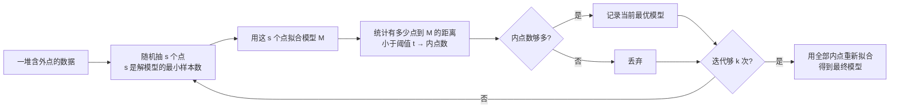
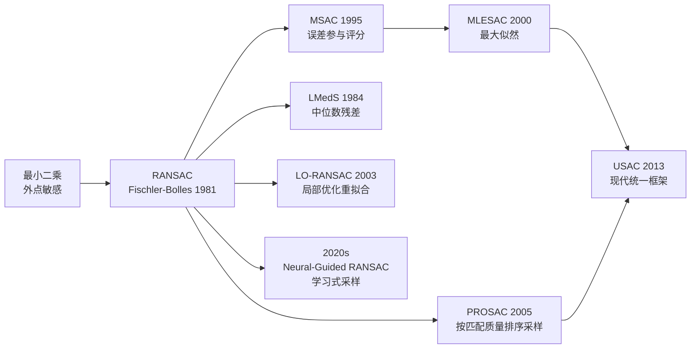

# RANSAC 随机采样一致性 (1981) · 总览

## 🧪 原理互动演示（RANSAC 直线拟合）

<ClientOnly><MathVisualizer initial-tab="ransac" /></ClientOnly>


> **一群外点里的「投票找真相」**：数据里混着一堆捣乱的外点，与其硬算，不如随机抽几组最小样本猜模型，谁猜出的模型能招揽到最多「同意者」（内点），谁就是真模型。

<AlgorithmCard
  name="RANSAC 随机采样一致性"
  enName="Random Sample Consensus"
  year="1981"
  chapter="第13章 · 广义匹配"  chapterLink="/chapters/ch13-matching"
  branch="特征匹配 / 几何视觉"
  level="中层"
  analogy="教室里一群人报自己的身高体重，混进几个瞎报的。随手抓两个人画一条线，看能圈住多少人；试够多次，圈住人最多的那条线就是真实规律。"
  scene="单应矩阵估计、基础矩阵估计、图像拼接、SLAM 位姿估计、点云配准、直线与圆拟合"
  paper="https://dl.acm.org/doi/10.1145/358669.358692"
/>

## TL;DR

| 项 | 内容 |
|---|---|
| **一句话** | 随机抽最小样本猜模型，用「有多少数据支持它」来投票，重复够多次就能在大量外点里找到真模型 |
| **解决什么** | 用最小二乘拟合时，只要有 1 个外点就会把模型拉歪——RANSAC 能在内点率低到 30% 时依然给出正确模型 |
| **代价** | 迭代次数随内点率指数上升；内点率 50% 时约需 35 次，内点率 20% 时约需 1000 次 |
| **前置阅读** | [SIFT](/algorithms/sift/)（产生待筛选的匹配点对）、[霍夫变换](/algorithms/hough/)（另一种投票式抗噪思想） |
| **最快上手** | `H, mask = cv2.findHomography(src_pts, dst_pts, cv2.RANSAC, 5.0)` |

## 3 分钟电梯演讲



1. **随机采样**：每次只抽解模型所需的**最小点数** $s$——直线要 2 点，单应矩阵要 4 点，基础矩阵要 7 或 8 点。样本越小，抽到全内点的概率越高。
2. **拟合与计票**：用这 $s$ 个点解出一个候选模型，然后让**所有**数据投给它——距离小于阈值 $t$ 的算内点。
3. **留最优**：只记住内点数最多的那个模型。
4. **重拟合**：最后拿全部内点做一次最小二乘，把随机采样的粗糙结果精修成最终解。

## 为什么它厉害

- **外点免疫**：最小二乘会被 1 个外点带偏，RANSAC 只要内点占多数（>50% 最稳，极端情况 20% 也能救），就能给出正确结果。这是 1981 年的思想，44 年过去依然是所有几何估计的默认收尾步骤。
- **模型无关**：只要你能定义「解模型的最小样本数」和「点到模型的距离」，直线、平面、单应矩阵、基础矩阵、相机位姿、点云刚体变换全都套同一个框架。
- **不需要预先知道哪些是外点**：外点识别本身就是算法的输出——`mask` 里为 1 的就是被认定的内点。
- **与学科无关**：它诞生于计算机视觉（论文标题就写着 Applications in Image Analysis），但今天在机器人、测绘、天文、生物统计里都是标配工具。

## 四层闭环视图

- **L1 论文层**：Fischler & Bolles 1981 CACM「Random Sample Consensus」→ [论文精读](/algorithms/ransac/paper)
- **L2 理论层**：内点/外点、最小样本集、距离阈值 t、自适应迭代次数公式、内点率 w → [核心概念](/algorithms/ransac/concepts)
- **L3 实现层**：标准 RANSAC、MSAC、MLESAC、PROSAC、LO-RANSAC、LMedS、USAC → [算法流程](/algorithms/ransac/architecture)
- **L4 实战层**：单应矩阵估计、基础矩阵估计、PnP、图像拼接、点云配准 → [源码走读](/algorithms/ransac/source) · [踩坑指南](/algorithms/ransac/painpoints) · [调参技巧](/algorithms/ransac/tricks)

## 核心贡献（含代码落点）

| 贡献 | 说明 | 代码中 |
|---|---|---|
| 内点/外点二分 | 首次把数据明确分成「符合模型」与「不符合模型」两类，且允许外点完全不服从任何分布 | `mask = np.abs(dist) < t` |
| 最小样本范式 | 用最少的点解模型（直线 2 点、H 矩阵 4 点），最大化抽到全内点的概率 | `idx = rng.choice(n, size=s, replace=False)` |
| 一致性投票 | 用内点数量（而非误差平方和）作为模型优劣的判据，天然免疫外点 | `if inliers.sum() > best_count:` |
| 自适应迭代次数 | 根据当前内点率动态收缩所需迭代次数，内点率高时提前收敛 | `k = log(1-p) / log(1 - w**s)` |
| 模型无关框架 | 直线、平面、H、F、E、PnP、刚体变换共用一套采样-拟合-投票流程 | `cv2.solvePnPRansac` / `cv2.findHomography` |

## 快速上手（3 行）

```python
import cv2, numpy as np
# src_pts / dst_pts 是 SIFT 匹配得到的 Nx2 点对
H, mask = cv2.findHomography(src_pts, dst_pts, cv2.RANSAC, ransacReprojThreshold=5.0)
matches_mask = mask.ravel().tolist()   # 1 = 内点，0 = 外点
```

## 它在家族里的位置



## 什么时候用 / 不该用

| ✅ 该用 RANSAC | ❌ 别用 RANSAC |
|---|---|
| 数据里有**明确的外点**（错误匹配、误检点） | 数据基本干净、几乎无外点（直接最小二乘即可） |
| 外点比例不高（<50% 最理想，<80% 勉强） | 外点比内点还多（此时应换 LMedS 或先改善数据） |
| 模型能用**少量点**确定（直线、H、F、PnP） | 模型需要大量参数（如高次多项式：最小样本集太大，采样效率极低） |
| 需要**鲁棒**、可复现的几何估计 | 需要**确定性**结果、不允许随机性抖动（可固定随机种子，或输出后重拟合） |
| 能做**几何一致性检验**（有明确的距离度量） | 无法定义「点到模型的距离」（那 RANSAC 无从计票） |

## RANSAC 变体选型

| 变体 | 年份 | 关键改进 | 何时选 |
|---|---|---|---|
| **RANSAC** | 1981 | 原始版本，内点计数评分 | 通用首选，OpenCV 默认 |
| **LMedS** | 1984 | 用残差中位数评分，抗外点更强 | 外点率 >50% 时 |
| **MSAC** | 1995 | 内点记固定分、外点按误差扣分 | 内点质量差异大时 |
| **MLESAC** | 2000 | 最大似然评分，对内点噪声建模 | 需要概率解释时 |
| **PROSAC** | 2005 | 按匹配质量降序采样，优先抽好点 | 特征匹配（SIFT 距离已知优劣） |
| **LO-RANSAC** | 2003 | 找到候选模型后做局部优化再计票 | 精度要求高、内点率低时 |
| **USAC** | 2013 | 融合上述优点的现代统一实现 | 追求最优速度/精度 |
| **LMedS** | 1984 | 中位数残差最小化 | 光照/遮挡导致大量外点时 |

👉 工业默认：**OpenCV `findHomography` / `findFundamentalMat` / `solvePnPRansac` 内置的 RANSAC 已经够用**；内点率低于 30%、或匹配质量参差时，考虑 PROSAC（`pydegensac` / `poselib` 库）或 USAC。

## 下一步

- [📄 原始论文](/algorithms/ransac/paper)：Fischler & Bolles 1981 CACM 精读
- [💡 核心概念](/algorithms/ransac/concepts)：内点/外点、t、w、自适应迭代公式
- [🏗️ 算法流程](/algorithms/ransac/architecture)：6 步拆解 + 手写 Numpy 实现
- [💻 源码走读](/algorithms/ransac/source)：OpenCV 三大 API + 手写单应 RANSAC
- [⚠️ 踩坑指南](/algorithms/ransac/painpoints)：10 个典型坑
- [🎛️ 调参技巧](/algorithms/ransac/tricks)：t 怎么定 + 7 个场景抄作业


---

## 🚀 动手体验（浏览器里直接玩，不用装环境）

> 下面这些组件都在**你的浏览器本地运行**，不上传任何图片、也不用安装 OpenCV 或写代码。


> 想换示例图、上传自己的照片、或切换别的算法？去 [🎮 真机实验室](/playgrounds/)；想看完整的 14 个数学原理互动？去 [🧪 原理实验室](/math-lab/)。
