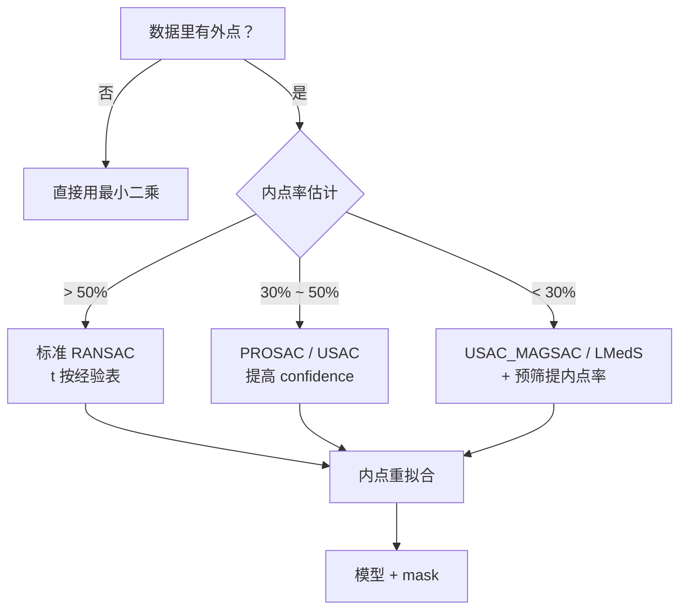

# 调参技巧 · RANSAC

> RANSAC 只有四个参数：$s$、$t$、$p$、`maxIters`。
> 其中 $s$ 由模型决定（改不了），**真正要调的是阈值 $t$ 和期望概率 $p$**。
> 这一页先讲 $t$ 怎么定，再给 7 个可直接抄的场景配置。

## 一、$t$（距离阈值）怎么定

$t$ 是唯一「凭经验」的参数，定错直接毁掉结果。三条路，按可靠度排序：

### 路线 A：从噪声尺度推（最可靠）

当你知道特征点的定位噪声标准差 $\sigma$（像素）时：

$$t \approx \sigma \sqrt{\chi^2_{d,\,0.95} / d}$$

- $d=2$（二维点对应距离）时，$\chi^2_{2,0.95} = 5.99$，即 $t \approx 1.73\,\sigma$
- SIFT/ORB 的定位精度约 1 px，故 $t \approx 1.7\sim2$ px

### 路线 B：按经验表起步（最快）

| 场景 | 距离度量 | 推荐 $t$ |
|---|---|---|
| 单应矩阵（像素坐标） | 重投影距离 | **3.0 ~ 5.0 px** |
| 基础矩阵 F | Sampson 距离 | **1.0 ~ 3.0 px** |
| 本质矩阵 E | Sampson 距离 | **1.0 ~ 2.0 px** |
| 直线/圆拟合 | 点到模型垂直距离 | **1.0 ~ 2.0 px** |
| PnP 位姿 | 重投影误差 | **3.0 ~ 8.0 px** |
| 点云刚体配准 | 点到点距离 | **点云分辨率的 1~2 倍** |

### 路线 C：扫参看拐点（最稳）

$t$ 从小到大扫一遍，画出「内点数 vs $t$」曲线。
曲线通常先陡升、后走平——**拐点附近就是合理值**。
拐点之后还在涨的部分，基本是把外点也圈进来了。

## 二、$p$（confidence）怎么定

$p$ 是「至少有一轮抽到全内点」的目标概率，直接决定 $k$：

$$k = \frac{\log(1-p)}{\log(1-w^{s})}$$

| $p$ | 含义 | 何时用 |
|---|---|---|
| 0.90 | 允许 10% 失败 | 实时场景、可容忍偶发失败 |
| 0.99 | 允许 1% 失败 | **通用默认** |
| 0.995 | 允许 0.5% 失败 | 精度要求高的离线任务 |
| 0.999 | 允许 0.1% 失败 | 极低内点率、算力充裕 |

**经验**：$p$ 从 0.99 提到 0.999，迭代次数大约翻倍。
除非内点率极低，0.99 足够。

## 三、7 个场景抄作业

### ① 图像拼接（全景）

```python
H, mask = cv2.findHomography(src, dst, cv2.RANSAC,
                             ransacReprojThreshold=3.0,
                             maxIters=3000, confidence=0.995)
```
匹配点已过 Lowe 比值检验，内点率通常 > 60%，$t=3$ 足够。

### ② 文档扫描矫正

```python
H, mask = cv2.findHomography(src, dst, cv2.RANSAC, 5.0)
```
文档是平面，边缘纹理弱、匹配点不多，$t$ 放宽到 5 px 保住内点。

### ③ 双目 / SFM 基础矩阵

```python
F, mask = cv2.findFundamentalMat(p1, p2, cv2.USAC_MAGSAC,
                                 ransacReprojThreshold=1.5,
                                 confidence=0.999)
```
外点率常达 50%+，用 USAC 或提高 confidence。

### ④ 相机位姿估计（PnP）

```python
ok, rvec, tvec, inl = cv2.solvePnPRansac(obj, img, K, dist,
                                         reprojectionError=4.0,
                                         iterationsCount=1000,
                                         confidence=0.99)
```
$t$ 按标定后的重投影误差量级给，4 px 是常见起点。

### ⑤ 车道线拟合

```python
# 先霍夫出候选点，再用 RANSAC 拟合单条直线
line, mask = ransac_line(edge_points, t=2.0)
```
边缘点噪声小，$t$ 收到 2 px。

### ⑥ 点云平面分割

```python
plane_model, inliers = cloud.segment_plane(distance_threshold=0.01,
                                           ransac_n=3, num_iterations=1000)
```
阈值单位是**米**，须按传感器精度给（如深度相机取 0.01 m）。

### ⑦ 低内点率匹配（< 30%）

```python
F, mask = cv2.findFundamentalMat(p1, p2, cv2.USAC_MAGSAC, 2.0, 0.9999, 5000)
```
换 USAC、提高 confidence 到 0.9999、放宽 $t$——三管齐下。

## 四、7 个通用技巧

1. **先预筛再 RANSAC**。用 Lowe 比值（0.7~0.8）、交叉一致性检验
   把内点率从 30% 提到 60%，比任何 RANSAC 调参都有效。
2. **永远保留 `mask`**。它是 RANSAC 的另一半产出，下一步全靠它。
3. **H 还是 F：用重投影误差自动选**。若 H 的内点率 > 0.6 且误差与 F 相当，
   按平面场景处理（用 H）；否则用 F/E。
4. **固定随机种子**。可复现是工程底线，`np.random.seed(0)` 一句话的事。
5. **批量任务换 USAC**。OpenCV 4.5+ 的 `cv2.USAC_*` 在低内点率下
   和传统 RANSAC 精度相当、速度快数倍。
6. **`maxIters` 只做兜底**。让 `confidence` 驱动自适应收敛，而不是硬堆迭代数。
7. **RANSAC 后必做重拟合**。用全部内点再来一次最小二乘，拿亚像素精度。

## 五、一张决策图



## 下一步

- [⚠️ 踩坑指南](/algorithms/ransac/painpoints)：10 个典型坑
- [💻 源码走读](/algorithms/ransac/source)：三大 API 与手写实现
- [🔗 对极几何与三角化](/algorithms/epipolar-geometry/)：RANSAC 的经典下游
