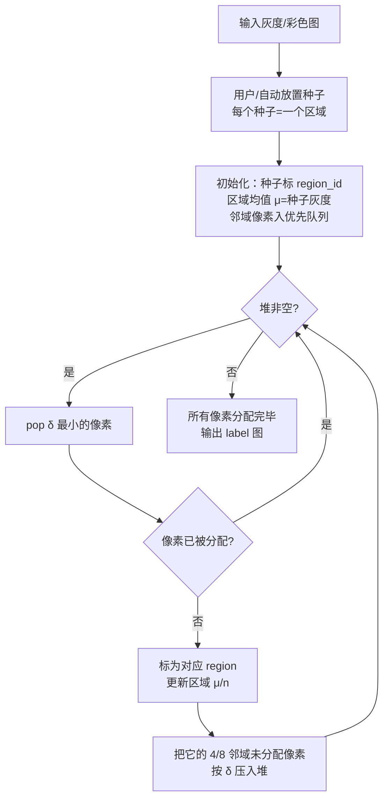

# 算法流程：区域生长分割

## 整体流程图



## 步骤详解

### Step 1：预处理
- 高斯平滑去噪（σ=1–2），避免噪声让生长乱跳
- 必要时做 CLAHE 增强对比度
- 彩色图建议转 LAB 空间（欧氏距离感知均匀）

### Step 2：放置种子
- 人工：用户点击
- 自动：距离变换局部极大（和分水岭类似）、阈值确定的前景/背景硬区域、或网格采样

### Step 3：初始化数据结构
- `labels[y,x] = -1`（未分配），种子点 labels=region_id
- `region_mean[i]` = 种子灰度，`region_count[i]` = 1
- 优先队列（heapq）：把种子的 4/8 邻居按 (|I-μ|, x, y, region_id) 压入
- `in_heap[y,x]` 标记避免重复入堆

### Step 4：主循环
```
while heap 非空:
    delta, x, y, rid = heappop(heap)
    if labels[y,x] != -1: continue     # 已被其他区域抢走
    labels[y,x] = rid
    更新 region_mean[rid]（增量公式）
    更新 region_count[rid]
    for (nx, ny) in 4/8 neighbors:
        if labels[ny,nx] == -1 and not in_heap:
            d = abs(I[ny,nx] - region_mean[rid])
            heappush(heap, (d, nx, ny, rid))
            in_heap[ny,nx] = True
```

### Step 5：后处理（可选）
- 过小区域合并到邻居
- 闭运算填小缝

## 参数对照（论文 vs OpenCV 默认 vs 工程建议）

| 参数 | 论文建议 | OpenCV 默认 | 工程建议 | 调参影响 |
|---|---|---|---|---|
| 邻域 connectivity | 8 | — | 8（默认速度快），4 边界更稳 | 生长邻域 |
| 相似性度量 | 灰度差 | — | LAB 颜色欧氏距离（彩色） | 准则选择 |
| 阈值（如果用固定阈值） | — | 无（优先级不需要） | 通常不需要，靠堆自动 | SRG 本质无阈值 |
| 种子数 | ≥2 | — | 目标数 +1（含背景） | 决定分割块数 |

## 复杂度分析

- 每个像素入堆一次，每次 push/pop O(log N)
- 总复杂度 O(N log N)，N=像素数
- 512×512 图纯 Python 约 5–20s，C++ 实现约 50–200ms
