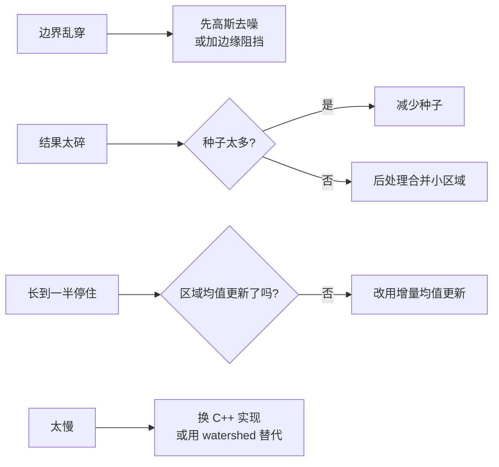

# 实战踩坑：区域生长分割

## 最常见的 8 个坑

### 1. 没去噪就直接生长，边界到处漏
噪声像素会把区域均值慢慢拉偏，最后长到别的区域里。**修法**：先做 σ=1–2 的高斯模糊。

### 2. 种子点放错位置
种子必须放在**区域内部**（别放边界上）。如果种子放错了一块阴影，那块阴影会被单独分出。**修法**：提供交互允许用户删除错误种子/新增种子。

### 3. 用 BFS 代替优先队列
简单 BFS（队列先进先出）没有优先级，早进队的像素即使差异大也会被先归并，边界会不规则。**修法**：必须用 heap 按 δ 排序。

### 4. 区域均值不更新
始终用初始种子灰度做阈值，区域长着长着就长不动（因为区域本身灰度是渐变的）。**修法**：每次归并用增量公式更新均值。

### 5. 跨边缘漏长（边缘梯度小的时候）
物体内部有弱纹理，区域生长可能跨过弱边缘长到背景。**修法**：加「边缘阻挡」——梯度 magnitude 大的地方不入堆；或改用 watershed。

### 6. 纯 Python 实现太慢
heapq 处理 512×512=26 万像素在 Python 里 10s+。**修法**：用 C++/Cython/Numba，或直接换 watershed（OpenCV 优化过，ms 级）。

### 7. 彩色图用灰度差
RGB 空间的差不感知均匀。**修法**：转 LAB，用 E = √((L1-L2)² + (a1-a2)² + (b1-b2)²)。

### 8. 长到最后有孤立小孔
未被分配的孤立像素（最后才遇到）会被标为它最后被推入的 region，可能错。**修法**：主循环结束后，对 -1 像素做一次最近邻填充或中值滤波。

## 失败案例诊断流程

