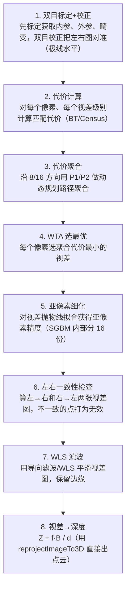
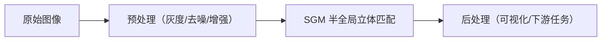

# SGM 半全局立体匹配 · 算法流程

<AlgorithmCard
  name="SGM 半全局立体匹配"
  enName="Semi-Global Matching"
  chapter="ch-14-3d-vision"
  branch="geometry"
  year="2005"
  author="Heiko Hirschmüller"
  paper="—"
  level="advanced"
  tagline="双目测距的工业标准，8 个方向做平滑约束，又快又稳出稠密视差图"
  analogy="BM 块匹配像个没耐心的小孩，只看自己周围一小圈就乱猜；SGM 像个老练的侦探，从上下左右斜 8 个方向打听消息，让相邻像素的深度差不多，拼出连贯的深度图"
  scene="双目深度相机（RealSense、自动驾驶双目）、无人机避障、机器人导航、三维重建、工业检测"
  :pros='["稠密视差图", "速度可接受(CPU实时)", "精度经典最高", "OpenCV内置StereoSGBM", "参数可解释"]'
  :cons='["参数多", "无纹理区域失败", "重复纹理误匹配", "需要精确标定", "远处深度误差大"]'
/>

## 完整算法流程

SGM 半全局立体匹配算法可以分解为以下关键步骤：

## 步骤详解

### 步骤 1：双目标定+校正

先标定获取内参、外参、畸变，双目校正把左右图对准（极线水平）

### 步骤 2：代价计算

对每个像素、每个视差级别计算匹配代价（BT/Census）

### 步骤 3：代价聚合

沿 8/16 方向用 P1/P2 做动态规划路径聚合

### 步骤 4：WTA 选最优

每个像素选聚合代价最小的视差

### 步骤 5：亚像素细化

对视差抛物线拟合获得亚像素精度（SGBM 内部分 16 份）

### 步骤 6：左右一致性检查

算左→右和右→左两张视差图，不一致的点打为无效

### 步骤 7：WLS 滤波

用导向滤波/WLS 平滑视差图，保留边缘

### 步骤 8：视差→深度

Z = f·B / d（用 reprojectImageTo3D 直接出点云）

## 在整体视觉 pipeline 中的位置

### 关键复杂度

| 维度 | 复杂度 |
|---|---|
| 时间 | 详见各实现 |
| 内存 | 与图像尺寸线性相关 |

