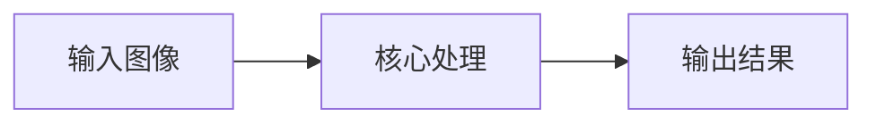
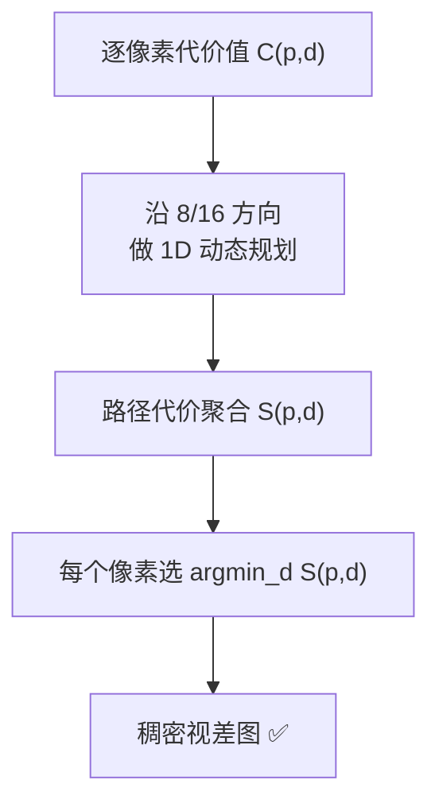

# SGM 半全局立体匹配 · 核心概念

<AlgorithmCard
  name="SGM 半全局立体匹配"
  enName="Semi-Global Matching"
  chapter="ch-14-3d-vision"
  branch="geometry"
  year="2005"
  author="Heiko Hirschmüller"
  paper="—"
  level="advanced"
  tagline="双目测距的工业标准，8 个方向做平滑约束，又快又稳出稠密视差图"
  analogy="BM 块匹配像个没耐心的小孩，只看自己周围一小圈就乱猜；SGM 像个老练的侦探，从上下左右斜 8 个方向打听消息，让相邻像素的深度差不多，拼出连贯的深度图"
  scene="双目深度相机（RealSense、自动驾驶双目）、无人机避障、机器人导航、三维重建、工业检测"
  :pros='["稠密视差图", "速度可接受(CPU实时)", "精度经典最高", "OpenCV内置StereoSGBM", "参数可解释"]'
  :cons='["参数多", "无纹理区域失败", "重复纹理误匹配", "需要精确标定", "远处深度误差大"]'
/>

🧪 公式看不懂？去 <a href="/math-lab/">原理实验室</a> 拖动滑块直观体验卷积/梯度/高斯/霍夫/角点/RANSAC/光流等核心概念；看完原理再去本页底部 <a href="./source">源码/真机实验室</a> 亲手调参数。

## SGM 半全局立体匹配的核心思想

双目测距的工业标准，8 个方向做平滑约束，又快又稳出稠密视差图。BM 块匹配像个没耐心的小孩，只看自己周围一小圈就乱猜；SGM 像个老练的侦探，从上下左右斜 8 个方向打听消息，让相邻像素的深度差不多，拼出连贯的深度图

**生活类比**：BM 块匹配像个没耐心的小孩，只看自己周围一小圈就乱猜；SGM 像个老练的侦探，从上下左右斜 8 个方向打听消息，让相邻像素的深度差不多，拼出连贯的深度图

**典型应用**：双目深度相机（RealSense、自动驾驶双目）、无人机避障、机器人导航、三维重建、工业检测

## 核心概念详解

### 概念1：视差 Disparity

双目相机左右水平放置，同一空间点在左图坐标 x_L、右图坐标 x_R，**视差 d = x_L - x_R**。深度 Z = f·B/d，其中 f 是焦距、B 是基线距离。**视差越大=越近，视差越小=越远**。

### 概念2：匹配代价

对左图每个像素 (x,y) 和可能视差 d，算右图 (x-d,y) 位置的像素**相似度（代价）**。常用：BT（Birchfield-Tomasi）、Census 变换、互信息 MI。代价越小，这个视差越可能是真的。

### 概念3：半全局聚合

如果只看单像素最小代价，得到的视差图全是噪声。SGM 沿**8 或 16 个方向**做动态规划路径聚合，每条路径上对**视差突变**加惩罚 P1（小跳变）和 P2（大跳变），让相邻像素视差趋于一致。

### 概念4：P1/P2 惩罚

P1 惩罚相邻像素视差差 1 的情况（斜面，允许）；P2 惩罚视差差 >1 的情况（跳变，重罚）。**P1 控制平滑度，P2 控制对不连续的保留**。P2 通常与相邻像素灰度差成反比（灰度差大→很可能真是深度跳变→少罚）。

### 概念5：WLS 后处理

OpenCV 提供 ximgproc 的 `DisparityWLSFilter`：用左右一致性检查（左右视差图一致性）过滤错误点，用加权最小二乘做边缘保留的视差图平滑，效果显著提升。

