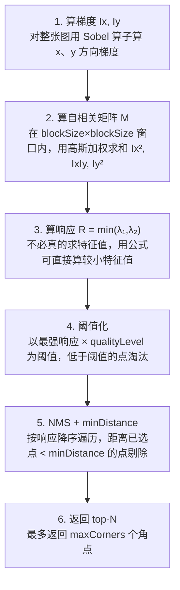
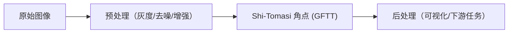

# Shi-Tomasi 角点 (GFTT) · 算法流程

<AlgorithmCard
  name="Shi-Tomasi 角点 (GFTT)"
  enName="Shi-Tomasi / Good Features to Track"
  chapter="ch-8-local-feature"
  branch="feature-detection"
  year="1994"
  author="Jianbo Shi / Carlo Tomasi"
  paper="—"
  level="mid"
  tagline="把 Harris 响应函数换成 min(λ1,λ2)，一个参数不用调，工程界角点首选"
  analogy="Harris 像个老中医用「阴阳失调公式」判断亚健康，还要调一个神秘的 k；Shi-Tomasi 直接看你「最差的那一科成绩」——只要最差那一科也及格，你就是好学生"
  scene="光流跟踪（goodFeaturesToTrack+calcOpticalFlowPyrLK 是标配）、相机标定棋盘角点、视频稳像"
  :pros='["无需调 k 参数", "响应值物理意义明确", "自带 minDistance 防扎堆", "能限制 top-N 数量"]'
  :cons='["不具尺度/旋转不变", "需要定 qualityLevel", "分布不均时扎堆", "不含描述子"]'
/>

## 完整算法流程

Shi-Tomasi 角点 (GFTT)算法可以分解为以下关键步骤：

## 步骤详解

### 步骤 1：算梯度 Ix, Iy

对整张图用 Sobel 算子算 x、y 方向梯度

### 步骤 2：算自相关矩阵 M

在 blockSize×blockSize 窗口内，用高斯加权求和 Ix², IxIy, Iy²

### 步骤 3：算响应 R = min(λ₁,λ₂)

不必真的求特征值，用公式可直接算较小特征值

### 步骤 4：阈值化

以最强响应 × qualityLevel 为阈值，低于阈值的点淘汰

### 步骤 5：NMS + minDistance

按响应降序遍历，距离已选点 < minDistance 的点剔除

### 步骤 6：返回 top-N

最多返回 maxCorners 个角点

## 在整体视觉 pipeline 中的位置

### 关键复杂度

| 维度 | 复杂度 |
|---|---|
| 时间 | 详见各实现 |
| 内存 | 与图像尺寸线性相关 |

