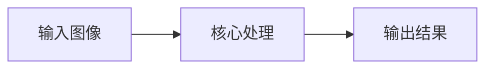
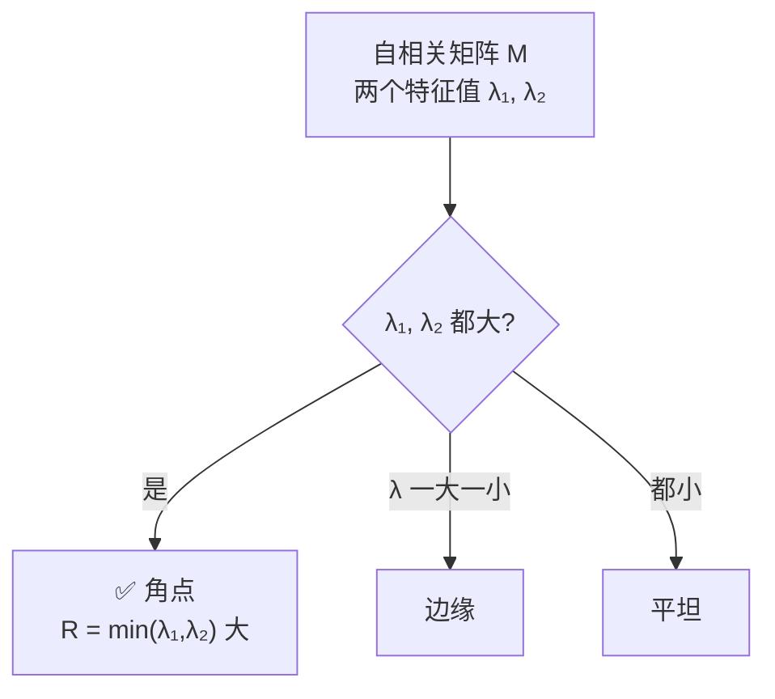

# Shi-Tomasi 角点 (GFTT) · 核心概念

<AlgorithmCard
  name="Shi-Tomasi 角点 (GFTT)"
  enName="Shi-Tomasi / Good Features to Track"
  chapter="ch-8-local-feature"
  branch="feature-detection"
  year="1994"
  author="Jianbo Shi / Carlo Tomasi"
  paper="—"
  level="mid"
  tagline="把 Harris 响应函数换成 min(λ1,λ2)，一个参数不用调，工程界角点首选"
  analogy="Harris 像个老中医用「阴阳失调公式」判断亚健康，还要调一个神秘的 k；Shi-Tomasi 直接看你「最差的那一科成绩」——只要最差那一科也及格，你就是好学生"
  scene="光流跟踪（goodFeaturesToTrack+calcOpticalFlowPyrLK 是标配）、相机标定棋盘角点、视频稳像"
  :pros='["无需调 k 参数", "响应值物理意义明确", "自带 minDistance 防扎堆", "能限制 top-N 数量"]'
  :cons='["不具尺度/旋转不变", "需要定 qualityLevel", "分布不均时扎堆", "不含描述子"]'
/>

🧪 公式看不懂？去 <a href="/math-lab/">原理实验室</a> 拖动滑块直观体验卷积/梯度/高斯/霍夫/角点/RANSAC/光流等核心概念；看完原理再去本页底部 <a href="./source">源码/真机实验室</a> 亲手调参数。

## Shi-Tomasi 角点 (GFTT)的核心思想

把 Harris 响应函数换成 min(λ1,λ2)，一个参数不用调，工程界角点首选。Harris 像个老中医用「阴阳失调公式」判断亚健康，还要调一个神秘的 k；Shi-Tomasi 直接看你「最差的那一科成绩」——只要最差那一科也及格，你就是好学生

**生活类比**：Harris 像个老中医用「阴阳失调公式」判断亚健康，还要调一个神秘的 k；Shi-Tomasi 直接看你「最差的那一科成绩」——只要最差那一科也及格，你就是好学生

**典型应用**：光流跟踪（goodFeaturesToTrack+calcOpticalFlowPyrLK 是标配）、相机标定棋盘角点、视频稳像

## 核心概念详解

### 概念1：角点的数学条件

Harris 在自相关矩阵 M 上定义响应 R=det(M)-k·trace(M)²，其中 k 是个 0.04–0.06 的经验值。Shi-Tomasi 观察发现：**角点的本质就是 M 的两个特征值都足够大**——那直接让 R = min(λ₁, λ₂) 不就行了？这样既不用调 k，响应值也有明确物理意义：较小的那个特征值代表「最弱方向上的纹理强度」。

### 概念2：质量等级 qualityLevel

OpenCV 的 `goodFeaturesToTrack` 不直接让你设阈值，而是让你给一个**比例**：`qualityLevel=0.01` 表示「只保留响应值 > 最强点响应×1% 的点」。这种设计自动适应图像对比度，不用手动调绝对阈值。

### 概念3：最小距离 minDistance

角点扎堆是所有角点检测的通病。Shi-Tomasi 直接提供 `minDistance` 参数，保证返回的角点之间至少相隔这么多像素——按响应从强到弱依次选取，近距离弱响应点会被抑制。

### 概念4：为什么是光流首选

LK 光流可解的条件是 $A^TA$ 可逆（即两个特征值都足够大），这**正好**就是 Shi-Tomasi 的判据！所以 Shi-Tomasi 角点就是天生为光流准备的——能被稳定跟踪的点。

