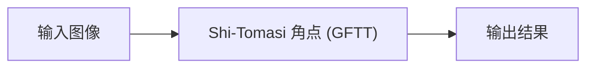

# Shi-Tomasi 角点 (GFTT)

<AlgorithmCard
  name="Shi-Tomasi 角点 (GFTT)"
  enName="Shi-Tomasi Corner / Good Features to Track"
  chapter="第4章 · 基元检测"  chapterLink="/chapters/ch04-primitives"
  branch="feature-detection"
  year="1994"
  author="Jianbo Shi / Carlo Tomasi"
  paper="https://ieeexplore.ieee.org/document/323794"
  level="mid"
  tagline="把 Harris 响应函数换成 min(λ1,λ2)，一个参数不用调，工程界角点首选"
  analogy="Harris 像个老中医用「阴阳失调公式」判断你是不是亚健康，还要调一个神秘的 k；Shi-Tomasi 直接看你「最差的那一科成绩」——只要最差那一科也及格，你就是好学生"
  scene="光流跟踪（goodFeaturesToTrack + calcOpticalFlowPyrLK 是标配）、相机标定棋盘角点、视频稳像"
  :pros='["无需调 k 参数", "响应值物理意义明确（较小特征值）", "自带 minDistance 防扎堆", "能限制 top-N 数量，工程首选"]'
  :cons='["不具备尺度/旋转不变性", "需要定 qualityLevel 比例阈值", "分布不均时角点扎堆", "不是完整特征（只有点没有描述子）"]'
/>

## 一句话理解

把 Harris 响应函数换成 min(λ1,λ2)，一个参数不用调，工程界角点首选。Harris 像个老中医用「阴阳失调公式」判断你是不是亚健康，还要调一个神秘的 k；Shi-Tomasi 直接看你「最差的那一科成绩」——只要最差那一科也及格，你就是好学生。

## 生活类比

Harris 像个老中医用「阴阳失调公式」判断你是不是亚健康，还要调一个神秘的 k；Shi-Tomasi 直接看你「最差的那一科成绩」——只要最差那一科也及格，你就是好学生

## 它解决什么问题

光流跟踪（goodFeaturesToTrack + calcOpticalFlowPyrLK 是标配）、相机标定棋盘角点、视频稳像。

在传统 CV 的六分支体系中，Shi-Tomasi 角点 (GFTT) 属于 **feature-detection** 分支，主要解决的是该分支中把 Harris 响应函数换成 min(λ1,λ2)，一个参数不用调，工程界角点首选的问题。

## 核心优点

- ✅ **无需调 k 参数**
- ✅ **响应值物理意义明确（较小特征值）**
- ✅ **自带 minDistance 防扎堆**
- ✅ **能限制 top-N 数量，工程首选**

## 它的短板

- ⚠️ 不具备尺度/旋转不变性
- ⚠️ 需要定 qualityLevel 比例阈值
- ⚠️ 分布不均时角点扎堆
- ⚠️ 不是完整特征（只有点没有描述子）

## 本算法档案包含 7 个页面

| 页面 | 内容 |
|---|---|
| [论文故事](/algorithms/shi-tomasi/paper) | 作者、发表时间、核心贡献、为什么它会被提出 |
| [核心概念](/algorithms/shi-tomasi/concepts) | 用生活比方讲清它依赖的关键概念 |
| [算法流程](/algorithms/shi-tomasi/architecture) | 一步步走通算法全流程，配 mermaid 图 |
| [源码实现](/algorithms/shi-tomasi/source) | OpenCV 调用 + NumPy 手写最小实现 |
| [踩坑清单](/algorithms/shi-tomasi/painpoints) | 新手最常犯的 N 个错误 |
| [调参口诀](/algorithms/shi-tomasi/tricks) | 参数怎么选、实战技巧、性能优化 |

## 相关链接

- 返回 [六大分支总览](/branches/)
- [Shi-Tomasi 角点 (GFTT)所在分支](/branches/feature-detection/)
- [算法档案总览](/algorithms/)

---

## 🚀 动手体验（浏览器里直接玩，不用装环境）

> 下面这些组件都在**你的浏览器本地运行**，不上传任何图片、也不用安装 OpenCV 或写代码。

### 🧪 先懂原理：Harris 角点到底在算什么

拖动滑块，看数学是怎么一步步变成图像的——纯 Canvas 绘制，秒开。

<ClientOnly>
  <MathVisualizer initial-tab="harris" compact />
</ClientOnly>

### 🎮 再跑真机：在浏览器里真跑 Shi-Tomasi 角点 (GFTT)

换成你自己的照片也行；下面还会**实时生成**对应的 Python / C++ / JavaScript 代码，拖参数时代码同步更新。

<ClientOnly>
  <OpencvPlayground initial-algo="gftt" compact />
</ClientOnly>

> 想换示例图、上传自己的照片、或切换别的算法？去 [🎮 真机实验室](/playgrounds/)；想看完整的 14 个数学原理互动？去 [🧪 原理实验室](/math-lab/)。
