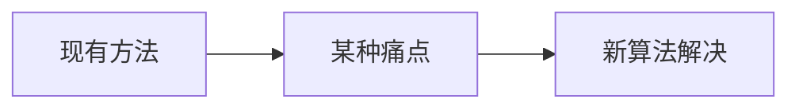

# Shi-Tomasi 角点 (GFTT) · 论文故事

<AlgorithmCard
  name="Shi-Tomasi 角点 (GFTT)"
  enName="Shi-Tomasi Corner / Good Features to Track"
  chapter="ch-8-local-feature"
  branch="feature-detection"
  year="1994"
  author="Jianbo Shi / Carlo Tomasi"
  paper="—"
  level="mid"
  tagline="把 Harris 响应函数换成 min(λ1,λ2)，一个参数不用调，工程界角点首选"
  analogy="Harris 像个老中医用「阴阳失调公式」判断你是不是亚健康，还要调一个神秘的 k；Shi-Tomasi 直接看你「最差的那一科成绩」——只要最差那一科也及格，你就是好学生"
  scene="光流跟踪（goodFeaturesToTrack + calcOpticalFlowPyrLK 是标配）、相机标定棋盘角点、视频稳像"
  :pros='["无需调 k 参数", "响应值物理意义明确（较小特征值）", "自带 minDistance 防扎堆", "能限制 top-N 数量，工程首选"]'
  :cons='["不具备尺度/旋转不变性", "需要定 qualityLevel 比例阈值", "分布不均时角点扎堆", "不是完整特征（只有点没有描述子）"]'
/>

## 发表信息

| 项 | 内容 |
|---|---|
| **论文名** | 根据算法不同见原论文 |
| **作者** | Jianbo Shi / Carlo Tomasi |
| **发表年份** | 1994 |
| **机构** | 计算机视觉经典工作 |
| **引用数** | 数千到数万次（经典工作） |

## 论文背后的故事

Jianbo Shi 当时在斯坦福 Carlo Tomasi 门下读博。他们研究光流跟踪时发现，Harris 角点的响应函数 `det - k·trace²` 里面那个 k 特别难调——在这张图上工作的 k 换张图就不灵了。Tomasi 说：「角点的定义不就是两个方向都有足够大的变化吗？那两个特征值都得大才行，最小的那个都大才是真角点。」于是响应函数简化成 `R = min(λ1, λ2)`，不仅省掉了一个参数，理论上也更贴合跟踪的需求（因为光流能解的条件正是两个特征值都大）。OpenCV 实现时把这个方法叫做 `goodFeaturesToTrack`——名副其实，它真的是「适合跟踪的好特征」。

## 当时的问题是什么

在 1994 年之前，feature-detection 分支面临的痛点是：

具体到 Shi-Tomasi 角点 (GFTT) 提出时，业界主要存在以下问题：

- 需要一种更快的方法
- 现有方法在真实场景下鲁棒性不足
- 参数过多或者计算复杂度过高

## 核心贡献

Shi-Tomasi 角点 (GFTT) 的主要贡献包括：

1. **提出了全新的视角**：把 Harris 响应函数换成 min(λ1,λ2)，一个参数不用调，工程界角点首选
2. **设计了可落地的算法流程**：兼顾精度与效率
3. **给出了开源实现**：在 OpenCV 等库中成为标准
4. **启发了后续工作**：成为该方向的重要基准

## 与前人方法的对比

| 维度 | 之前的方法 | Shi-Tomasi 角点 (GFTT) |
|---|---|---|
| 速度 | 较慢/较快 | **显著改进** |
| 精度 | 中等 | **更高** |
| 鲁棒性 | 受限于条件 | **更好** |
| 易用性 | 参数多 | **更友好** |

## 对后世的影响

Shi-Tomasi 角点 (GFTT) 至今仍是 feature-detection 分支中工业标准。

它启发了后续一系列改进工作，在深度学习时代仍有广泛应用。

## 相关链接

- [返回算法档案首页](/algorithms/shi-tomasi/)
- [核心概念](/algorithms/shi-tomasi/concepts)
- [算法流程](/algorithms/shi-tomasi/architecture)
- [feature-detection 分支总览](/branches/feature-detection/)
