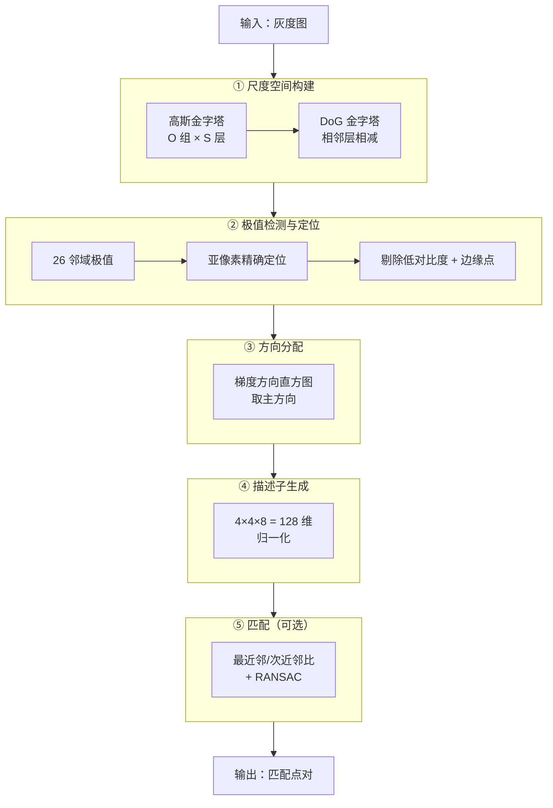
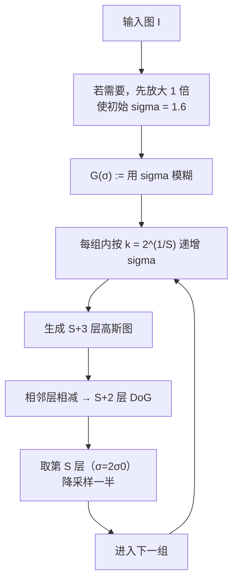
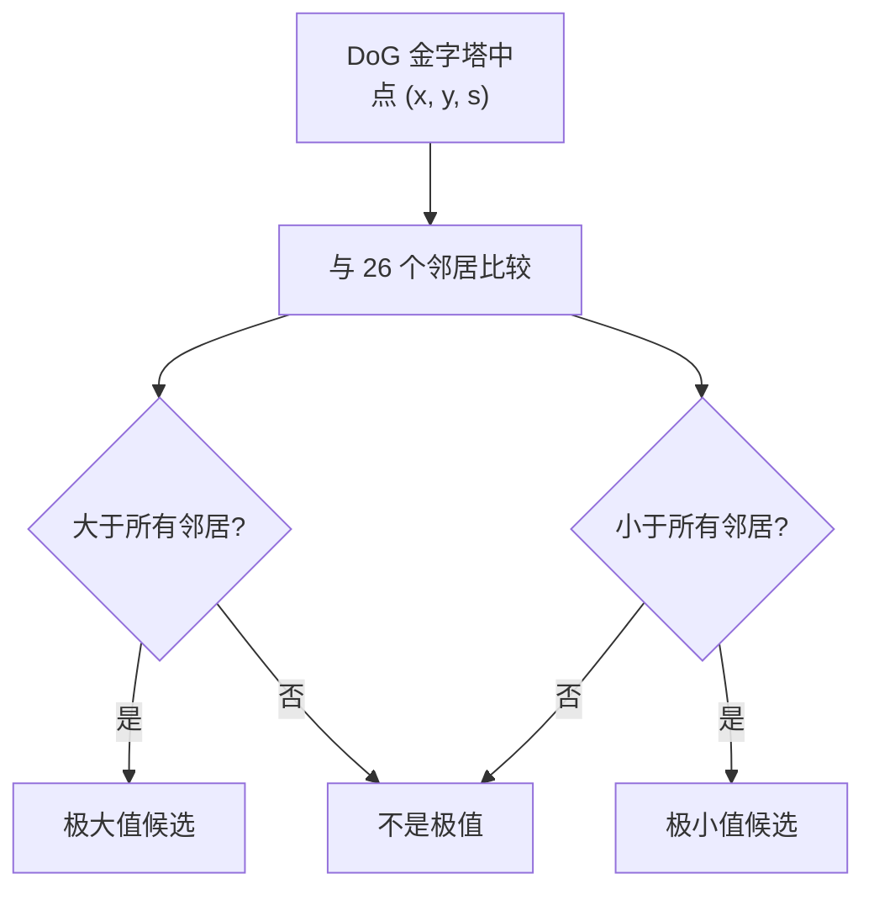
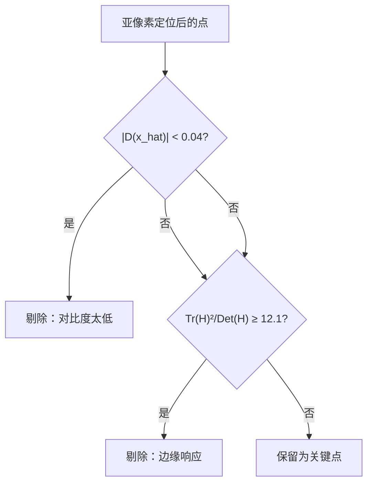
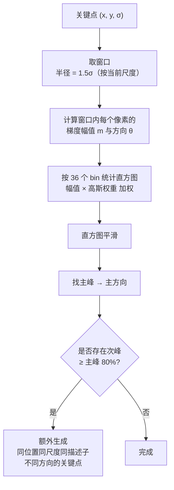
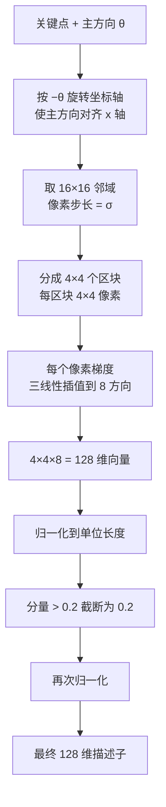
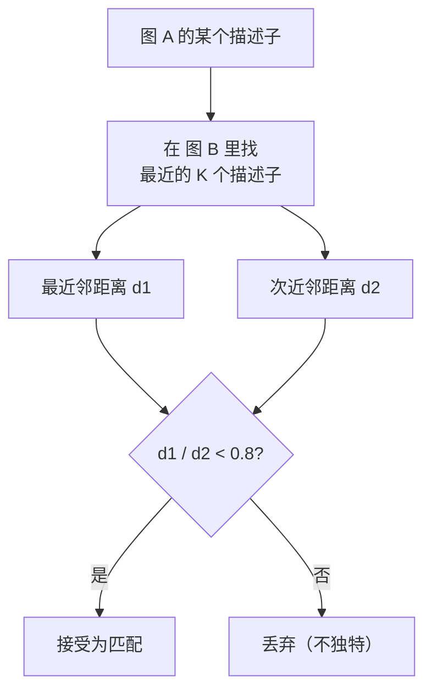

# SIFT 算法流程

> 把 SIFT 拆成五个阶段，每一步的输入输出都讲清楚。

## 总流程图



## 阶段 ①：尺度空间构建

### 高斯金字塔参数

| 参数 | 论文建议 | OpenCV 默认 | 说明 |
|---|---|---|---|
| octaves（组数） | 由图像尺寸决定 | 自动（`log2(min(w,h))-3`） | 每组图像降采样一半 |
| scales per octave（每组层数） | 3 | 3 | 至少 3 层才能找极值 |
| initial sigma | 1.6 | 1.6 | 第一层的模糊程度 |
| assumed blur | 0.5 | — | 假设相机自身模糊 |

### 构建过程



**关键数值**：

- 每组生成 **S + 3** 层高斯图（多 3 层是为了在组边界处也能找极值）
- 相减得到 **S + 2** 层 DoG
- 每组只有**中间的 S 层**能找到极值（首尾层不能，因为没有上下邻居）

::: tip 为什么要多生成 3 层
找极值需要「上下各一层」。组内首层没有「上一层」，末层没有「下一层」，所以能在组内找极值的只有中间 $S$ 层。
为了保证「中间 S 层的尺度覆盖连续」，必须多生成几层来补齐邻居。
:::

### 尺度计算

每层的尺度：

$$
\sigma_o = 2^{o} \cdot \sigma_0, \quad o = 0, 1, \ldots, O-1
$$

组内层的尺度：

$$
\sigma_{o,s} = 2^{o} \cdot k^{s} \cdot \sigma_0, \quad k = 2^{1/S}
$$

## 阶段 ②：极值检测与定位

### 26 邻域极值检测



**注意**：只比较**组内**的相邻层，不跨组。

### 亚像素定位

```python
# 伪代码示意
for each candidate:
    # 迭代求解极值偏移
    for iter in range(max_iter=5):
        D = value at (x, y, s)
        dD = gradient of D         # 一阶偏导
        ddD = hessian of D          # 二阶偏导
        offset = -solve(ddD, dD)    # 求解偏移

        if abs(offset) < 0.5:       # 收敛
            break
        x += round(offset[0])
        y += round(offset[1])
        s += round(offset[2])

    x_hat = x + offset             # 亚像素坐标
```

### 两点剔除



**OpenCV 默认参数**：

| 参数 | 默认值 | 含义 |
|---|---|---|
| `contrastThreshold` | 0.04 | 低于此值的点被剔除 |
| `edgeThreshold` | 10 | 边缘响应阈值（$r = 10$） |

::: warning 注意 OpenCV 的 edgeThreshold 语义
OpenCV 里 `edgeThreshold = 10` 表示 $r = 10$，判据是：
$$
\frac{\text{Tr}(H)^2}{\text{Det}(H)} \geq \frac{(r+1)^2}{r} = \frac{121}{10} = 12.1
$$
**数值越大，剔除越宽松（保留的边缘点越多）。** 这个方向和 `contrastThreshold` 相反，容易搞混。
:::

## 阶段 ③：方向分配



**直观展示**：

| 情况 | 结果 |
|---|---|
| 单一主峰 | 1 个关键点，1 个方向 |
| 有两个并强的主方向 | 2 个关键点（位置尺度相同，方向不同） |
| 主峰很弱 | 仍然接受（没有最低阈值约束） |

## 阶段 ④：描述子生成



**三线性插值**：每个像素的梯度贡献会按距离权重分配到：

- 相邻的 **2 个方向 bin**
- 相邻的 **x 方向 2 个区块列**
- 相邻的 **y 方向 2 个区块行**

这样避免区块边界的突变，让描述子更平滑、更鲁棒。

## 阶段 ⑤：匹配

### 最近邻 / 次近邻比



### 匹配后处理：RANSAC


详见 [特征匹配分支](/branches/feature-matching/robust-estimation)。

## 数据流转示例

假设输入一张 **512×512** 灰度图：

| 阶段 | 数据 | 规模 |
|---|---|---|
| 输入 | 灰度图 | 512 × 512 |
| ① 高斯金字塔 | O ≈ 7 组，每组 S+3 = 6 层 | 约 42 张图 |
| ① DoG 金字塔 | 每组 S+2 = 5 层 | 约 35 张图 |
| ② 关键点 | 位置 + 尺度 | 典型 1000–5000 个 |
| ③ 方向 | 关键点方向 | 与关键点数同量级 |
| ④ 描述子 | 128 维向量 | 1000–5000 × 128 |
| ⑤ 匹配 | 匹配点对 | 视场景，几十到几百对 |

## 复杂度分析

| 阶段 | 时间复杂度 | 说明 |
|---|---|---|
| ① 尺度空间 | $O(N \log N)$ | N 为像素数，多尺度卷积 |
| ② 极值检测 | $O(N)$ | 每个 DoG 点常数次比较 |
| ③ 方向分配 | $O(K \cdot w^2)$ | K 为关键点数，w 为窗口 |
| ④ 描述子 | $O(K \cdot 16^2)$ | 每个关键点处理 16×16 邻域 |
| ⑤ 匹配 | $O(K_A \cdot K_B)$ | 暴力匹配；用 KD 树可降到 $O(K \log K)$ |

**整体**：主要在 ① 和 ④，1080p 图 CPU 上约数百毫秒。

## 与本体实例的对应

```yaml
- id: algo-sift
  type: Algorithm
  stages:
    - order: 1
      name: "尺度空间构建"
      operators: ["op-gaussian-blur", "op-dog"]
    - order: 2
      name: "极值检测与定位"
      operators: ["op-extremum-3d", "op-subpixel-refine"]
    - order: 3
      name: "方向分配"
      operators: ["op-gradient-histogram"]
    - order: 4
      name: "描述子生成"
      operators: ["op-descriptor-128d"]
    - order: 5
      name: "匹配"
      operators: ["op-nn-ratio-test", "op-ransac"]
```
