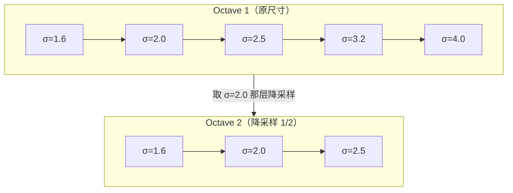
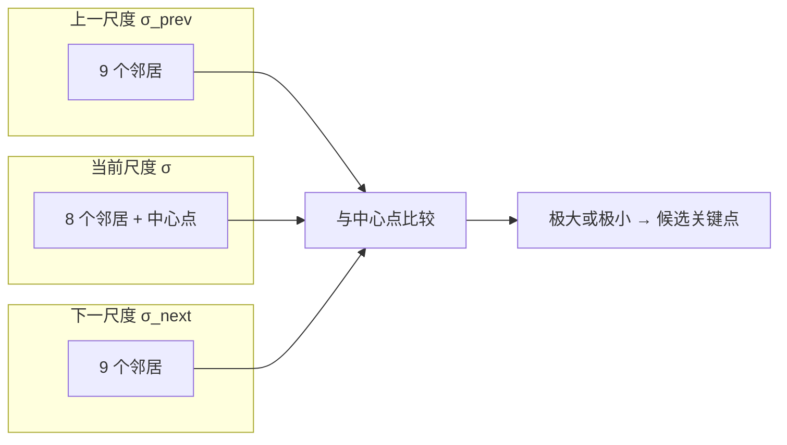
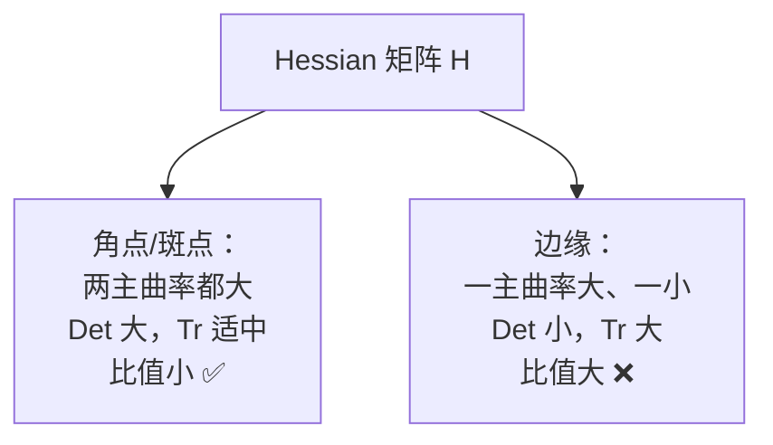
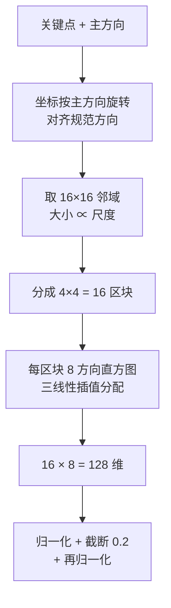
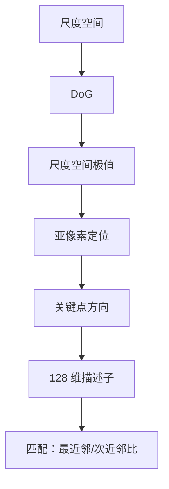

# SIFT 核心概念

> SIFT 里 6 个关键概念，每个都讲清楚「为什么需要它」。

<div class="tip custom-block"><p>🧪 公式看不懂？去 <a href="/math-lab/">原理实验室</a> 拖动滑块直观体验卷积/梯度/高斯/霍夫/角点/RANSAC/光流等核心概念；看完原理再去本页底部 <a href="./source">源码/真机实验室</a> 亲手调参数。</p></div>


## Concept 1：尺度空间（Scale Space）

**一句话**：把图像按不同模糊程度堆叠成金字塔，模拟「从近看和从远看」。

**通俗版**：你把这张照片想象成一叠纸，最下面那张最清晰，越往上越模糊。模糊的那几张代表「退远了看」的画面。

**公式**：

$$
L(x, y, \sigma) = G(x, y, \sigma) * I(x, y)
$$

$$
G(x,y,\sigma) = \frac{1}{2\pi\sigma^2}e^{-\frac{x^2+y^2}{2\sigma^2}}
$$

**结构设计**：



**为什么需要**：不这么做，特征就只能在某一个固定尺度下找到，换个缩放就失效。

**对应的本体实体**：`concept-scale-space`

## Concept 2：DoG 差分高斯

**一句话**：相邻两层高斯图相减，用极小的代价近似高斯拉普拉斯（LoG）。

**通俗版**：「稍微模糊一点」减去「原本的模糊程度」——差值大的地方，就是「在这个尺度下比较有特点的地方」。

**公式**：

$$
D(x,y,\sigma) = L(x,y,k\sigma) - L(x,y,\sigma)
$$

**为什么不用 LoG 直接算**：

| 方案 | 计算量 | 效果 |
|---|---|---|
| 直接算 LoG | 大（二阶导） | 精确 |
| **DoG** | **小（只需减法）** | **近似 LoG，够用** |

::: tip 数学小传
高斯对 sigma 求导：
$$\frac{\partial G}{\partial \sigma} = \sigma \nabla^2 G$$
而 $\frac{\partial G}{\partial \sigma} \approx \frac{G(k\sigma) - G(\sigma)}{k\sigma - \sigma}$，所以 DoG ∝ LoG。
**结论：相减就够了，不用费劲算二阶导。**
:::

## Concept 3：尺度空间极值

**一句话**：一个候选点必须同时是「空间邻域」和「相邻尺度」的极值。

**通俗版**：一个人要当「明星」，不仅要在他自己那栋楼里最出名（空间极值），还要在隔壁几栋楼里也同样出名（尺度极值）。

**26 邻域比较**：



**总数**：$3 \times 3 \times 3 - 1 = 26$

**为什么必须跨尺度比较**：只在单层找极值 → 该点在缩放后就消失了。跨尺度比较 → 找到的点在多个尺度都稳定 → 尺度不变。

## Concept 4：亚像素定位

**一句话**：检测到的极值是整数坐标，用泰勒展开求真正的连续极值位置。

**通俗版**：网格纸上找到「最亮的格子」，但真正的最亮点可能落在格子之间的缝隙里。泰勒展开就是用来估出这个精确位置。

**公式**：

泰勒展开：

$$
D(\mathbf{x}) = D + \frac{\partial D^T}{\partial \mathbf{x}}\mathbf{x} + \frac{1}{2}\mathbf{x}^T\frac{\partial^2 D}{\partial \mathbf{x}^2}\mathbf{x}
$$

求极值偏移（令导数为零）：

$$
\hat{\mathbf{x}} = -\left(\frac{\partial^2 D}{\partial \mathbf{x}^2}\right)^{-1}\frac{\partial D}{\partial \mathbf{x}}
$$

**剔除不稳定的关键点**：

| 剔除类型 | 判据 | 默认值 |
|---|---|---|
| 低对比度点 | $\|D(\hat{\mathbf{x}})\| < T_c$ | OpenCV `contrastThreshold=0.04` |
| 边缘响应点 | $\dfrac{\text{Tr}(H)^2}{\text{Det}(H)} \geq \dfrac{(r+1)^2}{r}$ | OpenCV `edgeThreshold=10` |

**边缘响应判据的直觉**：



## Concept 5：关键点方向

**一句话**：用邻域梯度方向直方图的主峰，作为关键点的方向。

**通俗版**：看看这个小点周围，纹理主要是朝哪个方向走的。把那个方向定义为「正前方」。以后不管图片怎么转，只要按「正前方」来记录周围的样子，就能对上。

**计算**：

梯度幅值：

$$
m(x,y) = \sqrt{(L(x+1,y)-L(x-1,y))^2 + (L(x,y+1)-L(x,y-1))^2}
$$

梯度方向：

$$
\theta(x,y) = \arctan\frac{L(x,y+1)-L(x,y-1)}{L(x+1,y)-L(x-1,y)}
$$

**直方图构建**：

| 项目 | 设置 |
|---|---|
| bin 数量 | 36（每 10° 一个） |
| 加权方式 | 梯度幅值 × 高斯距离权重 |
| 窗口大小 | $1.5\sigma$ 半径 |
| 主方向 | 直方图最高峰 |
| 次方向 | 峰值 ≥ 主峰 80% 时额外生成关键点 |

::: tip 为什么这一步是「旋转不变」的关键
描述子不是按「图像坐标系」算的，而是**按关键点主方向算的**。

图像整体转 30° → 所有关键点的主方向也转 30° → 「相对主方向」的描述子不变 → 匹配成功。
:::

## Concept 6：128 维描述子

**一句话**：把关键点邻域切 16 块、每块统计 8 个方向的梯度强度，拼成 128 个数字的指纹。

**通俗版**：给每个关键点周围拍一张「方向分布照片」，切成 16 小块，每小块记录「纹理主要朝哪 8 个方向、各有多强」，拼起来就是一串 128 个数字，像指纹一样独特。

**构建流程**：



**归一化为什么重要**：

| 步骤 | 目的 |
|---|---|
| 第一次归一化 | 消除光照**整体缩放**的影响 |
| 截断 > 0.2 的分量 | 抑制**局部强光**造成的大梯度 |
| 第二次归一化 | 恢复单位长度 |

**为什么是 4×4×8**：

| 配置 | 维度 | 效果 |
|---|---|---|
| 2×2×8 | 32 | 太快但区分度低 |
| **4×4×8** | **128** | **论文实验最优** |
| 6×6×8 | 288 | 更精确但太慢且易受形变影响 |

## 概念之间的关系



**逻辑链**：

1. 尺度空间 → 提供多尺度观察窗口
2. DoG → 高效地在尺度空间里找候选
3. 尺度空间极值 → 筛出真正稳定的候选点
4. 亚像素定位 → 精确定位 + 剔除不稳定点
5. 关键点方向 → 赋予旋转不变性
6. 128 维描述子 → 生成可匹配的独特指纹

## 本体实例

```yaml
- id: algo-sift
  type: Algorithm
  concepts:
    - "concept-scale-space"
    - "concept-dog"
    - "concept-scale-space-extremum"
    - "concept-subpixel-localization"
    - "concept-keypoint-orientation"
    - "concept-descriptor-128d"
  dependsOn:
    - "op-gaussian-blur"
    - "op-dog"
    - "op-gradient-histogram"
  evolvedFrom: "algo-harris"
  replacedBy:
    - target: "algo-surf"
      scope: "速度敏感场景"
```
