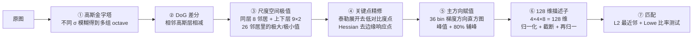
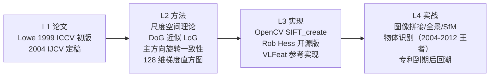

# SIFT 特征匹配

## 🧪 原理互动演示

<AlgoVisualizer type="sift" />


## 🚀 动手体验

> 🧪 **先懂原理**：翻到下一节「核心概念」，页面里直接嵌入了可拖动滑块的原理动画（SIFT高斯金字塔、FLANN KD树、GrabCut迭代、KCF响应峰、ICP配准等），拖一拖就懂。

> 🎮 **再跑真机**：跳到第5页「源码实现」，底部有真机实验室（OpenCV.js 浏览器本地运行），选图调参即可看到真实效果与三语代码。

---

<AlgorithmCard
  name="SIFT 尺度不变特征变换"
  en-name="Scale-Invariant Feature Transform"
  chapter="第4章 · 基元检测 / 第6章 · 目标表达和描述"  chapterLink="/chapters/ch04-primitives"
  branch="特征检测 · 特征点族 / 特征匹配 · 描述子族"
  year="2004"
  author="David G. Lowe"
  paper="https://www.cs.ubc.ca/~lowe/papers/ijcv04.pdf"
  level="中层"
  tagline="近 20 年最具影响力的局部特征——图像界的「指纹」"
  analogy="把图像当成一张地图，在上面找到一批最稳定的地标（关键点）——不管你把地图缩放、旋转、拉近拉远、变暗变亮，这些地标都能被认出来；每个地标周围的特征就是它的「指纹」，两张图只要对上十几个指纹，就能确认它们拍的是同一个地方。"
  scene="图像拼接/全景图、物体识别（当年的「手机拍一下就认出商品」）、图像检索、SLAM 早期前端、相机位姿估计、古籍/画作匹配、无人机航拍图拼接。"
  :pros="[
    '尺度不变、旋转不变，对光照/视角变化鲁棒',
    '描述子区分度高，一个特征点是 128 维向量',
    '匹配精度高，在纹理丰富的场景近乎教科书',
    '专利已过期（2020 年），OpenCV 主分支已重新开放',
    '为后续 SURF/ORB/AKAZE/BRISK 奠定了整个范式'
  ]"
  :cons="[
    '计算量大（构建 DoG 金字塔比较耗时），CPU 实时困难',
    '128 维浮点描述子内存占用高',
    '对弱纹理区域（白墙、天空）几乎找不到关键点',
    '对极端大视角变化（>60°）会掉点',
    '被专利锁了 16 年，工业界很多人转向 ORB'
  ]"
/>

## TL;DR

**一句话**：在**高斯差分（DoG）尺度空间**里找跨尺度极值点，给每个点赋主方向 + 生成 128 维梯度方向描述子——尺度/旋转/光照三不变，像给图像上的每个地标办了一张"数字身份证"。
**解决**：Harris 角点不抗缩放/旋转，无法做跨视角/跨距离匹配的问题。
**代价**：计算量大（DoG 金字塔构建 + 128 维浮点描述子），CPU 上 1080p 图几百毫秒；2020 年前受专利限制工业界被迫用 ORB。
**前置阅读**：[🐣 入门第 4 页 SIFT 一句话](/for-beginners/p4-other-classics#sift-找指纹点) → [💡 核心概念](./concepts)

## 3 分钟电梯演讲



## 四层闭环视图



## 核心贡献一览

| 贡献 | 一句话 | 代码落点 |
|---|---|---|
| 尺度空间极值检测 | 用 DoG 近似 LoG，跨 octave 找极值点 | `sift.cpp::findScaleSpaceExtrema` |
| 关键点精修 | 泰勒展开二次拟合亚像素位置，去低对比度/边缘点 | `adjustLocalExtrema` |
| 主方向赋值 | 36 bin 梯度直方图峰值作为方向，支持多辅峰 | `calcOrientationHist` |
| 128 维描述子 | 相对主方向取 4×4×8 梯度直方图，归一化抗光照 | `computeDescriptors` |
| Lowe 比率测试 | 最近/次近距离 < 0.75 才算匹配有效，大幅降错配 | `BFMatcher.knnMatch(k=2)` |

## 📖 档案目录

| 页面 | 内容 |
|---|---|
| [📄 论文精读](/algorithms/sift/paper) | Lowe 2004 IJCV，尺度空间理论的集大成之作 |
| [💡 核心概念](/algorithms/sift/concepts) | 尺度空间、DoG、主方向、128 维描述子——白话讲 |
| [🏗 算法流程](/algorithms/sift/architecture) | 五步法：金字塔→关键点→方向→描述子→匹配 |
| [🔍 源码走读](/algorithms/sift/source) | OpenCV `SIFT_create` 关键实现 |
| [💣 实战踩坑](/algorithms/sift/painpoints) | 常见的 7 类坑（空匹配、错配、漂移等） |
| [🎛 调参技巧](/algorithms/sift/tricks) | nfeatures、contrastThreshold、sigma 怎么调 |

## 🔗 所属网络

- **学习路径**：🟩 [第4章 基元检测 + 第6章 表达与描述](/learning-path)
- **技术分支**：🌿 [特征检测 → 斑点与特征点](/branches/feature-detection/blobs) + [特征匹配 → 描述子匹配](/branches/feature-matching/descriptors)
- **上游依赖**：[高斯金字塔](/branches/image-processing/filtering)、Harris/Harris-Laplace（先驱）、LoG 斑点检测
- **下游输出**：关键点+描述子 → 用于特征匹配、图像拼接、图像检索、物体识别、SfM 三维重建
- **演化关系**：← Harris/Moravec（先驱）→ SURF（加速版）→ ORB（二值化、无专利）→ AKAZE（非线性尺度空间）→ 被深度学习特征（SuperPoint/D2Net）接班

## 🚀 一行代码

```python
import cv2
sift = cv2.SIFT_create(nfeatures=500)
kp, des = sift.detectAndCompute(img, mask=None)
```
