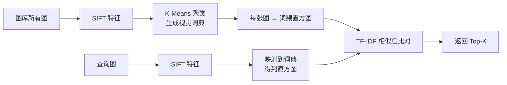
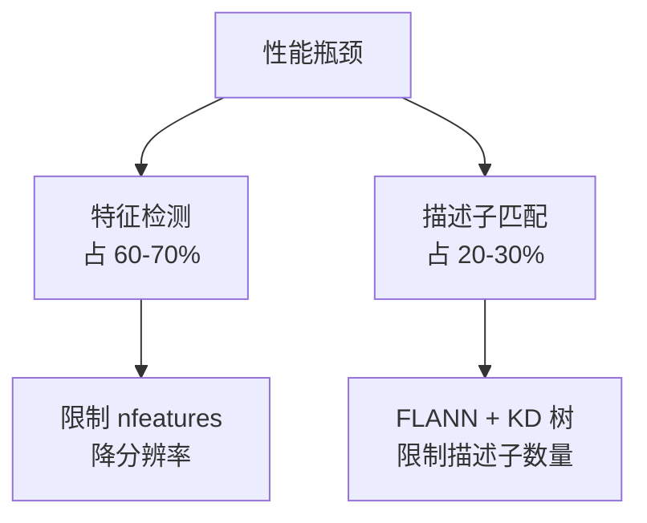

# SIFT 实战与踩坑

> 全景拼接、图像检索、三维重建等真实场景里的经验与坑。

## 案例 1：全景照片拼接

### 场景

手机拍摄多张有重叠的照片，自动缝合成全景长图。

### 技术栈


### 关键参数

| 环节 | 参数 | 推荐值 |
|---|---|---|
| SIFT | contrastThreshold | 0.03（多找点） |
| 匹配 | knn k | 2 |
| Lowe 比值 | ratio | 0.75 |
| RANSAC | reprojThreshold | 4.0 |
| RANSAC | maxIters | 2000 |

### 实测效果

| 指标 | 数值 |
|---|---|
| 单对拼接耗时 | 800 ms – 2 s（1080p，CPU） |
| 匹配点对 | 典型 100–500 对 |
| RANSAC 内点率 | 60%–85% |
| 拼接成功率 | 95%+（光照差异不大时） |

### 踩过的坑

::: danger 坑 1：只做单边匹配，出现「多对一」
**现象**：图 A 的 10 个点都匹配到图 B 的同一个点，错的匹配被当成对的。

**解决**：做**交叉验证（cross-check）**——A 到 B 的最近邻是 B_j，同时 B_j 到 A 的最近邻必须是 A_i，双向一致才保留。

```python
# 双向匹配
matches_ab = flann.knnMatch(des1, des2, k=2)
matches_ba = flann.knnMatch(des2, des1, k=2)

# 建 B→A 的索引
good_ba = {}
for m in matches_ba:
    good_ba[m[0].queryIdx] = m[0].trainIdx
```
:::

::: danger 坑 2：拍摄时绕光心旋转不够 → 单应矩阵失效
**现象**：拼接结果有明显错位或扭曲。

**根因**：**单应矩阵只适用于「相机绕光心纯旋转」或「场景是平面」**。如果拍摄时人绕着景物平移，视差会产生，单应模型无法描述，必然错位。

**解决**：

- 拍摄时**尽量绕光心旋转**（双手举相机原地转身，别平移）
- 或改用**多平面/柱面投影**处理
- 或做**局部对齐 + 接缝优化**（Seam Carving / Graph Cut 融合）
:::

::: danger 坑 3：曝光差异导致接缝明显
**现象**：两张图明明对齐了，但接缝处一条亮暗分界线。

**解决**：
- **增益补偿**：整体调整亮度使重叠区一致
- **多频段融合（Multi-band Blending）**：在不同频率上分别融合，消除接缝
- **泊松融合**：在梯度域融合，效果最好但慢

::: tip 这就是 OpenCV `Stitcher` 类的内部流程
OpenCV 的 `cv2.Stitcher_create()` 内部已经做了：特征匹配 → 单应估计 → 增益补偿 → 多频段融合。生产环境优先用它，自己拼容易踩坑。
:::

## 案例 2：图像检索（相似图搜索）

### 场景

给定一张查询图，从图库里找出相似的图。

### 技术栈（词袋模型 BoW）



### 关键设计

| 环节 | 做法 |
|---|---|
| 词典大小 | 1000–10000 个视觉词 |
| 特征数限制 | 每图最多 500–1000 个特征（提速） |
| 加权 | TF-IDF（罕见词权重高） |
| 加速 | 倒排索引（Inverted File） |
| 重排序 | 用 RANSAC 几何验证 Top 候选 |

### 踩坑

::: danger 坑 4：直接比对原始 SIFT 特征太慢
**现象**：图库 10 万张，查询一次要几十秒。

**解决**：必须走**倒排索引**——把「每个视觉词对应哪些图」索引好，查询时只查查询图命中的词的倒排表。速度提升 100 倍以上。
:::

::: danger 坑 5：只用 BoW 会「丢空间信息」
**现象**：检索出很多「纹理相似但内容不同」的图。

**解决**：加**几何验证**——对 Top-50 候选，用 SIFT 匹配 + RANSAC 验证是否真的存在一致的几何变换。这一步能大幅提升精度。
:::

## 案例 3：老照片/文档对齐

### 场景

同一份文档的多张扫描件对齐，或老照片与新照片的对齐。

### 特点

- **纹理弱**：文档只有文字，特征点少且重复性高
- **SIFT 表现**：文字区域能检测到大量角点，但**描述子区分度不高**（同样的字母形状重复出现）

### 踩坑

::: danger 坑 6：重复纹理导致大量误匹配
**现象**：一页文字里有很多「一样的字形」，SIFT 把它们互相匹配，RANSAC 也救不回来。

**解决**：
- 提高**特征检测阈值**，只保留最独特的点
- 用**更大的邻域**计算描述子（增加上下文区分度）
- 或改用**基于局部区域的方法**（如相位相关）
:::

## 通用踩坑清单

### 数据相关

| 坑 | 现象 | 解决 |
|---|---|---|
| 传彩色图 | `CV_Assert` 报错 | 先 `cvtColor` |
| 图太小 | 关键点太少（<20 个） | SIFT 自动放大小图，或手动 resize |
| 图太大 | 太慢 | 缩放到 1000–2000 px 长边 |
| 图像模糊 | 检测不到特征 | 模糊破坏梯度结构，SIFT 天生不擅长 |

### 匹配相关

| 坑 | 现象 | 解决 |
|---|---|---|
| 没做比值检验 | 大量误匹配 | `ratio < 0.75` |
| 没做交叉验证 | 多对一 | 双向匹配 |
| 没做 RANSAC | 误匹配污染结果 | `findHomography(..., RANSAC)` |
| ratio 阈值太松 | 误匹配多 | 降到 0.6–0.7 |
| ratio 阈值太严 | 匹配太少 | 升到 0.8–0.85 |

### 性能相关

| 坑 | 现象 | 解决 |
|---|---|---|
| 用暴力匹配 | 慢 | 换 FLANN |
| 特征数不限 | 百万级特征太慢 | 限制 `nfeatures` |
| 每次重新建 KD 树 | 重复开销 | 复用 matcher 对象 |
| 全分辨率处理 | 慢 | 缩放到 1000–2000 px |

## 性能优化实践



### 优化前后对比

| 配置 | 检测 | 匹配 | 总耗时 |
|---|---|---|---|
| 原图 4K 全流程 | 1.8 s | 2.5 s | 4.3 s |
| 缩放到 1080p + FLANN + nfeatures=2000 | 0.35 s | 0.12 s | **0.47 s** |
| **提速** | | | **约 9×** |

## SIFT vs 替代方案

::: warning 什么时候不用 SIFT
1. **需要实时** → 用 ORB / FAST + BRIEF
2. **嵌入式低算力** → 用 ORB / BRISK
3. **图像严重模糊** → SIFT 也不擅长，考虑基于模板的方法
4. **有专利顾虑**（历史上）→ 用 ORB（2020 年后 SIFT 专利已过期）
:::

| 场景 | 推荐 |
|---|---|
| 全景拼接（离线高质量） | SIFT |
| 实时 SLAM | ORB |
| 图像检索（大库） | SIFT + BoW / 或用 CNN 特征 |
| 嵌入式 | ORB |
| 三维重建（离线） | SIFT |
| 需要尺度不变 + 快 | SURF（已有开源实现） |

## 实用工具

```python
# 一个鲁棒的匹配函数模板
def match_images(img1, img2, ratio=0.75):
    sift = cv2.SIFT_create(nfeatures=2000)

    kp1, des1 = sift.detectAndCompute(img1, None)
    kp2, des2 = sift.detectAndCompute(img2, None)

    if des1 is None or des2 is None:
        return [], None, None

    # FLANN
    flann = cv2.FlannBasedMatcher(
        dict(algorithm=1, trees=5), dict(checks=50)
    )

    # knn 匹配
    matches = flann.knnMatch(des1, des2, k=2)

    # Lowe 比值检验
    good = [m for m, n in matches if m.distance < ratio * n.distance]

    if len(good) < 4:
        return good, None, None

    # RANSAC 求单应
    src = np.float32([kp1[m.queryIdx].pt for m in good]).reshape(-1, 1, 2)
    dst = np.float32([kp2[m.trainIdx].pt for m in good]).reshape(-1, 1, 2)
    H, mask = cv2.findHomography(src, dst, cv2.RANSAC, 5.0)

    inliers = [good[i] for i in range(len(good)) if mask[i][0]]
    return inliers, H, kp1
```
