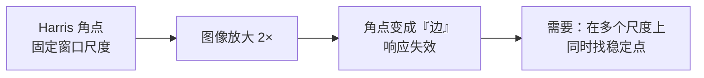
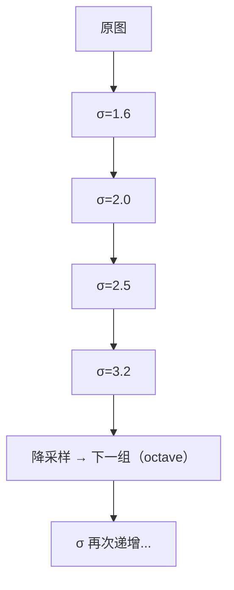
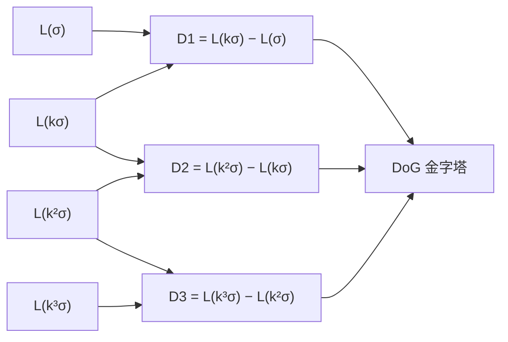
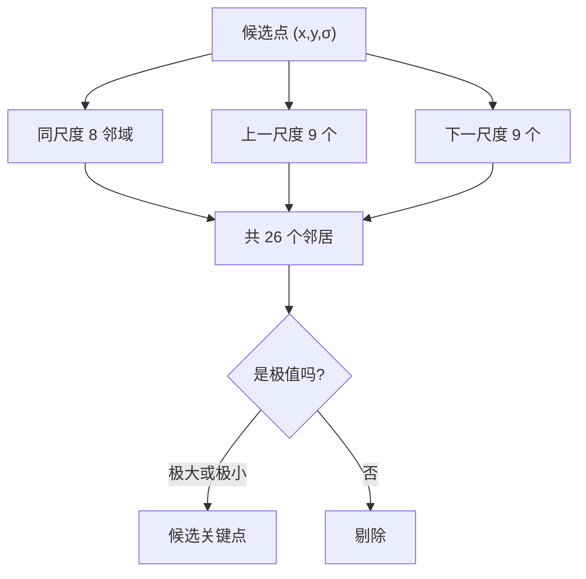
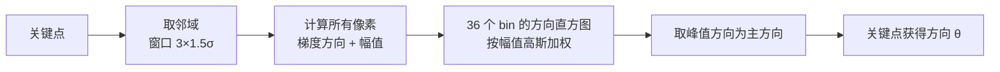
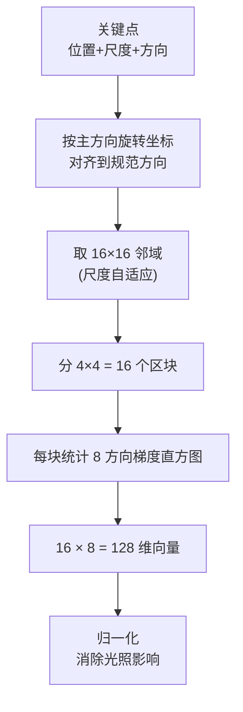
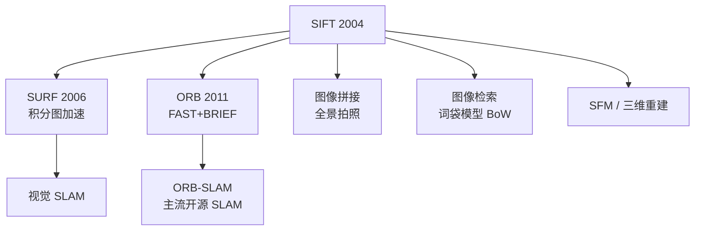

# SIFT 论文精读

> **Distinctive Image Features from Scale-Invariant Keypoints**
> David G. Lowe, International Journal of Computer Vision (IJCV), 2004
> 雏形版：Lowe, ICCV 1999, *Object Recognition from Local Scale-Invariant Features*

## 论文要解决什么问题

2004 年之前，图像匹配的老大难是**视角与尺度变化**：

- 同一个物体，拍近一点、远一点，特征点位置就变了
- 相机转个角度，特征描述子对不上
- 光照变了，梯度幅值全变，匹配全乱

Harris 角点虽然对旋转鲁棒，但它**固定窗口尺度**——图像一缩放，角点的「角」就不成立了。

论文开篇就点明目标：

> 我们需要一种特征，它**在尺度、旋转、部分光照变化下保持稳定**，并且**高度可区分（distinctive）**。

## Motivation：为什么必须引入「尺度」

核心洞察是：

> **一个「角」不是一个点，而是一个跨尺度的现象。**

同一物理位置，在小尺度下可能是角点，在大尺度下可能只是平滑区域的一部分。要在缩放后依然找到它，就**必须在多个尺度上搜索**。

## Innovation 1：尺度空间与 DoG

### 尺度空间（Scale Space）

把图像与不同 sigma 的高斯核卷积，得到一系列模糊程度递增的图像：

$$
L(x, y, \sigma) = G(x, y, \sigma) * I(x, y)
$$

其中 $G(x,y,\sigma)$ 是高斯核。sigma 越大，图像越模糊——**模拟「退后看」的效果**。

**Octave（组）设计**：

- 每组（octave）内，图像尺寸不变，sigma 按 $k = 2^{1/s}$ 递增（$s$ 为每组层数）
- 一组结束后，图像**降采样一半**，进入下一组
- 这样用有限计算量覆盖了「大范围尺度」

### DoG（Difference of Gaussians）

直接对图像求**高斯拉普拉斯（LoG）**计算量大，Lowe 用**相邻两层高斯图相减**来近似：

$$
D(x, y, \sigma) = L(x, y, k\sigma) - L(x, y, \sigma)
$$

::: tip 为什么 DoG 能近似 LoG
$$
\frac{\partial G}{\partial \sigma} \approx \frac{G(x,y,k\sigma) - G(x,y,\sigma)}{k\sigma - \sigma}
$$
高斯函数对 sigma 的导数近似正比于 LoG。所以 **DoG 是 LoG 的高效近似**。
:::

**优势**：只需做高斯卷积，然后做减法，比显式计算 LoG 快得多。

## Innovation 2：26 邻域极值检测

在 DoG 金字塔里，每个点要和**3×3×3 − 1 = 26** 个邻居比较：

**关键点**：**同时在空间和尺度上**要求极值。这保证了：

- 空间极值 → 位置稳定
- 尺度极值 → 缩放后仍能找到

## Innovation 3：亚像素定位与不稳定点剔除

检测到的极值点是**离散的整数位置**，需要精确定位。用**泰勒展开**：

$$
D(\mathbf{x}) = D + \frac{\partial D^T}{\partial \mathbf{x}}\mathbf{x} + \frac{1}{2}\mathbf{x}^T\frac{\partial^2 D}{\partial \mathbf{x}^2}\mathbf{x}
$$

求导置零得极值偏移：

$$
\hat{\mathbf{x}} = -\left(\frac{\partial^2 D}{\partial \mathbf{x}^2}\right)^{-1}\frac{\partial D}{\partial \mathbf{x}}
$$

然后剔除两类不稳定点：

### 剔除 1：低对比度点

$$
|D(\hat{\mathbf{x}})| < 0.03
$$

（论文默认对比度阈值 0.03，OpenCV 里 `contrastThreshold` 默认 0.04）

**原因**：对比度太低的点，位置随噪声漂移，不稳定。

### 剔除 2：边缘响应点

DoG 在**边缘上**也会有强响应，但边缘点沿边方向位置不稳定（要响一整条线）。用 **Hessian 矩阵的迹与行列式比值**判断：

$$
\frac{\text{Tr}(H)^2}{\text{Det}(H)} < \frac{(r+1)^2}{r}
$$

（论文取 $r = 10$，OpenCV 里 `edgeThreshold` 默认 10）

**直观理解**：

- 若是**角点/斑点**：两个主曲率都大 → 迹小、行列式大 → 比值小 ✅ 保留
- 若是**边缘**：一个主曲率大一个极小 → 迹大、行列式小 → 比值大 ❌ 剔除

## Innovation 4：方向分配（旋转不变的关键）

对每个关键点，统计其邻域内**梯度的方向直方图**：

**公式**：

$$
m(x,y) = \sqrt{(L(x+1,y)-L(x-1,y))^2 + (L(x,y+1)-L(x,y-1))^2}
$$

$$
\theta(x,y) = \arctan\frac{L(x,y+1)-L(x,y-1)}{L(x+1,y)-L(x-1,y)}
$$

**处理细节**：

- 直方图共 **36 个 bin**，每 10° 一个
- 每个像素的贡献按**梯度幅值**和**高斯距离权重**加权
- 最后对直方图做**平滑**，取主峰
- 若有次峰达到主峰 **80%**，会额外产生一个同位置同尺度但不同方向的关键点

::: tip 为什么这一步能实现旋转不变
描述子是「相对关键点方向」计算的。图像整体旋转 30°，关键点的**主方向也跟着转 30°**，于是「相对方向」保持不变 —— 描述子自然就一致了。
:::

## Innovation 5：128 维描述子

**细节**：

- 邻域大小与关键点**尺度成正比**（尺寸自适应）
- 每个区块用 **8 个方向 bin**
- 4×4 区块 × 8 方向 = **128 维**
- 三线性插值把梯度贡献分摊到相邻 bin 和相邻区块
- **归一化**：先归一化到单位长度，截断大于 0.2 的分量，再归一化一次 → 抗光照变化

::: tip 通俗版
这就像把关键点周围的一小块区域，切成 16 个小格子，每个格子里记「这个格子里的纹理主要朝哪几个方向、有多强」，拼成一个 128 个数字的「指纹」。
指纹越独特，两张图匹配时越不会认错。
:::

## Innovation 6：匹配策略 —— 最近邻 / 次近邻比

匹配时不看绝对距离，看**距离比**：

$$
\text{ratio} = \frac{d_1}{d_2} < 0.8
$$

其中 $d_1$ 是最近邻距离，$d_2$ 是次近邻距离。

::: tip 为什么用比值
如果最近邻和次近邻距离差不多（比如 100 和 105），说明这个描述子**不独特**——可能对应的是「一片相似的纹理」，不是可靠匹配，丢弃。

如果最近邻明显更近（比如 80 和 200），说明这个特征**很有辨识度**，可靠。

**比值 0.8 是论文给出的经验值**，能剔除 90% 的错误匹配，同时只损失不到 5% 的正确匹配。
:::

## Tradeoff：代价与妥协

| 维度 | SIFT 的取舍 |
|---|---|
| **精度 vs 速度** | 5 步流程 + 128 维描述子，精度极高但速度慢 |
| **不变性 vs 唯一性** | 尺度/旋转不变换来了描述子的复杂度 |
| **光照鲁棒 vs 非线性形变** | 对光照鲁棒，但**非刚性形变**（人脸表情、布料褶皱）不鲁棒 |
| **通用 vs 模糊** | 对**运动模糊**、**失焦**图像表现差（模糊破坏梯度结构） |
| **实时性** | 无法实时，这也是 SURF/ORB/FAST 出现的原因 |

## 论文的长期影响

**SIFT 开启了一个时代**：所有后续的局部特征（SURF、ORB、BRISK、AKAZE）都是对它的「提速」或「改造」。它的**尺度空间**和**方向分配**思想，甚至影响了后来 CNN 里的多尺度特征提取。

## 一句话总结

> SIFT 的最大贡献是**证明了「跨尺度不变的特征」是可以被手工设计出来的**——它把「图像匹配」从「必须控制拍摄条件」变成了「随便拍也能对上」。

## 延伸阅读

- 原文：Lowe, D. G. (2004). *Distinctive Image Features from Scale-Invariant Keypoints.* IJCV, 60(2), 91–110.
- 雏形版：Lowe, D. G. (1999). *Object Recognition from Local Scale-Invariant Features.* ICCV.
- 相关：[SURF 论文](https://www.vision.ee.ethz.ch/~surf/eccv06.pdf)（Bay et al., ECCV 2006）
- 工程实现：[源码走读](/algorithms/sift/source)
