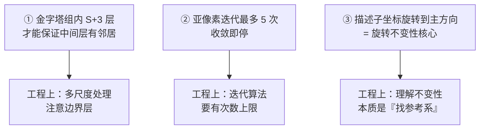

# SIFT 源码走读

> 基于 **OpenCV 4.x** 的 SIFT 实现。OpenCV 4.4 起 SIFT 从 `opencv_contrib` 移回主仓库。
> 相关文件：`modules/features2d/src/sift.dispatch.cpp`、`modules/features2d/src/sift.simd.hpp`

::: warning 说明
以下为**结构与逻辑示意**的伪代码注解，用于讲清实现思路。实际代码请以本地 OpenCV 版本为准。
:::

## 1. 函数入口

```cpp
// sift.dispatch.cpp  简化示意
void SIFT_Impl::detectAndCompute(
    InputArray _image, InputArray _mask,
    std::vector<KeyPoint>& keypoints,
    OutputArray _descriptors, bool useProvidedKeypoints)
{
    // 1. 必须是 8 位单通道
    Mat image = _image.getMat();
    CV_Assert(image.type() == CV_8UC1);   // ← 灰度图，否则报错

    // 2. 预处理：把图像放大一倍、并做初始高斯模糊
    Mat base = createInitialImage(image, firstOctave, (float)sigma);

    // 3. 构建高斯金字塔和 DoG 金字塔
    std::vector<Mat> gpyr, dogpyr;
    int nOctaves = buildGaussianPyramid(base, gpyr);
    buildDoGPyramid(gpyr, dogpyr);

    // 4. 在 DoG 金字塔里找关键点
    findScaleSpaceExtrema(gpyr, dogpyr, keypoints);

    // 5. 过滤掉重复/边界关键点
    // 6. 为每个关键点计算描述子
    if (!useProvidedKeypoints) {
        // 计算方向已在 findScaleSpaceExtrema 里做了
    }
    calcDescriptors(gpyr, keypoints, descriptors, nOctaveLayers, firstOctave);

    // 7. 输出
    _descriptors.assign(descriptors);
}
```

**第一个关键点**：`CV_Assert(image.type() == CV_8UC1)` —— **SIFT 也只接受单通道 8 位图**，和 Canny 一样。

## 2. 初始图像处理

```cpp
// 处理初始图像：放大 + 初始模糊
static Mat createInitialImage(const Mat& img, bool doubleImageSize, float sigma)
{
    Mat gray, temp;

    // 8. 计算需要的初始模糊量
    //    假设输入图本身有 0.5 的模糊（相机造成）
    float sig_diff = sqrtf(std::max(sigma * sigma - 0.5f * 0.5f * 4, 0.01f));

    // 9. 可选：把图像放大一倍（提升小图上的关键点数量）
    if (doubleImageSize) {
        resize(img, temp, Size(img.cols * 2, img.rows * 2), 0, 0, INTER_LINEAR);
        gray = temp;
    } else {
        gray = img;
    }

    // 10. 用算出的小 sigma 做初始模糊
    GaussianBlur(gray, gray, Size(), sig_diff, sig_diff, BORDER_REFLECT_101);
    return gray;
}
```

**为什么 `sigma = 1.6` 而初始模糊只有约 1.52**：

- 论文设定目标尺度是 $\sigma_{\text{target}} = 1.6$
- 但假设相机自身模糊 $\sigma_{\text{cam}} = 0.5$
- 需要额外补充的模糊：

$$
\sigma_{\text{diff}} = \sqrt{\sigma_{\text{target}}^2 - (2\sigma_{\text{cam}})^2} = \sqrt{1.6^2 - 1^2} \approx 1.25
$$

::: tip 为什么要减去相机模糊
模糊是**可叠加**的：$\sigma_{\text{total}}^2 = \sigma_1^2 + \sigma_2^2$。

如果已经在相机里模糊了 0.5，再补 1.6 就会变成 $\sqrt{1.6^2 + 0.5^2}$，超过目标。所以要**先减掉已有部分**。
:::

## 3. 构建高斯金字塔

```cpp
// 构建高斯金字塔
int SIFT_Impl::buildGaussianPyramid(const Mat& base, std::vector<Mat>& pyr)
{
    int nimages = nOctaveLayers + 3;    // 11. 每组层数 = S + 3
    pyr.resize(nOctaves * nimages);

    // 12. 记录每层的 sigma 值
    std::vector<double> sig(nOctaveLayers + 3);
    sig[0] = sigma;                              // 首层 sigma
    double k = pow(2.0, 1.0 / nOctaveLayers);    // 13. 层间倍数 k
    for (int i = 1; i < nOctaveLayers + 3; i++)
        sig[i] = sig[i-1] * k;                   // 逐层乘 k

    // 14. 逐组构建
    for (int o = 0; o < nOctaves; o++) {
        for (int i = 0; i < nOctaveLayers + 3; i++) {
            Mat& dst = pyr[o * (nOctaveLayers + 3) + i];
            if (o == 0 && i == 0) {
                dst = base;
            } else if (i == 0) {
                // 15. 新组的第一层：由上一组降采样而来
                const Mat& src = pyr[(o-1) * (nOctaveLayers + 3) + nOctaveLayers];
                resize(src, dst, Size(src.cols/2, src.rows/2), 0, 0, INTER_NEAREST);
            } else {
                // 16. 同一组内：从前一层再模糊一点
                const Mat& src = pyr[o * (nOctaveLayers + 3) + i - 1];
                double sd = sig[i] * sig[i] - sig[i-1] * sig[i-1];
                GaussianBlur(src, dst, Size(), sqrt(sd), sqrt(sd), BORDER_REFLECT_101);
            }
        }
    }
    return nOctaves;
}
```

**关键设计点**：

| 设计 | 目的 |
|---|---|
| 每组 **S+3** 层 | 保证中间 S 层都有上下邻居可比较 |
| 层间 sigma 按 **k** 递增 | 尺度连续覆盖 |
| 新组首层**降采样** | 用相同计算量覆盖更大尺度 |
| **增量模糊**（16 行） | 每层只补「比上一层多出来的模糊」，不重复计算 |

## 4. 构建 DoG 金字塔

```cpp
// 构建 DoG 金字塔：相邻高斯层相减
void SIFT_Impl::buildDoGPyramid(const std::vector<Mat>& gpyr, std::vector<Mat>& dogpyr)
{
    int nOctaveLayers = this->nOctaveLayers;
    dogpyr.resize(nOctaves * (nOctaveLayers + 2));   // 17. 每组 S+2 层

    for (int o = 0; o < nOctaves; o++) {
        for (int i = 0; i < nOctaveLayers + 2; i++) {
            const Mat& src1 = gpyr[o * (nOctaveLayers + 3) + i];
            const Mat& src2 = gpyr[o * (nOctaveLayers + 3) + i + 1];
            Mat& dst = dogpyr[o * (nOctaveLayers + 2) + i];
            // 18. 用浮点相减，避免 uint8 下溢
            subtract(src2, src1, dst, noArray(), CV_32F);
        }
    }
}
```

**注意第 18 行**：`subtract` 的输出类型是 **`CV_32F`**。DoG 值有正有负，必须用浮点，不能用 uint8（会下溢）。

## 5. 极值检测核心循环

```cpp
void SIFT_Impl::findScaleSpaceExtrema(
    const std::vector<Mat>& gauss_pyr,
    const std::vector<Mat>& dog_pyr,
    std::vector<KeyPoint>& keypoints)
{
    for (int o = 0; o < nOctaves; o++) {
        for (int i = 1; i <= nOctaveLayers; i++) {   // 19. 只遍历中间 S 层
            const Mat& img = dog_pyr[o * (nOctaveLayers + 2) + i];
            const Mat& prev = dog_pyr[o * (nOctaveLayers + 2) + i - 1];
            const Mat& next = dog_pyr[o * (nOctaveLayers + 2) + i + 1];
            int step = img.step / sizeof(float);
            float* curr_ptr = (float*)img.data;
            float* prev_ptr = (float*)prev.data;
            float* next_ptr = (float*)next.data;

            // 20. 跳过边界像素
            for (int r = 1; r < img.rows - 1; r++) {
                for (int c = 1; c < img.cols - 1; c++, curr_ptr++, prev_ptr++, next_ptr++) {
                    float val = curr_ptr[0];

                    // 21. 快速预筛：先把明显不是极值的排除
                    if (std::abs(val) < 0.5f * contrastThreshold / nOctaveLayers) continue;

                    // 22. 检查 26 邻域
                    if (isExtremum(r, c, prev_ptr, next_ptr, curr_ptr, step)) {
                        // 23. 亚像素精确定位 + 剔除不稳定点
                        int kpt = adjustLocalExtrema(dog_pyr, o, i, r, c);
                        if (kpt >= 0) {
                            // 24. 计算方向
                            float scl_octv = ...;
                            float ori = calcOrientationHist(gauss_pyr[...], r, c, ...);
                            // 25. 生成关键点
                            keypoints.push_back(KeyPoint(...));
                        }
                    }
                }
            }
        }
    }
}
```

**逐点理解**：

- **第 19 行**：`i` 从 1 到 `nOctaveLayers`，只遍历中间层（首尾层没有完整邻居）
- **第 20 行**：边界像素跳过（无法取 3×3 邻居）
- **第 21 行**：**快速预筛**是关键性能优化——先判断幅值够不够大，不够就不做 26 邻域比较
- **第 22 行**：`isExtremum` 做 26 邻域比较
- **第 23 行**：`adjustLocalExtrema` 做亚像素定位 + 剔除

### isExtremum 的实现要点

```cpp
// 判断是否极值（简化示意）
bool isExtremum(int r, int c, float* prev, float* next, float* curr, int step)
{
    float v = curr[c];
    if (v > 0) {   // 26. 极大值检查
        if (v <  prev[c-step-1] || v <  prev[c-step] || ... ) return false;  // 上一尺度 9 个
        if (v <  curr[c-1]      || v <  curr[c+1]      || ... ) return false;  // 本层 8 个
        if (v <  next[c-step-1] || v <  next[c-step]   || ... ) return false;  // 下一尺度 9 个
    } else {       // 极小值检查
        // 同上，把 < 换成 >
    }
    return true;
}
```

::: tip 为什么先判 `v > 0`
极大值一定大于 0（DoG 正区），极小值一定小于 0。用符号先分两类，代码路径更短。
:::

### adjustLocalExtrema：亚像素定位

```cpp
int SIFT_Impl::adjustLocalExtrema(const std::vector<Mat>& dog_pyr,
    int octv, int layer, int r, int c)
{
    const int nIter = 5;   // 27. 最多迭代 5 次
    double contrastThreshold = this->contrastThreshold;
    double edgeThreshold = this->edgeThreshold;

    for (int i = 0; i < nIter; i++) {
        // 28. 取 3×3×3 立方体，算一阶、二阶偏导
        float dD[3], H[9];
        // ... 用中心差分计算 ...

        // 29. 求极值偏移 offset = -H^{-1} * dD
        Mat Hm(3,3,CV_32F, H), dDm(3,1,CV_32F, dD);
        Mat offset = -Hm.inv() * dDm;

        // 30. 如果偏移很小，说明收敛了
        if (std::abs(offset.at<float>(0)) < 0.5 &&
            std::abs(offset.at<float>(1)) < 0.5 &&
            std::abs(offset.at<float>(2)) < 0.5) {
            r += cvRound(offset.at<float>(0));
            c += cvRound(offset.at<float>(1));
            layer += cvRound(offset.at<float>(2));
            break;
        }
        // 否则移动位置继续迭代
        r += cvRound(offset.at<float>(0));
        // ...
    }

    // 31. 剔除低对比度点
    //    计算 D(x_hat)
    double val = D + 0.5 * (dD dot offset);
    if (std::abs(val) < contrastThreshold) return -1;

    // 32. 剔除边缘响应点
    //    用 Hessian 的迹和行列式
    float tr = H[0] + H[4];       // 2×2 空间 Hessian 的迹
    float det = H[0]*H[4] - H[1]*H[3];
    float thr = (edgeThreshold + 1) * (edgeThreshold + 1) / edgeThreshold;
    if (tr * tr * edgeThreshold >= thr * det * edgeThreshold) return -1;

    return layer;   // 返回有效层号
}
```

**注意第 32 行的判据**：这里 OpenCV 的实现等价于论文的

$$
\frac{\text{Tr}(H)^2}{\text{Det}(H)} \geq \frac{(r+1)^2}{r}
$$

注意 **`edgeThreshold` 越大越宽松**（保留更多边缘点），和 `contrastThreshold` 的方向相反，很容易搞混。

## 6. 方向分配

```cpp
// 计算关键点主方向
float SIFT_Impl::calcOrientationHist(const Mat& img, int r, int c, float scale, ...)
{
    #define N 36   // 33. 36 个方向 bin
    float hist[N] = {0};
    float expf_scale = -1.f / (2.f * sigma * sigma);   // 34. 高斯权重
    int rad = cvRound(3.f * 1.5f * sigma);              // 35. 窗口半径 = 1.5σ × 3
    float* temphist = ...;

    for (int y = -rad; y <= rad; y++) {
        for (int x = -rad; x <= rad; x++) {
            // 36. 算梯度
            float dx = img.at<float>(r+y, c+x+1) - img.at<float>(r+y, c+x-1);
            float dy = img.at<float>(r+y-1, c+x) - img.at<float>(r+y+1, c+x);
            float mag = std::sqrt(dx*dx + dy*dy);
            float ori = std::atan2(dy, dx) * 180.f / CV_PI;
            if (ori < 0) ori += 360.f;

            // 37. 按位置高斯加权
            float w = std::exp((y*y + x*x) * expf_scale);
            // 38. 三线性插值到相邻 bin
            int bin = cvRound(ori / 10.f) % N;
            hist[bin] += w * mag;
        }
    }

    // 39. 直方图平滑（6 次迭代，每次 1-2-1 加权）
    for (int i = 0; i < 6; i++) {
        // temphist[i] = (hist[i-1] + hist[i] + hist[i+1]) / 3
    }

    // 40. 找主峰和次峰
    float maxval = ...;
    for (int i = 0; i < N; i++) {
        if (hist[i] > maxval) maxval = hist[i];
    }
    // 41. 抛物线插值精修峰值位置
    // 42. 若有 bin > maxval * 0.8，额外生成关键点

    return best_ori;
}
```

**关键细节**：

| 行 | 关键点 |
|---|---|
| 34 | 高斯权重，离中心越远权重越小 |
| 35 | 窗口半径 = 1.5 × 3 × σ |
| 38 | 三线性插值，避免方向边界突变 |
| 39 | **6 次平滑**，让主峰更稳 |
| 41 | 抛物线插值，得到比 10° 更精确的方向 |

## 7. 描述子生成

```cpp
void SIFT_Impl::calcDescriptors(const std::vector<Mat>& gpyr,
    const std::vector<KeyPoint>& keypoints,
    Mat& descriptors, int nOctaveLayers, int firstOctave)
{
    descriptors.create((int)keypoints.size(), SIFT_DESCR_WIDTH * SIFT_DESCR_WIDTH * SIFT_DESCR_HIST_BINS, CV_32F);
    // 即 4 × 4 × 8 = 128 维

    for (int i = 0; i < keypoints.size(); i++) {
        float* d = descriptors.ptr<float>(i);
        // 43. 取对应组和层的高斯图
        calcSIFTDescriptor(gpyr[octave_idx], ptf, ori, scl, ...);
    }
}

// 单个描述子
void calcSIFTDescriptor(const Mat& img, Point2f pt, float ori, double scale,
                        float* dst, ...)
{
    #define d 4        // 44. 4×4 区块
    #define n 8        // 45. 8 个方向

    float cos_t = cos(ori * PI / 180);   // 46. 主方向
    float sin_t = sin(ori * PI / 180);

    // 47. 初始化 128 维直方图（4×4×8）
    float hist[d][d][n] = {0};

    // 48. 遍历旋转后的 16×16 邻域
    for (int i = -8; i < 8; i++) {
        for (int j = -8; j < 8; j++) {
            // 49. 旋转坐标到主方向
            float y = ((i * cos_t) + (j * sin_t)) * scale;
            float x = (-i * sin_t + j * cos_t) * scale;

            // 50. 算该点梯度（在旋转后的高斯图上）
            float dx = ...;
            float dy = ...;
            float mag = std::sqrt(dx*dx + dy*dy);

            // 51. 减去主方向，得到相对方向
            float angle = std::atan2(dy, dx) * 180 / PI - ori;
            if (angle < 0) angle += 360;
            float bins_per_rad = n / 360.f;
            int bin = angle * bins_per_rad;

            // 52. 三线性插值分配
            int rbin = i < 0 ? -1 : 0;
            int cbin = j < 0 ? -1 : 0;
            // ... 按距离权重分配到相邻 bin、行、列 ...

            // 53. 高斯加权（远离中心权重小）
            float w = std::exp(-(i*i + j*j) / (2 * (d * d)) * ...);
            // 分配到 hist[rbin][cbin][bin] 等 8 个位置
        }
    }

    // 54. 展平成 128 维 + 归一化
    // 55. 截断 > 0.2 再归一化
}
```

**最关键的三行**：

| 行 | 为什么重要 |
|---|---|
| 46 | 用主方向构造旋转矩阵 |
| 49 | **坐标旋转到主方向**（这是旋转不变性的核心） |
| 51 | 梯度方向**减去主方向**得到相对方向 |

::: tip 理解旋转不变性只需看第 46、49、51 行
图像整体旋转 → 关键点主方向 `ori` 跟着转 → 坐标旋转矩阵跟着转 → 相对方向不变 → **描述子完全一致**。
:::

## 8. 参数与默认值

| 参数 | OpenCV 默认 | 论文建议 | 说明 |
|---|---|---|---|
| `nfeatures` | 0（不限） | — | 保留的关键点数量上限 |
| `nOctaveLayers` | 3 | 3 | 每组层数 |
| `contrastThreshold` | 0.04 | 0.03 | 对比度阈值 |
| `edgeThreshold` | 10 | 10 | 边缘响应阈值 |
| `sigma` | 1.6 | 1.6 | 初始尺度 |

## 9. Python 调用示例

```python
import cv2
import numpy as np

# ① 读图并转灰度
img = cv2.imread('scene.jpg', cv2.IMREAD_GRAYSCALE)
if img is None:
    raise FileNotFoundError('读图失败')

# ② 创建 SIFT（OpenCV 4.4+ 在主库）
sift = cv2.SIFT_create(
    nfeatures=0,             # 不限数量
    nOctaveLayers=3,
    contrastThreshold=0.04,
    edgeThreshold=10,
    sigma=1.6
)

# ③ 检测 + 计算描述子
keypoints, descriptors = sift.detectAndCompute(img, None)
print(f'关键点数量: {len(keypoints)}')
print(f'描述子形状: {descriptors.shape}')   # (N, 128)

# ④ 画关键点
out = cv2.drawKeypoints(img, keypoints, None,
                        flags=cv2.DRAW_MATCHES_FLAGS_DRAW_RICH_KEYPOINTS)
cv2.imwrite('sift_keypoints.png', out)
```

## 10. 两图匹配示例

```python
import cv2
import numpy as np

sift = cv2.SIFT_create()

img1 = cv2.imread('a.jpg', cv2.IMREAD_GRAYSCALE)
img2 = cv2.imread('b.jpg', cv2.IMREAD_GRAYSCALE)

kp1, des1 = sift.detectAndCompute(img1, None)
kp2, des2 = sift.detectAndCompute(img2, None)

# FLANN 匹配器（比暴力匹配快）
FLANN_INDEX_KDTREE = 1
index_params = dict(algorithm=FLANN_INDEX_KDTREE, trees=5)
search_params = dict(checks=50)
flann = cv2.FlannBasedMatcher(index_params, search_params)

# 每个描述子找 2 个最近邻
matches = flann.knnMatch(des1, des2, k=2)

# Lowe 比值检验
good = []
for m, n in matches:
    if m.distance < 0.75 * n.distance:
        good.append(m)

print(f'好匹配: {len(good)}')

# 用 RANSAC 进一步筛选 + 求单应矩阵
if len(good) > 10:
    src_pts = np.float32([kp1[m.queryIdx].pt for m in good]).reshape(-1, 1, 2)
    dst_pts = np.float32([kp2[m.trainIdx].pt for m in good]).reshape(-1, 1, 2)
    H, mask = cv2.findHomography(src_pts, dst_pts, cv2.RANSAC, 5.0)
    inliers = mask.ravel().sum()
    print(f'RANSAC 内点: {inliers}')
```

## 11. 源码学习的三个关键收获



## 参考

- OpenCV 源码：`opencv/modules/features2d/src/sift.dispatch.cpp`
- 官方文档：[OpenCV SIFT](https://docs.opencv.org/4.x/da/df6/tutorial_py_sift_intro.html)
