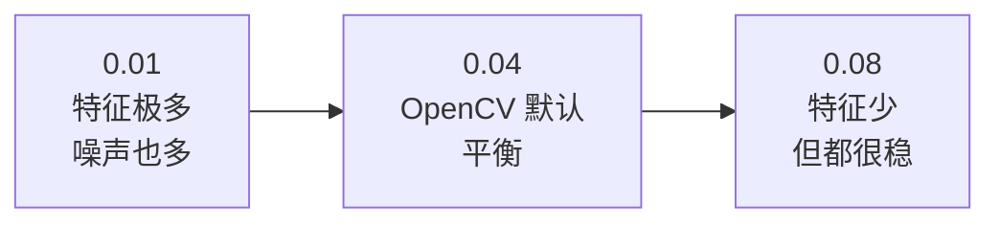
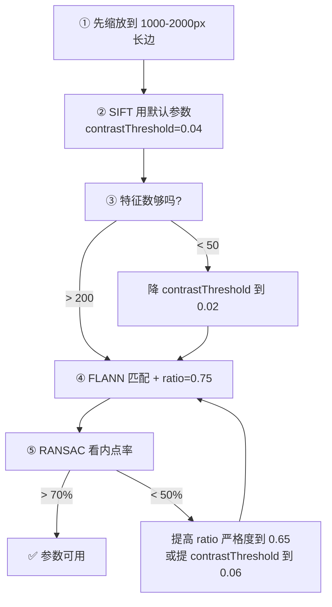
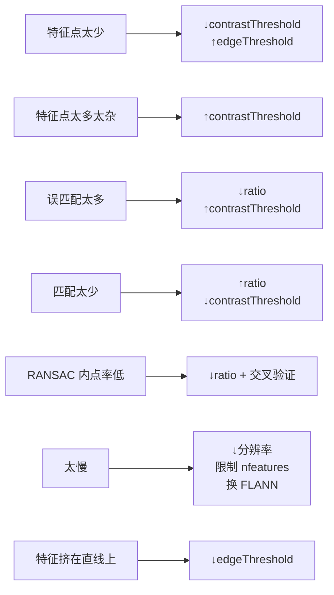

# SIFT 调参技巧

> SIFT 有 5 个参数，但真正需要调的只有 2–3 个。这一页讲清楚每个参数怎么定。

## 参数总览

```python
sift = cv2.SIFT_create(
    nfeatures=0,              # 保留特征数上限
    nOctaveLayers=3,          # 每组层数
    contrastThreshold=0.04,   # 对比度阈值
    edgeThreshold=10,         # 边缘响应阈值
    sigma=1.6                 # 初始尺度
)
```

| 参数 | 影响 | 调整频率 |
|---|---|---|
| `contrastThreshold` | 特征点数量与质量 | ⭐⭐⭐ 常调 |
| `edgeThreshold` | 保留/剔除边缘点 | ⭐⭐ 有时调 |
| `nfeatures` | 特征数量上限 | ⭐⭐ 性能相关 |
| `nOctaveLayers` | 尺度分辨率 | ⭐ 一般不动 |
| `sigma` | 初始模糊 | ⭐ 一般不动 |

## 参数 1：contrastThreshold（最重要）

**作用**：剔除低对比度（不稳定）的特征点。

**方向**：**值越小 → 保留越多特征点（包括噪声）；值越大 → 特征越少但越稳。**



| 取值 | 特征数 | 适用场景 |
|---|---|---|
| 0.01–0.02 | 很多（含噪声） | 纹理很弱、需要高召回 |
| 0.03–0.04 | 适中 | **通用推荐** |
| 0.06–0.10 | 少但可靠 | 匹配精度优先、重复纹理 |

::: tip 实践建议
- **默认用 0.04**
- 发现「特征太少，配不上」→ 降到 0.02
- 发现「大量误匹配」→ 升到 0.06
:::

## 参数 2：edgeThreshold

**作用**：剔除位于边缘上的不稳定点（沿边方向位置不定）。

**方向**：**值越大 → 剔除越宽松 → 保留更多边缘附近的点。**

::: warning 注意方向容易搞反
和 `contrastThreshold` **方向相反**！

| 参数 | 值增大时 |
|---|---|
| `contrastThreshold` | 剔除更严 → 特征更少 |
| `edgeThreshold` | 剔除更宽 → 特征更多 |
:::

| 取值 | 效果 |
|---|---|
| 5 | 严格剔除边缘点，特征少但位置稳 |
| **10** | **OpenCV 默认，推荐** |
| 20 | 宽松，保留更多边缘点 |

::: tip 什么时候要调
一般**不用动**。只有当你在「有强直线结构」的场景（如建筑物、棋盘格）发现特征点都挤在直线上时，才考虑**降低**到 5。
:::

## 参数 3：nfeatures

**作用**：保留特征的数量上限（按响应强度排序）。

| 取值 | 效果 | 适用 |
|---|---|---|
| 0 | 不限（默认） | 离线处理，追求质量 |
| 500–1000 | 限制数量 | 图像检索、需要提速 |
| 2000–5000 | 折中 | 全景拼接 |

::: tip 性能相关
`nfeatures` 限制后，**描述子计算量线性下降**。在图像检索场景，每图限制 500 个特征通常不影响精度，但速度快 4 倍。
:::

## 参数 4：nOctaveLayers

**作用**：每个 octave 的层数，决定尺度采样的**精细程度**。

| 取值 | 效果 |
|---|---|
| 3 | 论文/OpenCV 默认，够用 |
| 5–6 | 尺度采样更细，特征更多，但更慢 |

::: tip 不用动
**保持 3**。除非你发现「同一物体在不同缩放下的特征尺度对不上」，才考虑增加到 5。
:::

## 参数 5：sigma

**作用**：初始高斯模糊程度。

| 取值 | 效果 |
|---|---|
| 1.2 | 保留更多细节 |
| **1.6** | **论文标准值** |
| 2.0 | 更平滑，抗噪强，细节弱 |

::: tip 不用动
**保持 1.6**。这是论文基于实验选定的值。改成别的值需要同步调整金字塔构建，容易出错。
:::

## 匹配阶段的参数（往往比检测参数更重要）

很多人只顾调 SIFT 本身，其实**匹配阶段的 ratio 阈值影响更大**。

### Lowe 比值

```python
matches = flann.knnMatch(des1, des2, k=2)
good = [m for m, n in matches if m.distance < ratio * n.distance]
```

| ratio | 效果 | 适用 |
|---|---|---|
| 0.6 | 非常严格，匹配少但准 | 精度优先 |
| **0.75** | **常用推荐** | 通用 |
| 0.8 | 论文原值，稍宽松 | 特征少时 |
| 0.9 | 很宽松，误匹配多 | 一般不推荐 |

::: tip ratio 怎么选
- 匹配点对**太少**（<20 对）→ 放宽到 0.8
- 误匹配**太多**（RANSAC 内点率 < 50%）→ 收紧到 0.65

**注意**：`k=2` 是必须的（要次近邻才能算比值）。如果改成 `k=1` 就没法做比值检验了。
:::

### RANSAC 重投影阈值

```python
H, mask = cv2.findHomography(src, dst, cv2.RANSAC, reprojThreshold)
```

| 阈值 | 效果 |
|---|---|
| 1.0–2.0 | 严格，适合高精度对齐 |
| **3.0–5.0** | **通用推荐** |
| 8.0–10.0 | 宽松，适合低质量/低分辨率匹配 |

## 一个完整的调参流程



## 不同场景参数起点

| 场景 | contrastThreshold | edgeThreshold | nfeatures | ratio | reprojThresh |
|---|---|---|---|---|---|
| 全景拼接 | 0.03 | 10 | 0 | 0.75 | 4.0 |
| 图像检索 | 0.04 | 10 | 500 | 0.75 | — |
| 三维重建（离线） | 0.02 | 10 | 0 | 0.70 | 3.0 |
| 文档对齐 | 0.06 | 5 | 2000 | 0.80 | 5.0 |
| 低纹理场景 | 0.01 | 10 | 0 | 0.80 | 6.0 |
| 实时近似（用 ORB 替代） | — | — | 1000 | — | — |

## 调参速查表



## 与 ORB 的参数对比

如果你在考虑换 ORB，这是对应参数：

| SIFT | ORB | 说明 |
|---|---|---|
| `contrastThreshold` | `fastThreshold` | 语义不同，ORB 是对比度差阈值 |
| `nfeatures` | `nfeatures` | 语义相同 |
| `edgeThreshold` | `edgeThreshold` | ORB 是边界剔除宽度 |
| — | `scaleFactor` | ORB 金字塔缩放比例，默认 1.2 |
| — | `nlevels` | ORB 金字塔层数，默认 8 |
| — | `WTA_K` | BRIEF 描述子点对数，默认 2 |

## 最后一句建议

::: tip 调参优先级
1. **先保证图像质量**（去噪、适度缩放）——比调参数重要
2. **再调 contrastThreshold**——控制特征数量
3. **然后调 ratio**——控制匹配质量（往往效果最明显）
4. **最后调 RANSAC 阈值**——控制几何验证严格度
5. **其他参数（nOctaveLayers、sigma、edgeThreshold）默认就好**
:::
