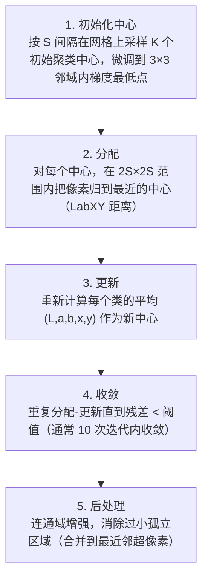

# SLIC 超像素 · 算法流程

<AlgorithmCard
  name="SLIC 超像素"
  enName="Simple Linear Iterative Clustering"
  chapter="ch-10-image-segmentation"
  branch="segmentation"
  year="2010"
  author="R. Achanta et al."
  paper="—"
  level="mid"
  tagline="把 200 万像素切成 200 个颜色一致、大小均匀的小方块，后续处理快 1000 倍"
  analogy="把一张大图当大蛋糕，先按网格切小方块，然后每块根据颜色微调，最后得到一堆大小差不多、颜色统一的小块"
  scene="分割预处理、显著性检测、光流加速、弱监督标注、深度估计超像素化、风格迁移"
  :pros='["速度极快", "超像素紧凑均匀", "内存小", "仅 2 参数", "边界贴合好"]'
  :cons='["必须指定超像素数", "OpenCV 主分支没有", "紧凑度 m 影响边界", "不是分割终点"]'
/>

## 完整算法流程

SLIC 超像素算法可以分解为以下关键步骤：

## 步骤详解

### 步骤 1：初始化中心

按 S 间隔在网格上采样 K 个初始聚类中心，微调到 3×3 邻域内梯度最低点

### 步骤 2：分配

对每个中心，在 2S×2S 范围内把像素归到最近的中心（LabXY 距离）

### 步骤 3：更新

重新计算每个类的平均 (L,a,b,x,y) 作为新中心

### 步骤 4：收敛

重复分配-更新直到残差 < 阈值（通常 10 次迭代内收敛）

### 步骤 5：后处理

连通域增强，消除过小孤立区域（合并到最近邻超像素）

## 在整体视觉 pipeline 中的位置

### 关键复杂度

| 维度 | 复杂度 |
|---|---|
| 时间 | 详见各实现 |
| 内存 | 与图像尺寸线性相关 |

