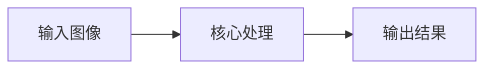
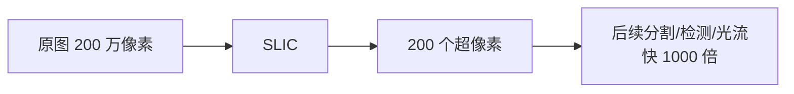

# SLIC 超像素 · 核心概念

<AlgorithmCard
  name="SLIC 超像素"
  enName="Simple Linear Iterative Clustering"
  chapter="ch-10-image-segmentation"
  branch="segmentation"
  year="2010"
  author="R. Achanta et al."
  paper="—"
  level="mid"
  tagline="把 200 万像素切成 200 个颜色一致、大小均匀的小方块，后续处理快 1000 倍"
  analogy="把一张大图当大蛋糕，先按网格切小方块，然后每块根据颜色微调，最后得到一堆大小差不多、颜色统一的小块"
  scene="分割预处理、显著性检测、光流加速、弱监督标注、深度估计超像素化、风格迁移"
  :pros='["速度极快", "超像素紧凑均匀", "内存小", "仅 2 参数", "边界贴合好"]'
  :cons='["必须指定超像素数", "OpenCV 主分支没有", "紧凑度 m 影响边界", "不是分割终点"]'
/>

🧪 公式看不懂？去 <a href="/math-lab/">原理实验室</a> 拖动滑块直观体验卷积/梯度/高斯/霍夫/角点/RANSAC/光流等核心概念；看完原理再去本页底部 <a href="./source">源码/真机实验室</a> 亲手调参数。

## SLIC 超像素的核心思想

把 200 万像素切成 200 个颜色一致、大小均匀的小方块，后续处理快 1000 倍。把一张大图当大蛋糕，先按网格切小方块，然后每块根据颜色微调，最后得到一堆大小差不多、颜色统一的小块

**生活类比**：把一张大图当大蛋糕，先按网格切小方块，然后每块根据颜色微调，最后得到一堆大小差不多、颜色统一的小块

**典型应用**：分割预处理、显著性检测、光流加速、弱监督标注、深度估计超像素化、风格迁移

## 核心概念详解

### 概念1：超像素

超像素 = 一组视觉上相似、位置相近的像素组成的小区域。用几百个超像素代替几百万个像素做后续处理，计算量降几个数量级，同时保留边缘结构。

### 概念2：五维 LabXY 空间

SLIC 在 (L, a, b, x, y) 五维空间做 K-Means 聚类：三个颜色通道加两个空间坐标。颜色距离和空间距离用不同权重平衡。

### 概念3：紧凑度 m

距离定义 D = d_color + (m/S)·d_spatial，其中 S 是超像素期望边长（S=sqrt(N/K)）。m 控制「形状方正 vs 贴紧边界」：m 小→形状不规则但贴边界；m 大→超像素方正。

### 概念4：局部搜索

标准 K-Means 在全图搜最近中心，SLIC 只在中心周围 2S×2S 区域搜索——复杂度从 O(NKI) 降到 O(NI)，即**线性复杂度**。

