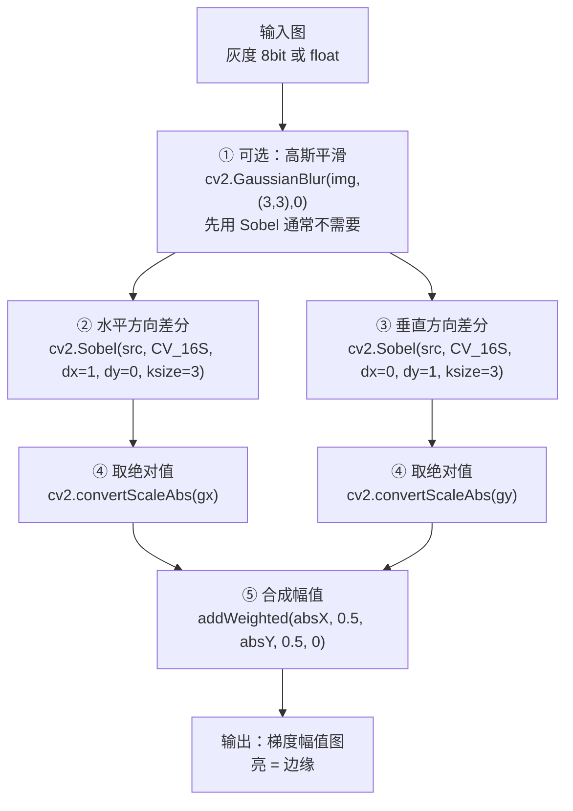

# Sobel 算法流程

> Sobel 只有「差分 → 合成」两大步，但细节全在参数和数值类型里。这一页从管线图到可运行代码，把每个环节讲透。

## 完整管线



::: warning 别被「④ 取绝对值」骗了
`cv2.Sobel` 的中间结果**必须**用 `CV_16S` 或 `CV_32F` 接住。原因是梯度有正有负（左暗右亮 vs 左亮右暗），用 `CV_8U` 接会让所有负值被截断成 0——结果就是**一半方向的边缘凭空消失**。这是 Sobel 最经典的坑，详见[踩坑页](./painpoints)。
:::

## 步骤拆解

| 步骤 | 输入 | 输出 | 关键参数 | 说明 |
|---|---|---|---|---|
| ① 平滑（可选） | 灰度图 | 平滑图 | `ksize`, `sigma` | Sobel 自带 1-2-1 平滑，通常跳过；噪声大可加 |
| ② x 方向差分 | 平滑图 | $G_x$ | `dx=1, dy=0` | 找出**竖直**边缘 |
| ③ y 方向差分 | 平滑图 | $G_y$ | `dx=0, dy=1` | 找出**水平**边缘 |
| ④ 取绝对值 | $G_x/G_y$ | $\lvert G_x\rvert,\lvert G_y\rvert$ | — | 把负值翻正，便于显示 |
| ⑤ 合成 | 两幅绝对值图 | 幅值图 | 权重 0.5 | 或用 L2：$\sqrt{G_x^2+G_y^2}$ |

## Numpy 手写：一次讲清的极简版

```python
import numpy as np
import cv2

def sobel_manual(gray):
    """纯 Numpy 手写 Sobel，理解用，不用 OpenCV 的 Sobel"""
    img = gray.astype(np.float32)

    # 两个经典核（注意 Gy 是 Gx 的转置）
    Kx = np.array([[-1, 0, 1],
                   [-2, 0, 2],
                   [-1, 0, 1]], dtype=np.float32)
    Ky = np.array([[-1, -2, -1],
                   [ 0,  0,  0],
                   [ 1,  2,  1]], dtype=np.float32)

    # 用 filter2D 做二维卷积（内部会处理边界）
    gx = cv2.filter2D(img, cv2.CV_32F, Kx)
    gy = cv2.filter2D(img, cv2.CV_32F, Ky)

    # 合成幅值（L2）与方向
    mag = np.sqrt(gx**2 + gy**2)
    ang = np.arctan2(gy, gx)

    # 归一化到 0-255 便于显示
    mag_disp = cv2.normalize(mag, None, 0, 255, cv2.NORM_MINMAX).astype(np.uint8)
    return gx, gy, mag_disp, ang
```

## 完全从零手写卷积（不含 OpenCV）

```python
import numpy as np

def conv2d_valid(img, kernel):
    """最朴素的 valid 卷积，只为了看清 Sobel 到底在算啥"""
    h, w = img.shape
    kh, kw = kernel.shape
    out = np.zeros((h - kh + 1, w - kw + 1), dtype=np.float32)
    for i in range(out.shape[0]):
        for j in range(out.shape[1]):
            patch = img[i:i+kh, j:j+kw]
            out[i, j] = np.sum(patch * kernel)
    return out

Kx = np.array([[-1, 0, 1], [-2, 0, 2], [-1, 0, 1]], dtype=np.float32)
gx = conv2d_valid(gray.astype(np.float32), Kx)
```

`conv2d` 只有一行是本质：`np.sum(patch * kernel)`——**把 3×3 邻域和核逐元素相乘再求和**。Sobel 的全部数学，就在这一行里。

## 可分离实现（性能版）

```python
# 2D 核 = 1D 平滑核 ⊗ 1D 差分核
smooth  = np.array([1, 2, 1], dtype=np.float32)      # 垂直平滑
diff    = np.array([-1, 0, 1], dtype=np.float32)     # 水平差分

# OpenCV 直接给你两个 1D 核
kx, ky = cv2.getDerivKernels(dx=1, dy=0, ksize=3)
# kx = [[-1.], [0.], [1.]] ，ky = [[1.], [2.], [1.]]
```

## OpenCV API 全参数

```python
gx = cv2.Sobel(src, ddepth, dx, dy, ksize=3, scale=1, delta=0, borderType=cv2.BORDER_DEFAULT)
```

| 参数 | 含义 | 典型值 | 影响 |
|---|---|---|---|
| `src` | 输入图像 | 灰度图（单通道） | 彩色图需先转灰度或分通道处理 |
| `ddepth` | 输出数据类型 | **`cv2.CV_16S`**（必用） | 用 `CV_8U` → 负梯度截断，边缘减半 |
| `dx` | x 方向求导阶数 | `1` 或 `0` | `dx=1,dy=0` 找竖边 |
| `dy` | y 方向求导阶数 | `0` 或 `1` | `dx=0,dy=1` 找横边 |
| `ksize` | 核大小 | `3`（或 `-1`=Scharr） | 奇数，越大越平滑越慢 |
| `scale` | 结果缩放因子 | `1` | 一般不用改 |
| `delta` | 结果加偏置 | `0` | 一般不用改 |
| `borderType` | 边界处理 | `BORDER_DEFAULT` | 影响图像边缘一圈像素 |

::: tip ksize = -1 是什么
`cv2.Sobel(..., ksize=-1)` 会**自动改用 3×3 的 Scharr 核**（方向对称性更好）。这是一种「不改代码就升级精度」的小技巧。
:::

## 变体家族对比

| 算子 | OpenCV 调用 | 核权重 | 抗噪 | 方向对称 | 适用 |
|---|---|---|---|---|---|
| Roberts | 手写 | 2×2 | ⭐ | ⭐ | 教学、极低算力 |
| Prewitt | 手写 | 3×3 全 1 | ⭐⭐ | ⭐⭐ | 教学 |
| **Sobel** | `cv2.Sobel` | 3×3 加 1-2-1 | ⭐⭐⭐ | ⭐⭐⭐ | **通用默认** |
| Scharr | `cv2.Scharr` | 3×3 优化权重 | ⭐⭐⭐ | ⭐⭐⭐⭐ | 方向要求高 |
| Laplacian | `cv2.Laplacian` | 二阶导 | ⭐ | — | 各向同性找边、锐化 |

## 与 Canny 的关系（一张图）


**一句话**：Canny = **Sobel 的梯度 + 三步后处理**。理解了这一页，Canny 就只剩「NMS + 双阈值」两个新东西要学。

[← 上一篇：核心概念](./concepts) · [下一篇：源码走读 →](./source)
