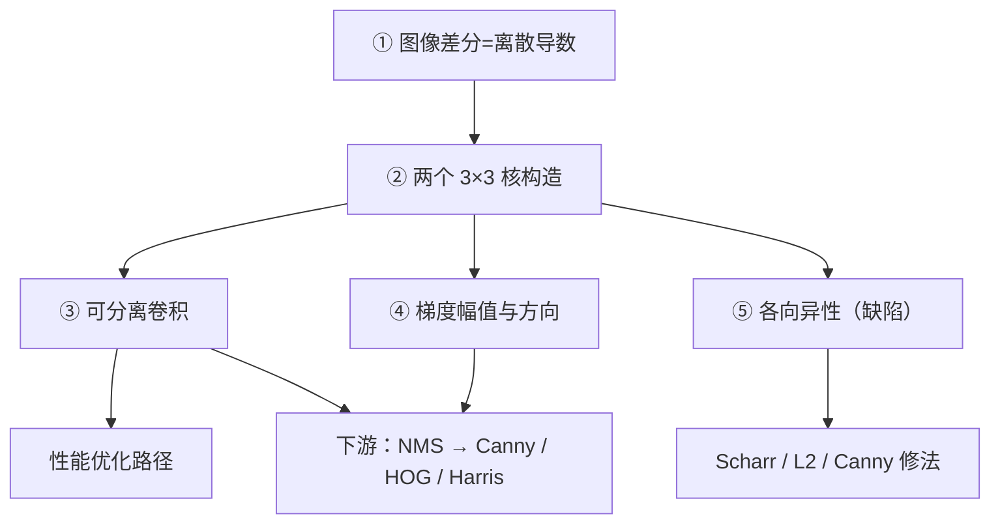

# Sobel 核心概念

> Sobel 背后只有 6 个概念，但每一个都牵连着整个传统 CV 的底层逻辑。逐个拆开讲清。

<div class="tip custom-block"><p>🧪 公式看不懂？去 <a href="/math-lab/">原理实验室</a> 拖动滑块直观体验卷积/梯度/高斯/霍夫/角点/RANSAC/光流等核心概念；看完原理再去本页底部 <a href="./source">源码/真机实验室</a> 亲手调参数。</p></div>


## Concept 1：图像差分 = 离散版导数

**一句话**：图像没有「导数」这种东西，只有相邻像素的**差值**——差得多就是变化快。

**通俗版**：把一列像素想成一段山路的高度，走一步的海拔变化就是「坡度」。差分就是拿两步海拔相减。

**数学化**：一维信号的连续导数对应离散差分

$$
\frac{\partial I}{\partial x} \approx I(x+1) - I(x)
$$

为了对称和抗噪，工程上用**中心差分**：

$$
\frac{\partial I}{\partial x} \approx \frac{I(x+1) - I(x-1)}{2}
$$

Sobel 的核 `[-1, 0, 1]` 就是「去掉分母 2、并按 1-2-1 加权取上下两行」的结果。

**对应本体实体**：`concept-gradient-magnitude`

## Concept 2：两个 3×3 卷积核的构造

**一句话**：$G_x$ 核管横向差分（找出竖着的边），$G_y$ 核管纵向差分（找出横着的边）。

**通俗版**：$G_x$ 像一只手左右摸——它在意「左边亮还是右边亮」；$G_y$ 像上下摸——它在意「上边亮还是下边亮」。

**两个核**：

$$
G_x = \begin{bmatrix} -1 & 0 & 1 \\ -2 & 0 & 2 \\ -1 & 0 & 1 \end{bmatrix},
\qquad
G_y = \begin{bmatrix} -1 & -2 & -1 \\ 0 & 0 & 0 \\ 1 & 2 & 1 \end{bmatrix}
$$

**三个记忆要点**：

- **每行/每列之和为 0** → 因为纯差分对「平坦区域」（全是同一个值）必须输出 0，否则会引入假边缘
- **中心为 0、两侧正负对称** → 只有「变化」才有响应，「整体亮度」不响应
- **$G_y$ 是 $G_x$ 的转置** → 同一个核旋转 90° 而已

**对应本体实体**：`op-sobel`

## Concept 3：可分离卷积（性能的关键）

**一句话**：3×3 的 Sobel 核 = 一个「差分」一维核 × 一个「平滑」一维核，所以可以用两次一维卷积代替一次二维卷积。

**通俗版**：本来是「3×3 一块布盖上去算 9 次」，现在改成「先横着刷一道，再竖着刷一道」，只算 6 次。

**数学化**：

$$
G_x = \begin{bmatrix}1\\2\\1\end{bmatrix} \otimes \begin{bmatrix}-1&0&1\end{bmatrix}
$$

- 二维卷积：每个像素 $9$ 次乘加
- 可分离：每个像素先在 x 方向做 $3$ 次（得中间结果），再在 y 方向做 $3$ 次 → 共 $3+3=6$ 次

| 方式 | 每像素乘加次数 | 相对速度 |
|---|---|---|
| 直接 2D 卷积 | 9 | 1.0× |
| 可分离卷积 | 6 | 1.5× |

**为什么大核更明显**：$k\times k$ 核的可分离把 $k^2$ 降到 $2k$。$k=15$ 时是 $225 \to 30$，快 7.5 倍。这就是 OpenCV `getDerivKernels` 存在的意义。

**对应本体实体**：`op-separable-convolution`（概念层）；实现见 [算法流程](./architecture)

## Concept 4：梯度幅值与方向

**一句话**：把两个方向的差分合成一个「有多陡」和「朝哪边陡」的向量。

**通俗版**：$G_x$ 和 $G_y$ 是坡度的横分量和纵分量，合起来就是「最陡方向」的坡度和朝向。

**公式**：

$$
M = \sqrt{G_x^2 + G_y^2}
\qquad \text{（L2 幅值，精度高）}
$$

$$
M \approx |G_x| + |G_y|
\qquad \text{（L1 幅值，省一次开方，OpenCV 的 } \texttt{L2gradient=False} \text{）}
$$

$$
\theta = \operatorname{atan2}(G_y,\ G_x) \in (-\pi, \pi]
$$

**关键点**：

- 幅值 $M$ 是**边缘强度图**：亮的像素就是边界
- 方向 $\theta$ 垂直于边缘走向（**沿梯度方向跨过边**，而不是顺着边）
- OpenCV 里 `L2gradient` 默认 `False`（用 L1 近似）——为了速度，代价是幅值略有偏差

**对应本体实体**：`concept-gradient-magnitude`、`concept-gradient-orientation-histogram`

## Concept 5：各向异性（Sobel 的核心缺陷）

**一句话**：Sobel 对水平/垂直边缘响应最强，对 45° 斜边响应最弱，两者相差约 $\sqrt2$ 倍。

**通俗版**：用米字型的尺子量「横边竖边」很准，量「斜边」就会偏小——同一个物体转 45° 后，Sobel 说它「边缘更弱了」，其实没变。

**定量对比**（对同一强度的理想阶梯边缘）：

| 边缘方向 | Sobel 响应（相对值） |
|---|---|
| 0°（垂直边） | 1.00 |
| 90°（水平边） | 1.00 |
| 45° / 135°（斜边） | ≈ 0.71（1/√2） |

**为什么重要**：在需要**旋转鲁棒**的场合（圆形零件检测、任意角度字符），直接看 Sobel 幅值会在斜边处系统性偏低，导致同一个阈值对斜边失效。

**三种修法**：

1. 换 **Scharr 算子**（优化权重，方向偏差显著减小）
2. 用 **L2 幅值** 而非 L1（略改善）
3. 改用 **Canny**（非极大值抑制 + 双阈值，对方向不敏感）

**对应本体实体**：`concept-anisotropy`（概念层）

## Concept 6：与三个近亲的区别

**一句话**：Sobel、Prewitt、Roberts、Scharr 都是「差分找边」，差别只在核的权重和大小。

**四个算子的核**：

| 算子 | 年份 | 核 | 特点 |
|---|---|---|---|
| **Roberts** | 1965 | $2\times2$ 交叉 $[[1,0],[0,-1]]$ | 最快，但抗噪极差、只有两方向 |
| **Prewitt** | 1970 | 全 1 的 3×3 差分 | 无平滑权重，抗噪中等、方向偏差更大 |
| **Sobel** | 1968 | 1-2-1 加权的 3×3 差分 | 平衡点，ISO 标准推荐 |
| **Scharr** | 2000 | $[-3,0,3;-10,0,10;-3,0,3]$ | 旋转对称性最好，`cv2.Scharr` |

**选择口诀**：

> 小图、低噪 → Roberts 也行；通用 → **Sobel**；要求方向准 → **Scharr**；要真正的边 → 上 **Canny**。

**对应本体实体**：`op-sobel`、`op-scharr`、`op-prewitt`

## 概念之间的关系



**逻辑链**：

1. 差分给出「边缘」的离散定义 →
2. 用两个 3×3 核在 x/y 两个方向实现差分 →
3. 核可分离 → 性能优化；
4. 两方向结果合成 → 幅值 + 方向；
5. 核的方向偏差 → 各向异性问题 → Scharr / Canny 补位。

## 本体实例映射

```yaml
- id: algo-sobel
  type: Algorithm
  concepts:
    - "concept-gradient-magnitude"
    - "concept-gradient-orientation-histogram"
  dependsOn:
    - "op-separable-convolution"
    - "op-sobel"
  replacedBy:
    - "algo-canny"
```

[← 返回 Sobel 总览](./) · [下一篇：算法流程 →](./architecture)

> 🧪 **看不懂公式？去[数学实验室](/math-lab/)拖动滑块直观体验**——卷积、梯度、高斯、霍夫、角点、RANSAC、光流都有实时互动demo，看完再回来。
