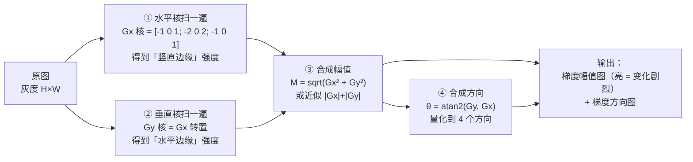
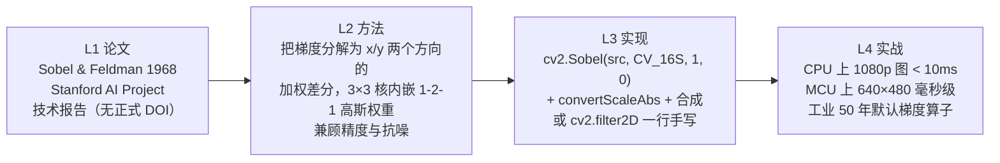
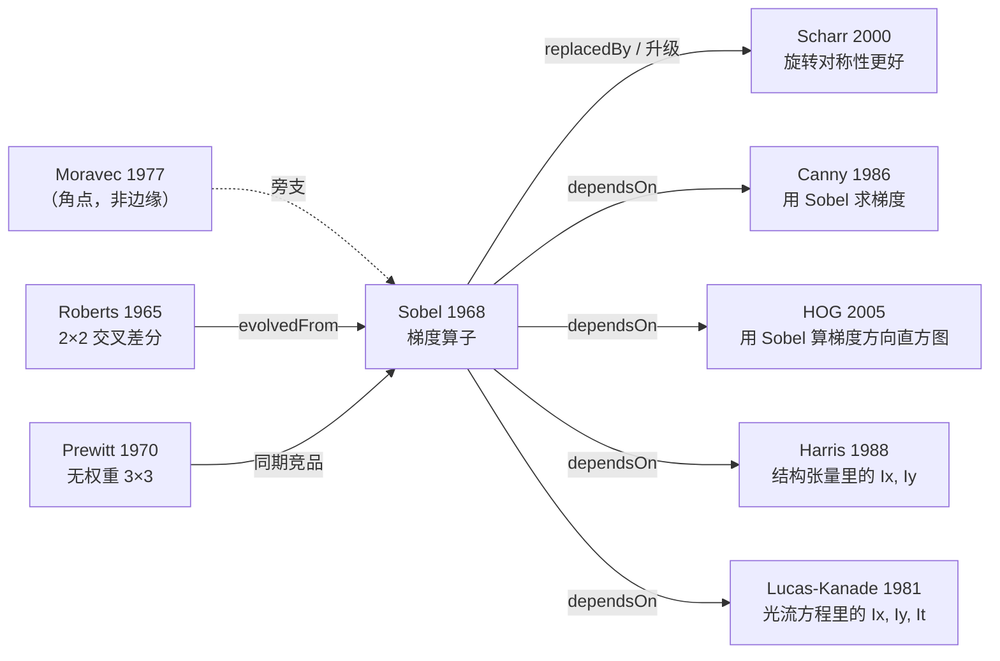

# Sobel 边缘算子

<AlgorithmCard
  name="Sobel 边缘算子"
  en-name="Sobel Operator"
  chapter="第4章 · 基元检测"  chapterLink="/chapters/ch04-primitives"
  branch="图像处理 · 梯度/边缘族"
  year="1968"
  author="Irwin Sobel · Gary Feldman"
  paper="https://www.researchgate.net/publication/239398674_A_3x3_Isotropic_Gradient_Operator_for_Image_Processing"
  level="低层"
  tagline="边缘检测的原子积木——横着摸一下、竖着摸一下，就知道哪里在变"
  analogy="像蒙着眼睛用手掌摸桌面找一道棱：手掌横着划过（横向差），再竖着划过（纵向差），哪个方向突然硌手，棱就在那儿。而且手掌是软的（带 1-2-1 高斯加权），不会因为桌上一粒灰就误判成棱。"
  scene="所有需要边缘的场合：Canny 的第一步、工业零件轮廓粗提取、车道线、PCB 走线、车牌定位、HOG 特征的梯度计算、图像锐化的基础。"
  :pros="[
    '简洁到极致：两个 3×3 卷积核，任何库、任何硬件、任何语言都能几行实现',
    '带 1-2-1 高斯加权，比纯差分（Prewitt）更抗噪，工业噪声环境下更稳',
    '天然可分离：2×9 次乘法代替 3×3=9 次，嵌入式上速度提升近一倍',
    '是 Canny、HOG、Lucas-Kanade、Harris 等一大批算法的公共前置算子',
    '算力需求极低，MCU（无 GPU、无 NPU）上 640×480 图仍能毫秒级跑完'
  ]"
  :cons="[
    '各向异性：水平/垂直边缘响应最强，45° 斜边响应弱约 √2 倍（Scharr 才是修正版）',
    '没有亚像素定位能力，边缘位置只能精确到像素',
    '只给梯度幅值，给不出「这条边是不是真的边」的判断（要 Canny 的非极大值抑制 + 双阈值）',
    '对噪声仍比 Canny 敏感——它没有平滑预处理，也没有滞后连接'
  ]"
/>

## TL;DR

**一句话**：用两个 3×3 的「加权差分」卷积核分别扫过图像，得到水平梯度 $G_x$ 与垂直梯度 $G_y$，再合成梯度幅值 $M=\sqrt{G_x^2+G_y^2}$ 与方向 $\theta=\arctan(G_y/G_x)$——幅值大的地方就是边缘。

**解决**：早期 Roberts 2×2 交叉差分算子在噪声下几乎不可用的痛点，给出一个「既简单又还算抗噪」的 3×3 梯度算子。

**代价**：各向异性（斜边响应偏弱）、无亚像素精度、无边缘判定机制（需配合 NMS + 阈值）。

**前置阅读**：[💡 核心概念](./concepts) → [🌿 图像处理分支 · 滤波与卷积](/branches/image-processing/filtering) → [🧱 算子词典 · Sobel](/operators/sobel)

## 3 分钟电梯演讲

**一句话流程**：**横着差分得 $G_x$ → 竖着差分得 $G_y$ → 合成幅值和方向**。三步，没有第 4 步——这就是 Sobel 的全部。

## 四层闭环视图

## 核心贡献一览

| 贡献 | 一句话 | 代码落点 |
|---|---|---|
| 3×3 分离梯度核 | 把二维梯度拆成两个方向的一维差分，计算量骤降 | `cv2.Sobel(src, ddepth, 1, 0)` / `(0, 1)` |
| 内嵌高斯加权 | 核中心的 2 让算子自带轻微平滑，抗噪优于纯差分 | 核权重 `[-1,0,1; -2,0,2; -1,0,1]` |
| 可分离性 | 2D 卷积 = 两次 1D 卷积，复杂度从 O(k²) 降到 O(2k) | `cv2.getDerivKernels(1,0,3)` 返回两个 1D 核 |
| 「Isotropic」的追求 | 论文标题即目标：各向同性 | `cv2.Scharr` 是其修正版 |
| 幅值+方向双输出 | 一次卷积同时给出边缘「强弱」和「朝向」 | `np.arctan2(gy, gx)` |

## 📖 档案目录

| 页面 | 内容 |
|---|---|
| [论文精读](./paper) | Sobel & Feldman 1968 报告精读：为什么加 1-2-1 权重、为什么叫「各向同性」 |
| [核心概念](./concepts) | 卷积与差分、3×3 核的构造、可分离性、各向异性、与 Prewitt/Scharr/Roberts 的对比 |
| [算法流程](./architecture) | 完整管线图 + 步骤拆解 + Numpy 手写 + OpenCV 全参数 |
| [源码走读](./source) | OpenCV 调用 / 手写卷积 / Scharr 替代 / 工业级锐化与轮廓提取 |
| [实战与踩坑](./painpoints) | ddepth 截断、忘取绝对值、方向搞反、斜边漏检等 10 个坑 |
| [调参技巧](./tricks) | ksize 选择、ddepth 固定写法、5 个场景抄作业参数表 |

## 它站在哪条线的起点

**一句话定位**：Sobel 不是「最好的边缘检测器」，它是**所有需要梯度的算法的公共零件**。Canny 的非极大值抑制要它、HOG 的方向直方图要它、Harris 的结构张量要它、Lucas-Kanade 的空间梯度要它。理解 Sobel，等于拿到理解这一整族的钥匙。

[算子词典](/operators/) · [场景反查](/scenarios/) · [版本总览](/versions/) · [图像处理分支](/branches/image-processing/)
