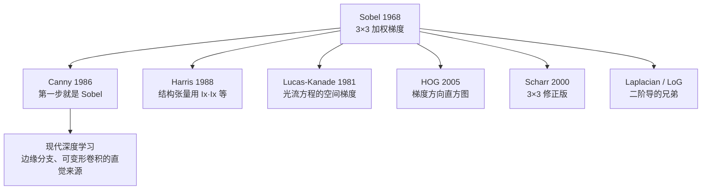

# Sobel 边缘算子 · 论文精读

> 严格的「论文」二字其实不太适用——Sobel 算子最早的出处是 1968 年斯坦福人工智能项目（Stanford AI Project）的一份技术报告，由 **Irwin Sobel** 与 **Gary Feldman** 署名。它没有正式期刊 DOI，却比绝大多数正式论文影响更广。这一页讲清这份报告到底说了什么、为什么 58 年后还在被用。

## 论文名片

| 项 | 内容 |
|---|---|
| 标题 | *A 3×3 Isotropic Gradient Operator for Image Processing* |
| 作者 | Irwin Sobel、Gary Feldman |
| 年份 | 1968 |
| 出处 | Stanford Artificial Intelligence Project（SAIL）技术报告 |
| 形式 | 技术报告 / 会议交流稿，无正式 DOI |
| 本体 ID | `paper-sobel-1968` |
| 引用量级 | 万级（几乎所有图像处理教材引用） |
| 阅读状态 | skimmed（作为基础算子速览） |

## 一、当时的问题：怎么「摸」出边缘？

1960 年代中期，图像处理刚从「打印字符画」阶段走出来，人们需要一个能自动找到**物体轮廓**的算法。当时可用的思路大致三条：

| 思路 | 代表 | 问题 |
|---|---|---|
| 直接像素相减 | 手动差分 | 对噪声极其敏感，随便一粒灰就报「边」 |
| 2×2 交叉差分 | Roberts 1965 | 核太小，几乎没有抗噪能力，且不覆盖 3×3 邻域 |
| 拉普拉斯二阶导 | 早期二阶算子 | 二阶导对噪声更敏感，定位好但抗噪差 |

Sobel 与 Feldman 的目标很明确：**造一个 3×3 的一阶梯度算子，既保留差分找边的能力，又能顺带压一点噪声**。

## 二、核心贡献（三条）

### 贡献 1：把梯度拆成两个一维方向

梯度是个二维向量，直接算二维导数既慢又难。Sobel 的做法是**分别在 x、y 两个方向做一维加权差分**：

$$
G_x = \begin{bmatrix} -1 & 0 & 1 \\ -2 & 0 & 2 \\ -1 & 0 & 1 \end{bmatrix} * I,
\qquad
G_y = \begin{bmatrix} -1 & -2 & -1 \\ 0 & 0 & 0 \\ 1 & 2 & 1 \end{bmatrix} * I
$$

注意 $G_y$ 恰好是 $G_x$ 的**转置**——这不是巧合，而是「水平差分 + 垂直平滑」这一组合的自然结果，也是它可分离的根源。

### 贡献 2：核里内嵌 1-2-1 的高斯加权

这是 Sobel 与 Prewitt（1970 年提出的无权重版）最本质的区别。看 $G_x$ 核的**列方向**权重 $[1, 2, 1]^T$：

```
  差分（找边）   平滑（抗噪）
  [-1  0  +1]  ×  [1]      →  [ -1  0  +1]
                  [2]         [ -2  0  +2]
                  [1]         [ -1  0  +1]
```

左边是「求导」，右边是「高斯平滑」。两者相乘就得到 Sobel 核。**这意味着 Sobel = 差分算子 × 高斯平滑算子**，所以它天然比纯差分（Prewitt）多了一层抗噪能力。

用一维核写出来更清楚：

$$
G_x = \underbrace{\begin{bmatrix}1\\2\\1\end{bmatrix}}_{\text{垂直平滑}} \otimes \underbrace{\begin{bmatrix}-1&0&1\end{bmatrix}}_{\text{水平差分}}
$$

### 贡献 3：追求「各向同性（Isotropic）」

论文标题里那个 **Isotropic** 是关键词。理想情况下，一个边缘算子对**所有方向**的边缘应该给出同样的响应——不管这条边是横的、竖的还是斜的。Roberts 算子完全做不到（只对两个对角方向敏感），Sobel 用 3×3 加权核把方向偏差**从「完全不可用」压到「约 $\sqrt2$ 倍以内」**，这是一个巨大进步。

> 讽刺的是，Sobel 并没有真正实现各向同性——45° 斜边的响应仍比轴向弱。这个「未竟的理想」直到 2000 年 **Scharr 算子**用优化方法重新求解 3×3 权重（$[-3,0,3;-10,0,10;-3,0,3]$）才基本补上。所以论文标题里的 Isotropic 更像「目标」而非「事实」，这也是它长期被引用的一个有趣注脚。

## 三、局限性（作者也清楚）

| 局限 | 说明 | 后来谁补上了 |
|---|---|---|
| 各向异性残留 | 斜边响应弱约 √2 倍 | Scharr 2000 |
| 无亚像素精度 | 边缘位置只到像素级 | Canny 1986（配合 NMS） |
| 无边缘判定 | 只给幅值，不说「是不是边」 | Canny 的 NMS + 双阈值 |
| 无自适应 | ksize、阈值全靠人工 | Otsu、自适应阈值 |
| 无尺度概念 | 只看 σ≈1 的梯度 | 高斯金字塔、SIFT |

## 四、对后世的影响（为什么 58 年还在用）



**结论**：Sobel 的价值不在于它是一个「好」的边缘检测器，而在于它是**整个视觉算法栈里最底层的公共积木**。几乎所有还在用梯度的算法——无论 1986 年的 Canny 还是 2020 年代某些轻量网络——第一行都在算类似 Sobel 的东西。这就是它被写进每一本教材的原因。

## 五、报告里值得抄的一句话

> 原文思想（意译）：**「我们不想追求梯度的绝对精确，我们想要一个在任何机器上都能几行跑完、且对噪声不过分敏感的 3×3 梯度核。」**

这句话精准解释了 Sobel 的设计哲学——**工程可用性优先于理论最优**。这也是它胜过很多「理论上更完美」的算子的原因。

[← 返回 Sobel 总览](./) · [下一篇：核心概念 →](./concepts)
