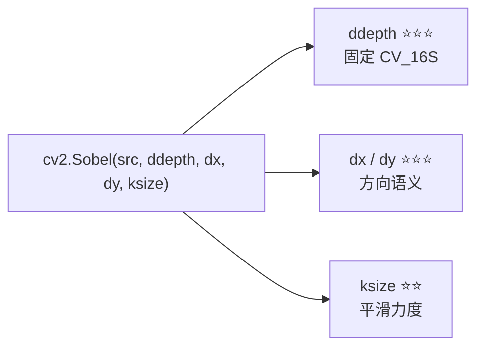

# Sobel 调参技巧

> Sobel 只有 `ddepth` / `ksize` / `dx` / `dy` 四个参数，其中真正需要动脑的其实只有一个：**ksize**。这一页给你可以直接抄的配置。

## 参数总览



| 参数 | 影响 | 优先级 | 口诀 |
|---|---|---|---|
| `ddepth` | 是否丢负梯度 | ⭐⭐⭐ | **永远 CV_16S** |
| `dx` / `dy` | 找哪个方向的边 | ⭐⭐⭐ | **dx=1 找竖边** |
| `ksize` | 平滑/抗噪 vs 细节 | ⭐⭐ | **默认 3，HOG/Harris 用 1** |
| `scale` / `delta` | 输出缩放/偏置 | ⭐ | 保持默认 |

## 技巧 1：ddepth 写成常量，不要纠结

```python
# 统一模板，复制粘贴即可
def sobel_mag(gray, ksize=3):
    gx = cv2.Sobel(gray, cv2.CV_16S, 1, 0, ksize=ksize)
    gy = cv2.Sobel(gray, cv2.CV_16S, 0, 1, ksize=ksize)
    return cv2.addWeighted(cv2.convertScaleAbs(gx), 0.5,
                           cv2.convertScaleAbs(gy), 0.5, 0)
```

**为什么**：`ddepth` 没有「场景差异」，`CV_16S` 适用于 99% 的情况。把这段封装成函数，全项目复用，从源头消灭坑 1、坑 2。

## 技巧 2：ksize 选 3 是默认，选 1 是「要原味」

| ksize | 你得到什么 | 典型用途 |
|---|---|---|
| `1` | 最原始的 $[-1,0,1]$ 差分，**不平滑** | HOG、Harris（后面自带归一化/平滑） |
| `3` | 带 1-2-1 平滑的经典 Sobel | **通用默认** |
| `5` / `7` | 更强平滑，边缘更粗更少 | 高噪声、只关心主轮廓 |
| `-1` | 自动切换为 **Scharr** | 方向对称性要求高 |

## 技巧 3：斜边检测弱 → 三招

```python
# 招 1：Scharr（首选）
gx = cv2.Scharr(blur, cv2.CV_16S, 1, 0)

# 招 2：L2 幅值（略改善）
mag = np.sqrt(gx.astype(np.float32)**2 + gy.astype(np.float32)**2)

# 招 3：降阈值 + 形态学连接
```

## 技巧 4：先降噪再求导（信噪比原则）

**普适原则**：**求导会放大噪声**（导数本质是高频增强）。所以噪声大的图先平滑：

```python
blur = cv2.GaussianBlur(gray, (3, 3), 0)   # 或 (5,5), 1.0
gx = cv2.Sobel(blur, cv2.CV_16S, 1, 0)
```

::: tip ksize 和预平滑不必重复做
`ksize=3` 的 Sobel **已经内置 1-2-1 平滑**。再叠一层高斯，等于平滑两次，边缘会更糊。噪声不是特别大时，加 `ksize`（如 5）比「高斯 + ksize=3」更省事。
:::

## 技巧 5：5 个场景抄作业参数表

| 场景 | 预处理 | 核 | 阈值/后处理 | 说明 |
|---|---|---|---|---|
| **工业零件轮廓** | 中值滤波 (3) | Sobel ksize=3 | 二值化 60 + 闭运算 | 去椒盐噪，轮廓要闭合 |
| **车道线粗提取** | 高斯 (5,5)σ=1 | Sobel ksize=3 | Otsu 二值 + ROI 梯形 | 只关心某方向斜边 |
| **文档/票据边界** | 高斯 (5,5) | Sobel ksize=3 | 大阈值抓强边 | 边界对比度大，阈值可高 |
| **HOG 前置** | 无 | Sobel **ksize=1** | 交给 HOG 归一化 | 要原始差分，不要平滑 |
| **嵌入式低算力** | 无 | Sobel ksize=3 | 直接阈值 | MCU 上别再叠高斯 |

## 技巧 6：Scharr 的无痛升级

```python
# 什么代码都不用改，只把 ksize 改成 -1
gx = cv2.Sobel(img, cv2.CV_16S, 1, 0, ksize=-1)   # 等价于 cv2.Scharr
```

**何时升级**：图像可能有任意方向边缘、做过旋转、或检测圆/斜向目标时，优先用 Scharr。

## 技巧 7：阈值怎么定

Sobel 的幅值图没有内置阈值，要自己做二值化。实用做法：

```python
# ① 用分位数——自适应不同曝光
th = np.percentile(mag, 92)          # 取幅值图前 8% 定为边
_, bw = cv2.threshold(mag, th, 255, cv2.THRESH_BINARY)

# ② 用 Otsu——幅值图双峰明显时很灵
_, bw = cv2.threshold(mag, 0, 255, cv2.THRESH_BINARY + cv2.THRESH_OTSU)
```

| 阈值策略 | 适用 |
|---|---|
| 固定值（如 60） | 光照稳定的产线 |
| 分位数（percentile） | 曝光会变的场景 |
| Otsu | 幅值图双峰清晰时 |
| 均值 + k×标准差 | 通用自适应 |

## 调参顺序建议

1. **固定 `ddepth = CV_16S`**（不讨论）
2. **确定方向** `dx`/`dy`（想找哪种边）
3. **定 ksize**：默认 3；HOG/Harris 用 1；方向敏感用 -1（Scharr）
4. **决定是否预平滑**：噪声大才加高斯
5. **定阈值**：分位数法起步，再微调
6. **看结果再回头调**：斜边断 → Scharr；噪点多 → 加平滑或升 ksize

## 一句话口诀

> **CV_16S 不能忘，dx=1 找竖边；ksize 默认三，斜边不好用 Scharr。**

[← 上一篇：实战与踩坑](./painpoints) · [返回总览](./)
