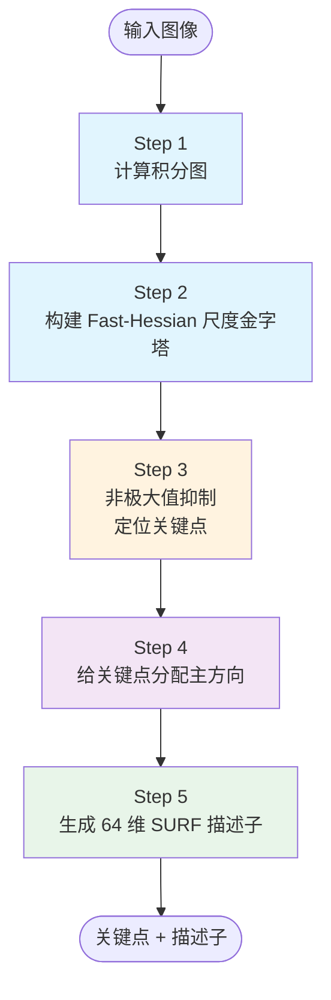
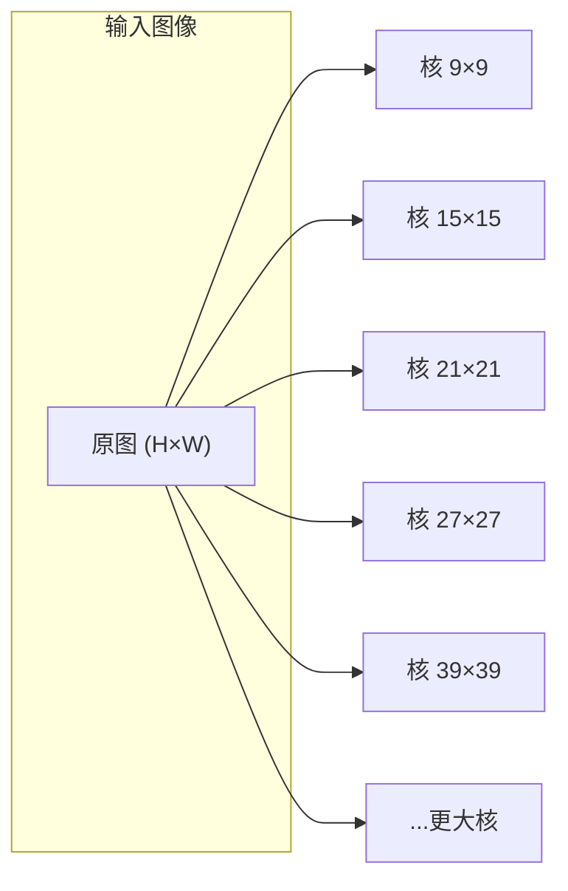
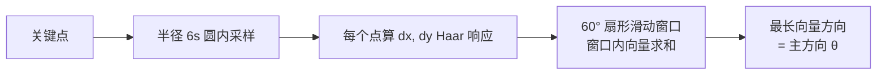
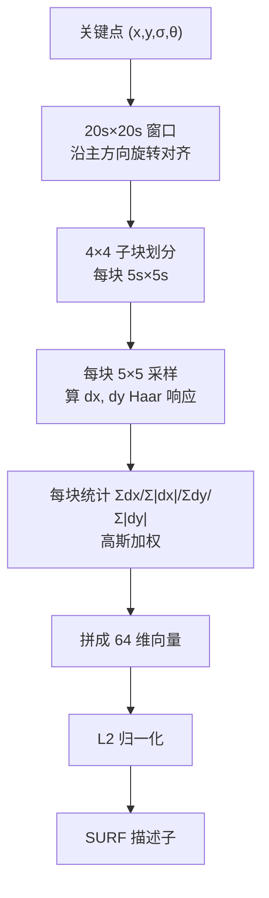

# SURF 算法流程



---

## Step 1：计算积分图（O(WH)）

对整幅图扫描一遍：

```python
I_int = np.zeros((H+1, W+1), dtype=np.int64)
for y in range(H):
    row_sum = 0
    for x in range(W):
        row_sum += I[y, x]
        I_int[y+1, x+1] = I_int[y, x+1] + row_sum
```

**之后任意矩形区域和 = 4 次查表**。所有箱式滤波、所有 Haar 小波都用这张积分图算。

---

## Step 2：尺度金字塔（SURF 不用降采样！）

### SIFT 的做法 vs SURF 的做法

| | SIFT | SURF |
|---|---|---|
| 图像 | 每层 octave **降采样**图像 | **图像尺寸不变** |
| 卷积核 | 同一 σ 的高斯核 | **箱式滤波核尺寸逐级放大** |
| 计算量 | 图像小了但卷积也要算 | 箱式滤波全靠积分图，**核越大速度一样** |

### 金字塔结构

SURF 把尺度分成若干 **octave**（倍频程），每个 octave 分 4 个 level：

| octave | box filter 尺寸 | 对应尺度 |
|---|---|---|
| 1 | 9×9 → 15×15 → 21×21 → 27×27 | ~1.2 → ~3.6 |
| 2 | 15×15 → 27×27 → 39×39 → 51×51 | ~2.0 → ~5.0 |
| 3 | 27×27 → 51×51 → 75×75 → 99×99 | ~4.0 → ~10 |
| 4 | 51×51 → 99×99 → ... | ... |

**关键**：核再大也是靠积分图算矩形和，跟 9×9 核耗时几乎相同。



---

## Step 3：关键点定位（非极大值抑制）

### 在 3×3×3 邻域里找极大值

每个候选点都要在**自身 + 上下两层尺度**共 3×3×3 = 27 个邻居里比较：

- 如果 det(H) 是 27 个里最大的 → 候选关键点
- 否则 → 不是

### 阈值过滤

det(H) < hessianThreshold（默认 400 左右）的点直接丢弃。阈值越大，点越少但越稳定。

### 插值到亚像素/亚尺度精度

和 SIFT 一样，用 Brown 插值在尺度空间中做二次拟合，把 (x, y, σ) 精修到**亚像素精度**（SURF 没有 SIFT 的插值那么激进，但保留了这步）。

---

## Step 4：主方向分配（旋转不变性的关键）

### 为什么要主方向

如果图像旋转了，描述子也应该跟着转——所以先找一个"主方向"，后面描述子**按主方向对齐**再提取。

### SURF 的找方向方法

1. 在关键点周围半径 **6s** 圆内（s 是关键点尺度）采样
2. 每个采样点算 4s 边长的 Haar 小波 dx、dy 响应
3. 所有响应按离关键点距离加**高斯权重**（σ=2.5s，近的权重大）
4. 用一个 **π/3（60°）宽的扇形窗口**在圆内滑动，步进 π/9（20°）
5. 窗口内所有 dx、dy 向量求和
6. **最长的那个向量方向 = 主方向**



::: tip U-SURF（无方向模式）
如果图像不会旋转（比如扫描文档、俯瞰监控），可以设 `upright=True`（U-SURF），跳过方向分配：
- **节省约 15% 时间**
- 不具有旋转不变性，但对竖直/水平图像更稳定
:::

---

## Step 5：生成描述子（64 维向量）

### 5.1 建立对齐坐标系

以关键点为中心、沿主方向 θ 旋转，选一个 **20s × 20s** 的方形窗口，分成 **4×4 = 16 个子块**，每块 5s × 5s。

### 5.2 每个子块统计 4 个量

在每个子块内，按 5×5 采样点（共 25 个点）算 Haar 小波响应 dx、dy（小波尺寸 2s），并按 σ = 3.3s 的高斯加权（靠关键点近的响应更重要），然后统计：

| 统计量 | 含义 |
|---|---|
| Σdx | 水平方向总响应（有方向） |
| Σ\|dx\| | 水平方向总能量（绝对值） |
| Σdy | 垂直方向总响应（有方向） |
| Σ\|dy\| | 垂直方向总能量（绝对值） |

4 个量 × 16 子块 = **64 维**描述子。

### 5.3 L2 归一化

最后对 64 维向量做 L2 归一化（单位向量），抵抗光照变化。

### 扩展模式（128 维）

extended=1 时，dx、dy 按正负分开统计：
- Σ(dx>0)、Σ|dx|(dx>0)、Σ(dx<0)、Σ|dx|(dx<0)
- Σ(dy>0)、Σ|dy|(dy>0)、Σ(dy<0)、Σ|dy|(dy<0)

每子块 8 个量，16×8 = **128 维**，区分度略高，但匹配慢一倍。



---

## 整体参数一览

| 参数 | 默认值 | 作用 |
|---|---|---|
| hessianThreshold | 400 | Hessian 响应阈值，越大点越少 |
| nOctaves | 4 | octave 数量 |
| nOctaveLayers | 4 | 每 octave 的层数 |
| extended | False | True=128 维，False=64 维 |
| upright | False | True=U-SURF（不分配方向，无旋转不变） |
