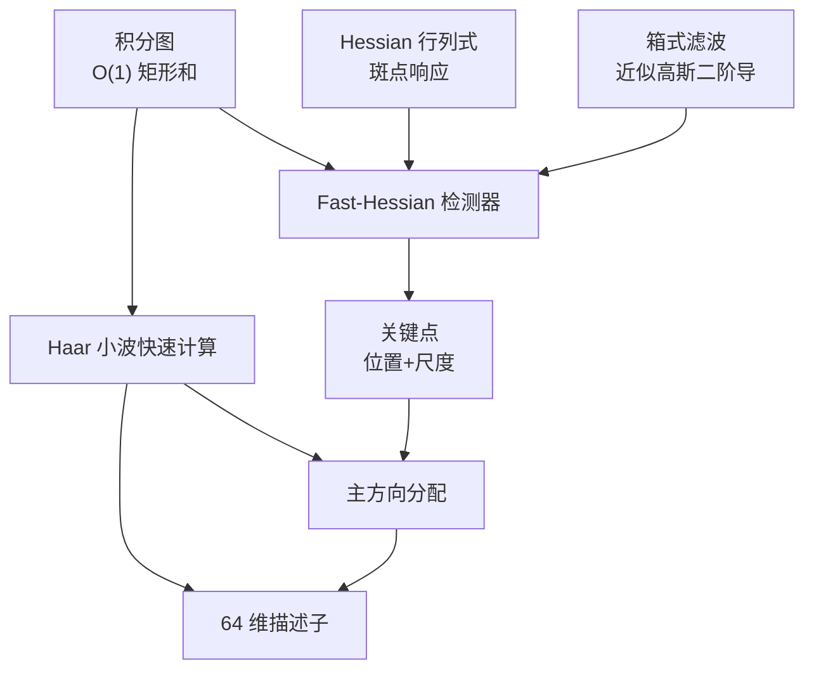

# SURF 核心概念

理解 SURF，只要搞懂四样东西：**积分图**、**Hessian 行列式**、**箱式滤波近似**、**Haar 小波响应**。

## ① 积分图（Integral Image）

### 一句话

**任意矩形区域的像素和，4 次查表 + 3 次加减法搞定**。

### 公式

定义积分图（也叫 summed-area table）：

$$
I_\Sigma(x, y) = \sum_{x'=0}^{x} \sum_{y'=0}^{y} I(x', y')
$$

递推计算：
$$
I_\Sigma(x, y) = I(x, y) + I_\Sigma(x-1, y) + I_\Sigma(x, y-1) - I_\Sigma(x-1, y-1)
$$

**O(WH) 预处理，之后任意矩形和 O(1)**。

### 用积分图算矩形和

要算矩形区域 `(x1,y1) ~ (x2,y2)` 内所有像素的和：

$$
\text{sum} = I_\Sigma(x_2,y_2) - I_\Sigma(x_1-1,y_2) - I_\Sigma(x_2,y_1-1) + I_\Sigma(x_1-1,y_1-1)
$$

**不管这个矩形是 3×3 还是 99×99，都是 4 次查表**——这就是 SURF 加速的基石。

### 生活类比

想象你要算一个月里任意几天的总销售额。**普通方法**：把那几天一张张加起来，天数越多越慢。**积分图方法**：提前算好「从 1 号到每天」的累计销售额，要算"5 号到 20 号"就是"累计到 20 号 − 累计到 4 号"，**秒算**。

## ② Hessian 矩阵（斑点检测的核心）

### 公式

图像 I 在点 (x, y)、尺度 σ 处的 Hessian 矩阵：

$$
H(x, \sigma) = \begin{bmatrix} L_{xx}(x,\sigma) & L_{xy}(x,\sigma) \\ L_{xy}(x,\sigma) & L_{yy}(x,\sigma) \end{bmatrix}
$$

其中 Lxx 是图像与**高斯二阶导数** ∂²g/∂x² 在尺度 σ 处的卷积：

$$
L_{xx}(x,\sigma) = I(x) * \frac{\partial^2}{\partial x^2} g(\sigma)
$$

### 行列式作为响应值

**Hessian 的行列式**：

$$
\det(H) = L_{xx} \cdot L_{yy} - (L_{xy})^2
$$

- det(H) > 0 且很大：**两个方向二阶导都强**→ 斑点（blob）
- det(H) < 0：**一个方向正一个方向负**→ 是边，不是点
- det(H) ≈ 0：**两个方向都平滑**→ 没有特征

### 为什么用行列式不是 Harris 响应

Harris 用 M 矩阵的 λ₁λ₂ − k(λ₁+λ₂)²，本质是"角点度量"。

Hessian 行列式**直接找斑点**，在多尺度下**对斑点的定位比 Harris 更稳定**（SIFT 用 LoG 极值的思想，SURF 借用了）。

## ③ 箱式滤波近似高斯二阶导数

### 为什么要近似

Lxx/Lyy/Lxy 是**高斯二阶导数**与图像的卷积，大 σ 时核非常大（比如 31×31），每个像素都要算成百上千次乘法。

### 近似思路

- 高斯二阶导数：光滑的钟形曲线
- **箱式滤波**：用几个矩形块拼出来，**每个块内权重相同**（全 1 或全 -2 或全 -1）

```
Lxx 近似（Dxx）:      Lyy 近似（Dyy）:      Lxy 近似（Dxy）:
┌──────────┐         ┌──────────┐         ┌─┬──┬─┐
│  -1 -1   │         │  +1 +1   │         │+1│  │-1│
│──────────│         │──────────│         ├─┼──┼─┤
│  -1 -1   │         │  -2 -2   │         │  │  │  │
│  +1 +1   │         │  +1 +1   │         ├─┼──┼─┤
│  +1 +1   │         │          │         │-1│  │+1│
└──────────┘         └──────────┘         └─┴──┴─┘
```

核权重的绝对值和相等（归一化），不同尺度只是块变大，**全用积分图 O(1) 算**。

### 加权平衡

因为近似有偏差，行列式里 Lxy 项要乘一个权重：

$$
\det(H_{\text{approx}}) = D_{xx}D_{yy} - (0.9 \cdot D_{xy})^2
$$

0.9 这个权值是作者在实验中确定的，平衡不同方向的响应。

## ④ Haar 小波响应

### 什么是 Haar 小波

最简单的小波基：
- **dx（水平方向响应）**：右边白 − 左边黑 = Σ(右半) − Σ(左半)
- **dy（垂直方向响应）**：下边白 − 上边黑 = Σ(下半) − Σ(上半)

```
dx 核（2×2 示例）:     dy 核（2×2 示例）:
┌───────┐            ┌───────┐
│ -1 +1 │            │ -1 -1 │
│ -1 +1 │            │ +1 +1 │
└───────┘            └───────┘
```

Haar 响应就是**两个矩形区域的像素和之差**——又是积分图的拿手好戏！

### 用 Haar 响应干两件事

1. **算方向**：在关键点周围 6s 半径内算 dx、dy，用扇形滑动窗口求和找主方向
2. **生成描述子**：在 4×4 子块内统计 Σdx、Σ|dx|、Σdy、Σ|dy|，拼起来就是 64 维向量

## 概念关系图



## 相关算子

| 算子 | 作用 | 页面 |
|---|---|---|
| 高斯模糊 | SIFT 用它做 DoG，SURF 用箱式滤波代替 | [高斯模糊](/operators/gaussian-blur) |
| 非极大值抑制 | 尺度空间内定位关键点 | [NMS](/operators/non-max-suppression) |
| Hessian 矩阵 | 斑点响应值计算 | [Hessian](/operators/hessian) |
